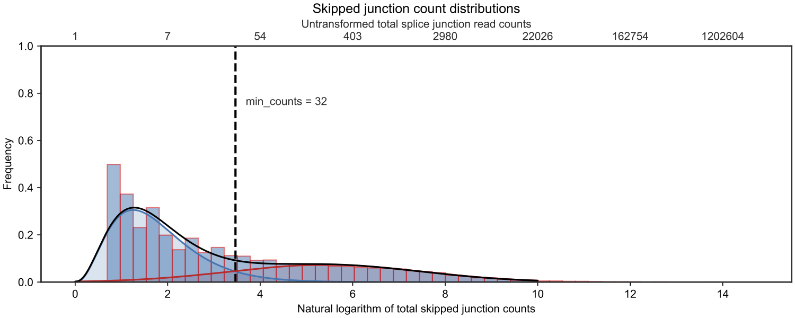

## Overview

The use of custom RNA-seq derived protein sequences has been shown to be a viable strategy for identifying non-canonical
gene products not documented in common protein sequence databases. However, the inclusion of too many sequences can
lead to false positive identifications. JCAST combines splice junction modeling and one-frame translation to create
small custom protein sequence databases.

JCAST is a command line tool that takes an annotation GTF file, rMATS results, and a genome FASTA file to create custom
protein FASTA files for downstream analysis. To prioritize likely detectable splice junctions, JCAST can model the
splice junction read counts in RNA-seq (`-m`) and use this model to calculate the minimal read count cutoff for in
silico translation. Without `-m`, the cutoff is set with `-r` (by default 1, which keeps every junction). An example of
the read count mixture model is shown below.



## Output

JCAST outputs FASTA databases which can be further filtered and combined using any scripting language, or used directly in virtually any shotgun proteomics database search engine (e.g., SEQUEST, Crux/Tide, MaxQuant, MS-GF+). Depending on the settings and input files, not every file below is written.

JCAST writes a small number of FASTA files into the output directory. Each
entry's header encodes the source rMATS row, slice number, junction
coordinates, translation strand, frame, and tier (see below).

| File | Contents |
|---|---|
| `psq_canonical.fasta` | Sequences identical to the canonical SwissProt/GTF protein for the gene. Headers follow UniProt convention. |
| `psq_T1.fasta` | **Tier 1.** Both slices translate in their annotated reading frames with no premature stop codon (PTC), and the event does not shift the reading frame: the slices' coding lengths, measured from each slice's frame, differ by a multiple of 3. Both slices are stitched into the canonical full-length protein. |
| `psq_T1_alt_cterm.fasta` | **Tier 1, alternative C-terminus.** One slice ends at an annotated protein-coding stop codon that is not the canonical protein's. It is a complete C-terminus, not a premature stop, and is joined to the canonical at its N-terminus only. |
| `psq_T1_alt_nterm.fasta` | **Tier 1, alternative N-terminus.** The gene's start codon lies in an alternative exon that this slice lacks. The slice is translated from another annotated start codon it contains, and joined to the canonical at its C-terminus only. |
| `psq_T1_alt_both.fasta` | **Tier 1, both termini alternative.** The slice starts at an alternative annotated start codon and ends at an alternative annotated stop codon (created only when needed). |
| `psq_T2.fasta` | **Tier 2.** As T1, but the coding lengths differ by a non-multiple of 3 (frameshift). A slice that cannot be stitched at both ends may be joined at its N-terminus only. |
| `psq_T4.fasta` | **Tier 4.** Only one slice translates; the other hits a PTC. The PTC slice is translated *up to* its stop codon, giving a truncated product, which is joined to the canonical at its N-terminus. If it is shorter than `params.ptc_threshold` × the other slice, or cannot be joined, it goes to `psq_T4_orphan.fasta`. **Treat T4 with caution — exclude from MS searches unless you have a specific reason to include it.** |
| `psq_T#_orphan.fasta` | Slices of that tier that translated but could not be stitched back to the canonical sequence: no unique 7-residue anchor at an end that needs joining. **Treat orphans with caution.** |
| `uniprot_canonicals.tsv` | With `--uniprot`: the canonical chosen for each gene, and how (by sequence, by gene name, from the GTF, or none). |
| `psq_isoforms.tsv` | With `--uniprot`: every JCAST record identical to a UniProt canonical or isoform, with its accession. |
| `jcast_uniprot_merged.fasta` | With `--uniprot`: a search database, made of the supplied UniProt FASTA plus the new `psq_T1` and `psq_T1_alt_*` records, renamed <code>sp&#124;&lt;accession&gt;-J&lt;n&gt;&#124;&lt;entry name&gt;</code>. |
| `junctions.tsv` | One row per junction, in rMATS file order: its read count, FDR, fate, frames, coding region, canonical, and the files its records went to. See below. |
| `logfile.log` | The run's settings and inputs, warnings and errors, and a summary: junctions by fate and splice type, records per file, and the time taken. With `-v`, also each junction's steps and sequences. |

:::{.callout-warning}
**Note:** Tier 4 and orphan sequences are truncated or not full-length. Exclude them from database searches, or interpret them with a great amount of caution.
:::

There is no Tier 3 from v0.4.0. It re-translated in a guessed frame when the
annotated frame failed, and was removed together with the three-frame
fallback (see [CHANGELOG.md](https://github.com/ed-lau/jcast/blob/main/CHANGELOG.md)).

Annotated start and stop codons are taken from protein-coding transcripts
with transcript support level ≤ `params.tsl_threshold`. A stop codon
annotated only on nonsense-mediated-decay transcripts, or not annotated at
all, is still a premature stop (T4).

How a junction is processed (v0.4.0):

0. **Filters.** A junction whose read count (header field 11) is below the
   cutoff, or whose rMATS FDR is outside `-q`, is skipped before anything
   else. The cutoff is `-r`, or the `-m` model's boundary in reads; a
   junction with exactly that many reads is kept. With `-c`, a skipped
   junction's gene still gets its canonical written.
1. **Trimming.** Every exon is trimmed to the gene's annotated coding region.
   This runs from the most upstream start codon to the most distal stop
   codon of protein-coding transcripts with transcript support level ≤
   `params.tsl_threshold`. Exons entirely in the UTR are removed.
2. **Skip if outside the coding region.** If the splice event lies entirely
   outside the coding region, both slices are identical after trimming. The
   junction is skipped (`SKIPPED. Splice event lies outside the annotated
   coding region.`), and the canonical is still written with `-c`.
3. **Reading frame.** Each slice is read in its own frame, taken from the
   annotated coding sequence at the slice's 5′ end. A slice with no annotated
   frame is not translated, for example in a lncRNA or a pseudogene. Frames
   are never guessed.

Skipped and failed junctions write no isoform sequences. Each junction's
outcome (fate) is a row of `junctions.tsv`.

For a typical proteomics workflow, append `psq_T1.fasta` and
`psq_canonical.fasta` to a base SwissProt database and search as usual.
Including T2, T4 and orphans is possible but increases false-discovery risk.

### `junctions.tsv`

One row per junction of the selected splice types, in rMATS file order,
tab-separated. It reads directly into R (`read.delim`) or pandas
(`pd.read_table`).

| Column | Contents |
|---|---|
| `junction_type`, `junction_id` | The rMATS splice type and row id. |
| `gene_id`, `gene_symbol`, `chr`, `strand` | As in the rMATS row. |
| `min_jc` | The read count that `-r` and `-m` filter on (header field 11). |
| `fdr` | The rMATS FDR, which `-q` filters on. |
| `fate` | `T1`, `T1_alt_terminus`, `T2`, `T4`, `fail` (no slice translates), `exception` (the junction raised an error; see the log), `skipped_low_count`, `skipped_fdr`, `skipped_masked` or `skipped_outside_cds`. |
| `fate_detail` | For `T4`, the slice that hit the premature stop; for `exception`, the error. |
| `slice1_phase`, `slice2_phase` | Each slice's annotated frame (0, 1 or 2). Empty if it has none, or if the junction was skipped before it was looked up. |
| `cds_start`, `cds_end` | The coding region the slices were trimmed to. Empty if unknown on that side, or not looked up. |
| `canonical_source`, `canonical_accession` | Where the gene's canonical came from: as in `uniprot_canonicals.tsv` with `--uniprot` (e.g. `sp by sequence`), `sp by API` or `tr by API` without it, `gtf`, or `none`. Empty if it was not looked up (a skipped junction without `-c`). |
| `files` | The `psq_<name>.fasta` files of the junction's records, as `<name>`, `;`-separated. |
| `new_records` | How many of its records were written. A record whose sequence is already in its file, from an earlier junction, is not written again. |

### Header format

Non-canonical FASTA entries are named as follows:

```
>sp|Q91VW5|GOGA4_MOUSE|ENSMUSG00000038708|MXE1|0|chr9|118560742:118560872|118565557:118565667|+2|r521|T1 sp|Q91VW5|...
```

The `|`-separated fields are:

1. Knowledgebase code (`sp` for SwissProt).
2. UniProt accession of the canonical entry.
3. UniProt entry name.
4. Ensembl gene id.
5. rMATS splice type and slice number (e.g. `MXE1`, `MXE2`).
6. rMATS row id.
7. Chromosome.
8. Anchor exon `start:end`.
9. Alternative exon `start:end`.
10. Translated strand and that slice's phase (e.g. `+2`).
11. Read count, prefixed with `r`: the smaller of the junction's inclusion
    and skipping junction counts, each summed over samples and replicates.
    This is the count `-r` and `-m` filter on.
12. Tier (`T1`, `T1_alt_cterm`, `T1_alt_nterm`, `T1_alt_both`, `T2`, `T4`).

When the canonical comes from the GTF rather than UniProt
(`use_gtf_only` in `jcast/params.py`, or a gene without a UniProt entry
with `--uniprot`), fields 1–3 are the Ensembl gene id,
the gene symbol, and the gene id again. A gene that rMATS
reports without a symbol (`NA`) is named `NoGeneName_<gene id>`.

## Options

`jcast` has two commands: `jcast run` translates junctions, and `jcast gui` opens the graphical interface.
`jcast RMATS_FOLDER GTF_FILE GENOME …`, as before v0.5.0, is short for `jcast run RMATS_FOLDER GTF_FILE GENOME …`.

```text
$ jcast -h
 Usage: jcast [OPTIONS] COMMAND [ARGS]...

 JCAST retrieves transcript splice junctions and translates them into amino acid
 sequences. jcast RMATS_FOLDER GTF_FILE GENOME [OPTIONS] is short for jcast run.

╭─ Options ────────────────────────────────────────────────────────────────────────────╮
│ --version          <bool>  show the version and exit                                 │
│ --help     -h      <bool>  Show this message and exit.                               │
╰──────────────────────────────────────────────────────────────────────────────────────╯
╭─ Commands ───────────────────────────────────────────────────────────────────────────╮
│ run  Translate the splice junctions in rMATS output into protein sequences.          │
│ gui  Open the graphical interface (a preview; it needs PySide6: pip install          │
│      'jcast[gui]').                                                                  │
╰──────────────────────────────────────────────────────────────────────────────────────╯

$ jcast run -h
 Usage: jcast run [OPTIONS] {RMATS_FOLDER} {GTF_FILE} {GENOME}

 Translate the splice junctions in rMATS output into protein sequences.

╭─ Arguments ──────────────────────────────────────────────────────────────────────────╮
│ *    RMATS_FOLDER      <str>  path to folder storing rMATS output [required]         │
│ *    GTF_FILE          <str>  path to Ensembl/Gencode GTF file [required]            │
│ *    GENOME            <str>  path to genome FASTA (optionally .gz) [required]       │
╰──────────────────────────────────────────────────────────────────────────────────────╯
╭─ Options ────────────────────────────────────────────────────────────────────────────╮
│ --help  -h      <bool>  Show this message and exit.                                  │
╰──────────────────────────────────────────────────────────────────────────────────────╯
╭─ Output ─────────────────────────────────────────────────────────────────────────────╮
│ --out        -o      DIR     output directory, created if needed [default: out]      │
│ --overwrite          <bool>  replace the output of an earlier run in the output      │
│                              directory; without it, a directory holding JCAST output │
│                              is refused                                              │
│ --cache_dir          DIR     directory for the GTF cache and the UniProt API cache   │
│                              [default: (the user cache directory, e.g.               │
│                              ~/Library/Caches/jcast or ~/.cache/jcast)]              │
╰──────────────────────────────────────────────────────────────────────────────────────╯
╭─ Filters ────────────────────────────────────────────────────────────────────────────╮
│ --read         -r      <int>                the lowest read count for a junction to  │
│                                             be translated: the smaller of its        │
│                                             inclusion and skipping junction counts,  │
│                                             each summed over samples and replicates. │
│                                             1 keeps every junction                   │
│                                             [default: 1]                             │
│ --model        -m      <bool>               take the read count cutoff from a Gamma  │
│                                             + Normal mixture model of the read       │
│                                             counts of every rMATS file in the folder │
│                                             (also those -s leaves out), instead of   │
│                                             -r (used only if the fit fails)          │
│ --qvalue       -q      Q_LO Q_HI            keep junctions whose rMATS FDR is in     │
│                                             this range                               │
│                                             [default: 0, 1]                          │
│ --splice_type  -s      MXE|SE|RI|A5SS|A3SS  splice types to translate (-s SE MXE, or │
│                                             -s SE -s MXE); only their rMATS files    │
│                                             need to be in the folder                 │
│                                             [default: (MXE SE RI A5SS A3SS)]         │
╰──────────────────────────────────────────────────────────────────────────────────────╯
╭─ Canonicals ─────────────────────────────────────────────────────────────────────────╮
│ --canonical  -c      <bool>  write the canonical protein of every gene with a        │
│                              junction to psq_canonical.fasta, whatever the           │
│                              junction's fate                                         │
│ --uniprot            FASTA   UniProt FASTA (e.g. Swiss-Prot with isoforms for the    │
│                              species, optionally .gz) to take canonical proteins     │
│                              from instead of the UniProt API; genes without an entry │
│                              use the GTF. Also writes jcast_uniprot_merged.fasta,    │
│                              psq_isoforms.tsv and uniprot_canonicals.tsv             │
│                              [default: (none, use the API)]                          │
╰──────────────────────────────────────────────────────────────────────────────────────╯
╭─ The run ────────────────────────────────────────────────────────────────────────────╮
│ --processes  -p      <int>   number of processes to translate junctions in; the      │
│                              output is the same for any number. More than 1 needs    │
│                              --uniprot (canonicals from the UniProt API are fetched  │
│                              and cached by one process only), and macOS or Linux     │
│                              [default: 1]                                            │
│ --verbose    -v      <bool>  also log each junction's steps and its sequences, at    │
│                              DEBUG level (large: 300 MB for a whole-genome -m run);  │
│                              without it, the log has the run's settings, warnings,   │
│                              errors and a summary, and each junction's outcome is in │
│                              junctions.tsv                                           │
╰──────────────────────────────────────────────────────────────────────────────────────╯
```

Several splice types can follow one `-s` (`-s SE MXE`), or each have their own (`-s SE -s MXE`).

### Canonicals from a UniProt FASTA (`--uniprot`, recommended)

By default JCAST asks the UniProt API for each gene's canonical protein.
If a request fails after its retries, or is refused, that junction fails
(`FAILURE (exception)`, see below) rather than going on without a
canonical, and the run continues. With `--uniprot`, JCAST reads a UniProt
FASTA you supply instead. This needs no network access, and the file
records which UniProt release was used.
Download Swiss-Prot with isoforms for your species, for human:

```bash
curl -o uniprot_sprot_human_isoforms_2026_04.fasta.gz \
  'https://rest.uniprot.org/uniprotkb/stream?compressed=true&format=fasta&includeIsoform=true&query=(proteome:UP000005640)+AND+(reviewed:true)'
```

Put the release in the file name, as above. The FASTA itself does not
record it; the download's `X-UniProt-Release` response header does.

Each gene's canonical is chosen as follows:
1. the UniProt canonical whose sequence equals a protein translated from
   one of the gene's GTF transcripts;
2. else the one whose gene name (`GN=`) is the gene symbol, if no other
   gene in the GTF has that symbol;
3. else the GTF canonical.

A match is used only if it is unique. No identifiers are mapped: GTFs
carry no UniProt accessions. On a whole human genome this agrees with
UniProt's own Ensembl cross-references for 99.35% of protein-coding genes
that have a Swiss-Prot entry
([reports/2026-11-12-uniprot-mapping-audit.md](https://github.com/ed-lau/jcast/blob/main/reports/2026-11-12-uniprot-mapping-audit.md)).

**The GTF canonical** is the longest coding sequence among the gene's
protein-coding transcripts that have transcript support level ≤
`params.tsl_threshold` (2) and annotated start and stop codons. If none
qualifies, it is the transcript the GTF tags `Ensembl_canonical`, as
GENCODE GTFs do, at any support level, if:
- it is protein-coding;
- it has annotated start and stop codons;
- it is not tagged `readthrough_transcript`.

**Readthrough genes get no GTF canonical** unless one of their
transcripts passes the first rule.
- A readthrough transcript spans two neighbouring genes.
- rMATS reports each event under one gene only. In a whole-genome human
  run, 45% of the readthrough genes' skipped-exon events skip an exon of
  another protein-coding gene.
- Joined to a readthrough canonical, their slices would read as fusion
  proteins, so they are written as orphans (`_orphan` files).
- In that run (GENCODE v50, Swiss-Prot), 370 of the 371 protein-coding
  genes left without a canonical are readthrough genes
  ([reports/2026-11-12-ensembl-canonical-audit.md](https://github.com/ed-lau/jcast/blob/main/reports/2026-11-12-ensembl-canonical-audit.md)).

**Swiss-Prot or Swiss-Prot + TrEMBL.**
- For human, Swiss-Prot is recommended.
- A FASTA that also holds TrEMBL entries (`reviewed:false`) is accepted.
  TrEMBL entries are used only after Swiss-Prot, by the same rules.
- Adding TrEMBL gives a canonical to some genes that have neither a
  Swiss-Prot entry nor a GTF canonical. In a whole human genome that is
  203 genes. Their records can then be joined instead of written as
  orphans.
- For species with little Swiss-Prot coverage, include TrEMBL.
- Records joined to a TrEMBL canonical are named `tr|…`. They are left out
  of `jcast_uniprot_merged.fasta`, which merges Swiss-Prot only.

The run also writes:
- `uniprot_canonicals.tsv`: the canonical chosen per gene, and how.
- `psq_isoforms.tsv`: every JCAST record identical to a UniProt canonical
  or isoform.
- `jcast_uniprot_merged.fasta`: a search database. It holds every entry of
  the supplied FASTA, then each `psq_T1` and `psq_T1_alt_*` record that was
  joined to a Swiss-Prot canonical and is not identical to a UniProt entry.
  Each is renamed `sp|<accession>-J<n>|<entry name>`, followed by its JCAST
  header.

### Several processes (`-p`)

`-p N` translates junctions in N processes. The output files and the log
are the same as with one process (except for the run time):
- the worker processes only translate;
- the main process writes every record, row of `junctions.tsv` and log
  line in rMATS file order.

On a whole-genome run, 16 processes are about 11× faster than one.
Memory barely grows, because the workers share the genome and GTF already
loaded rather than copying them.

`-p` above 1 has two requirements:
- **`--uniprot`.** Without it, canonicals come from the UniProt API, one
  request per gene. The answers are cached in a local database that
  several processes cannot safely share, and concurrent requests would
  load the EBI servers. The command line rejects `-p 2` without
  `--uniprot`.
- **macOS or Linux.** On Windows, JCAST warns and uses one process.

Leave a core or two for the system: `-p` set to the number of cores minus
2 is a reasonable maximum.

## Known issues

- **Use an unmasked or soft-masked genome, not a hard-masked one.**
  - Soft-masked (lowercase) bases are read as ordinary sequence, so Ensembl
    `dna_sm` or UCSC `hg38.fa` give exactly the same output as an unmasked
    genome.
  - Any slice containing N or another ambiguous base is skipped (fate
    `SKIPPED ... masked or ambiguous bases`).
  - A hard-masked genome (Ensembl `dna_rm`) replaces repeats with N, so
    every junction touching a repeat is skipped: 19% of the chr15 test
    junctions. See
    [reports/2026-11-11-masked-bases-audit.md](https://github.com/ed-lau/jcast/blob/main/reports/2026-11-11-masked-bases-audit.md).
- **Caches.** JCAST keeps two caches in the user cache directory, or in
  `--cache_dir`:
  - **the GTF**, read into a table: about 2 GB for GENCODE. The first run
    on a GTF builds it, about 5 minutes for GENCODE;
    later runs read it in seconds. A changed GTF gets a new cache.
  - **the UniProt API's answers**, used without `--uniprot`.

  `<gtf>.cached` files written by earlier versions next to the GTF are no
  longer used and can be deleted.
- **A junction that raises an error** gets the fate `exception` in
  `junctions.tsv`, with the error in `fate_detail`, and the run continues.
  Its traceback is in `logfile.log`, and the console reports how many
  junctions failed.
- **Tier 4 contains products truncated at a stop codon.** Alternative
  C-termini at an annotated stop codon go to `psq_T1_alt_cterm.fasta`
  instead. A stop codon that the annotation does not support stays in T4,
  and some of these may still be genuine. Treat T4 outputs as candidates for
  follow-up validation, not as confirmed identifications.
