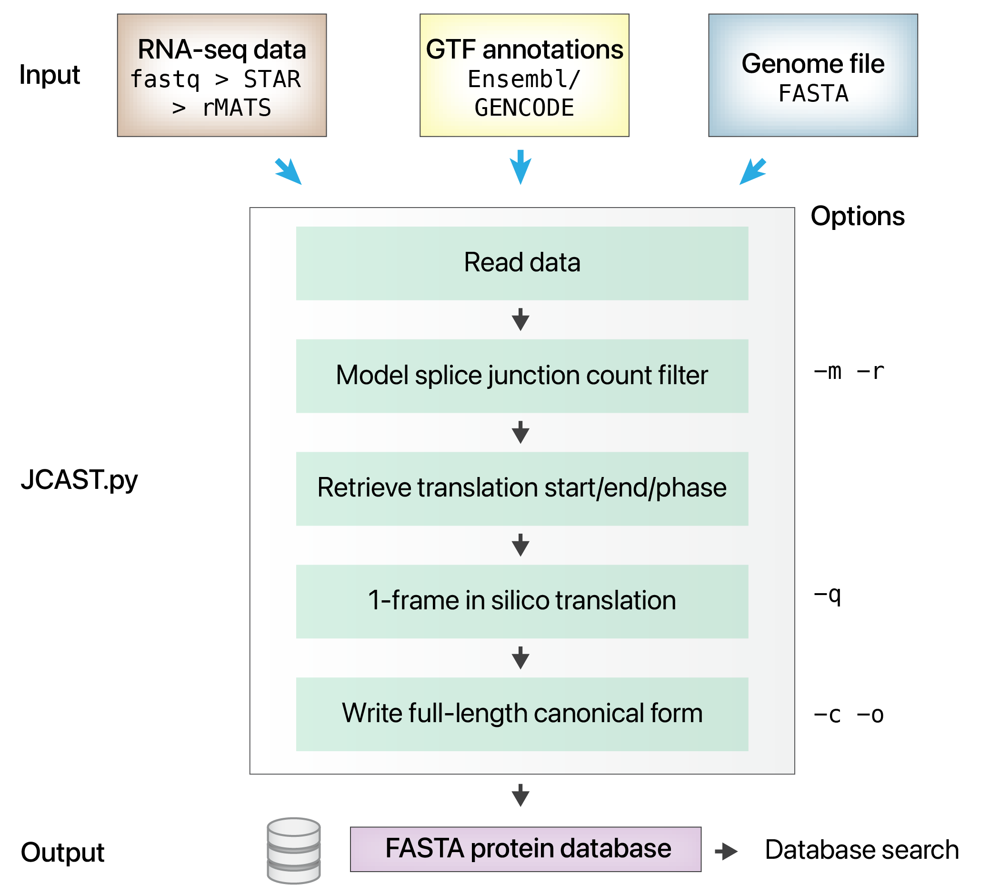

- [Maggie Lam Lab](https://maggielamlab.org), Depts of Medicine; Biochemistry & Molecular Genetics, University of Colorado School of Medicine
- [Edward Lau Lab](https://laulab.net), Dept of Medicine, University of Colorado School of Medicine


## About JCAST

JCAST (**J**unction **C**entric **A**lternative **S**plicing **T**ranslator) is a Python software that takes in splicing events from RNA sequencing data
to create custom protein sequence databases for protein isoform analysis. 

JCAST attempts to create small protein sequence databases that contain only likely sequences in mass spectrometry experiment samples to avoid runaway database size inflation.

To do so, JCAST selects likely translatable alternative splice junctions, translates each in its annotated
reading frame, then joins the translated variant sequences to full-length canonical sequences.





## Downloads

::: {.column-margin}
**Latest Updates**

v0.4.0 (November 13, 2026)
---

* Corrected translation and tiering. Re-run analyses made with v0.3.5a.
* `--uniprot`: canonical proteins from a downloaded UniProt FASTA
* About 25× faster on a whole genome; `-p` for several processes
* `junctions.tsv`: every junction's outcome
* Requires Python 3.11 or later

> See [Change Log](change.qmd) for details.

:::
JCAST is on PyPI and requires Python 3.11 or later:

```bash
$ pip install jcast
```

The source code is on GitHub: <https://github.com/ed-lau/jcast>.

See the [Quick Start](install.qmd) and [Documentation](about.qmd) for instructions.


## Contributors
* Edward Lau, PhD - [ed-lau](https://github.com/ed-lau)
* Maggie Lam, PhD - [Maggie-Lam](https://maggielamlab.org)
* R W Ludwig, BSc - [WesLudwig](https://github.com/WesLudwig)


## Citations

1. **JCAST: Sample-Specific Protein Isoform Databases for Mass Spectrometry-based Proteomics Experiments.**
RW Ludwig, E Lau *Software Impacts* 10, 100163 [Link](https://www.sciencedirect.com/science/article/pii/S2665963821000695)

2. **Determining Alternative Protein Isoform Expression Using RNA Sequencing and Mass Spectrometry.**
Y Han, JM Wright, E Lau, MPY Lam
*STAR Protocols* 1 (3), 100138 [Link](https://pubmed.ncbi.nlm.nih.gov/33377032/)

3. **Splice-Junction-based Mapping of Alternative Isoforms in the Human Proteome.**
E Lau, Y Han, DR Williams, CT Thomas, R Shrestha, JC Wu, MPY Lam
*Cell Reports* 29 (11), 3751-3765. e5 [Link](https://www.sciencedirect.com/science/article/pii/S2211124719314974)


