# Audit: the `-m` read-count model (row 23)

| | |
|---|---|
| **Date** | 2026-11-15; §§4–13 added 2026-11-16; §§14–16 and the answers to §13 on 2026-11-18 |
| **Status** | Measured on three data sets. The maintainer answered §13 on 2026-11-18: the model is kept, and the pair of cutoffs waits for a search against spectra (§16.1). The third data set, iPSC differentiation (§14), changes no conclusion. rMATS's statistics drop the events that one condition does not express (§15); decisions requested in §15.7. Before 2026-11-18: measured; decisions requested (§13). Which known protein-coding isoforms a cutoff loses (§3), the same on rMATS 4.4.0 (§4) and on a second data set, mouse heart (§5); genes against the proteins PaxDb finds in heart (§6); the model's fit to the counts (§8); two cutoffs, for annotated and novel events (§9); the NMDI14 test (§10). The maintainer's steer of 2026-11-16: the annotated and novel rule over a cutoff per splice type (§11), and a Model page that shows what a cutoff keeps (§12). A third data set is to come. |
| **Question** | Does the `-m` model fit junction read counts? Should each splice type have its own cutoff? Does a cutoff lose bona fide protein-coding isoforms? ([REVIEW.md §5.6](../REVIEW.md#56--the-modeled-read-cutoff-is-a-weakly-identified-heuristic--new), roadmap row 23, asked for on 2026-11-14.) Mass spectrometry, the decisive test, was deferred by the maintainer on 2026-11-15 as a future research item: no RNA-seq here has spectra from the same samples, and the result would depend on the spectra's depth. On 2026-11-16 the maintainer re-ran rMATS, added the mouse data set, and asked for the PaxDb comparison. |
| **Reproduce** | Run JCAST at `-r 1` with [audit_records.diff](model_audit/audit_records.diff) applied and `JCAST_AUDIT_RECORDS=<records.tsv>` set (8–11 min with `-p 10` to `-p 16`), then `python reports/model_audit/cutoff_recovery.py --records <records.tsv> --run <output dir> --rmats <dir> --uniprot <FASTA> --gencode <pc_translations.fa.gz> --gtf <gtf> [--cache_dir <dir>] [--salmon <dir>] [--paxdb <file>] [--check <output dir>:<cutoff> …] [--model_cutoff <n>] --out <dir>` (about 1 min with the GTF cache). §4.1: `python reports/model_audit/rmats_versions.py --old <rMATS 4.1.0 dir> --new <rMATS 4.4.0 dir> --out <dir>`. §8: `python reports/model_audit/model_fit.py --rmats <dir> --out <dir>` (3–8 min), and `--bundled tests/data/model` (offline, 10 min). §9: `python reports/model_audit/two_cutoffs.py` with `cutoff_recovery.py`'s inputs (5 min). §14: §§4, 8 and 9's steps on the third folder. §15: rMATS's post step again with `--statoff` and the folder's options (`rmats.py --task post --statoff`, `--tmp` a folder of links to its `.rmats` files), then `python reports/model_audit/dropped_events.py --rmats <dir> --statoff <dir> --dropped <dir> --out <dir>`, a `-r 1` run with the audit switch on the `--dropped` folder, and `dropped_events.py` again with `--records <records.tsv> --dropped_records <records.tsv> --dropped_run <dir>` and `cutoff_recovery.py`'s known sets (1 min). §16.1: [novel_only.diff](model_audit/novel_only.diff), `JCAST_AUDIT_ANNOTATED_CUTOFF=1` with `-m`, checked with `cutoff_recovery.py --check_novel_only <dir>:<cutoff>`. §10: `python reports/model_audit/nmd_response.py --rmats <dir> --run <-r 1 output dir> --targets <DTE_significant_NMD_targets.csv> --dte <DTE_results_NMD_vs_DMSO.csv> --gtf <gtf> [--cache_dir <dir>] --out <dir>` (1 min). |
| **Inputs** | Not bundled. **Human** (`20240514_Boomi_NMDI_RNASeq`): iPSC-derived cardiomyocytes, 3 DMSO and 3 NMDI14, 2 × 150 nt; GENCODE v50, GRCh38; Swiss-Prot human with isoforms of 2026-11-11 (42,545 entries); GENCODE v50 translations (`gencode.v50.pc_translations.fa.gz`, sha256 `5d6408c3…`); the folder's Salmon quantifications. rMATS 4.1.0 (§3: `rmats_4_1_0/`, 599,644 events; run at `3bfb12a`) and 4.4.0 (§4: `rmats/`, 623,738 events; run at `da06619`). **Mouse** (§5, `GSE49906_MouseHeart_RNASeq`): ventricles of FVB mice at E17, P1, P10, P28 and P90, one each, 2 × 100 nt ([Giudice et al. 2014](https://doi.org/10.1038/ncomms4603)); rMATS 4.4.0 (294,320 events); GENCODE vM39, GRCm39; Swiss-Prot mouse with isoforms of 2026-11-15 (25,764 entries); GENCODE vM39 translations (sha256 `bb90bb10…`); Salmon. All runs `-r 1 -c --uniprot`. **PaxDb** 6.1 (§6), downloaded 2026-11-16: `10090-HEART-integrated.txt` (sha256 `e7c4694b…`) and `9606-HEART-integrated.txt` (`835d4ca5…`). **§10:** the human folder's DESeq2 transcript results, `R/01_out/DTE_results_NMD_vs_DMSO.csv` and `DTE_significant_NMD_targets.csv`. **iPSC differentiation** (§14, `2019_iPSC_Diff_RNA`): 12 samples, three at each of four stages, 2 × 150 nt; rMATS 4.4.0 (1,436,384 events), days 0 and 2 against days 7 and 14; the human references above; Salmon. **§15:** rMATS 4.4.0 from bioconda (osx-arm64, Python 3.11), the post step with `--statoff` on each folder's prep files. |
| **Evidence** | One folder per run, each with `summary.txt` (the known sets and the check), `recovery.tsv` (per cutoff), `recovery_novel_only.tsv` and `tradeoff.tsv` (the cutoff on novel events only), `bins.tsv` (per read count and splice type), `expression.tsv`, the charts, and `r1_logfile.log` (the `-r 1` run, with its inputs' hashes): [human_rmats410/](model_audit/human_rmats410/) (§3), [human_rmats440/](model_audit/human_rmats440/) (§4) and [mouse_rmats440/](model_audit/mouse_rmats440/) (§5). The last two also have `rmats_versions.tsv` (§4.1), `genes.tsv`, `paxdb.tsv`, `paxdb_by_count.tsv` and `paxdb.png` (§6), and `pairs.tsv`, `frontier.tsv`, `gtf_calls.tsv` and `pairs.png` (§9). Each has `fit.tsv`, `rootogram.tsv`, `stability.tsv`, `subsets.tsv`, `depth.tsv`, `form.tsv`, `fit.png` and `fit_summary.txt` (§8); [bundled/](model_audit/bundled/) the bundled folders' fits; human_rmats440/ `nmd*.tsv` and `nmd.png` (§10). [ipsc_diff_rmats440/](model_audit/ipsc_diff_rmats440/) has all of these but §10's (§14). The three 4.4.0 folders have `dropped.tsv`, `dropped_bins.tsv`, `dropped_genes.tsv`, `dropped_model.txt`, `dropped_known.tsv` and `dropped_r1_logfile.log` (the `-r 1` run on the dropped events) (§15); ipsc_diff_rmats440/ also `novel_only_logfile.log` (§16.1). Scripts: [cutoff_recovery.py](model_audit/cutoff_recovery.py), [rmats_versions.py](model_audit/rmats_versions.py), [model_fit.py](model_audit/model_fit.py), [two_cutoffs.py](model_audit/two_cutoffs.py), [nmd_response.py](model_audit/nmd_response.py), [dropped_events.py](model_audit/dropped_events.py), [audit_records.diff](model_audit/audit_records.diff), [novel_only.diff](model_audit/novel_only.diff). |

## 1. Summary

Four runs: the human cells through rMATS 4.1.0 (§3) and 4.4.0 (§4),
mouse ventricles through 4.4.0 (§5), and an iPSC differentiation series
through 4.4.0 (§14).

- **One run at `-r 1` gives every cutoff.** An audit-only switch records
  each junction's records, even those JCAST does not write again, with
  the junction's read count. Cut at a cutoff, the records equal the full
  run at that cutoff, file by file and junction by junction. This was
  checked four times: at `-r 7` and `-m` (40) on 4.1.0, and at the
  maintainer's `-m` runs on 4.4.0 (42 human, 25 mouse).
- **What each cutoff keeps** of what `-r 1` reproduces (§§3.3, 4.3,
  5.3, 14.3), human on rMATS 4.4.0 / mouse / iPSC differentiation:

  | | `-r 1` | `-r 3` | `-r 7` | `-r 20` | `-m` (42 / 25 / 39) |
  |---|---|---|---|---|---|
  | Swiss-Prot isoforms | 6,418 / 2,236 / 7,969 | 93% / 90% / 93% | 85% / 80% / 86% | 72% / 67% / 76% | 63% / 65% / 70% |
  | GENCODE alternative proteins | 48,797 / 30,160 / 61,079 | 87% / 80% / 90% | 74% / 63% / 80% | 58% / 45% / 65% | 47% / 42% / 56% |
  | the same, ≥ 1 TPM in these samples | 4,470 / 2,808 / 5,827 | 96% / 90% / 96% | 92% / 81% / 92% | 85% / 71% / 86% | 81% / 69% / 82% |
  | database records in neither | 32,422 / 20,742 / 65,472 | 74% / 68% / 73% | 54% / 49% / 53% | 37% / 34% / 37% | 29% / 31% / 30% |
  | search database, × Swiss-Prot's size | 2.51 / 2.57 / 3.48 | 2.20 / 2.15 / 2.95 | 1.94 / 1.86 / 2.54 | 1.68 / 1.59 / 2.13 | 1.53 / 1.55 / 1.92 |

- **No read count stands out as a boundary,** in any of the three runs.
  The shares of junctions that keep the frame, and that give a known
  isoform, rise smoothly with read count. A cutoff trades recall against
  the size of the search database.
- **Whether an event is annotated says more than its read count.** With
  rMATS 4.4.0 (§§4.4, 5.4):
  - **annotated events with 1 read** give a known isoform at least as
    often as annotated events with 100 (56% against 47% human; 48%
    against 40% mouse);
  - **novel events** keep the frame as often as chance at 1–2 reads in
    both. In the human cells they stay at chance (32–35%) at every read
    count below 4,096.
- **rMATS 4.1.0 mislabelled novel events** (§4.1). On the same BAMs, 4.4.0
  calls 61,246 of 4.1.0's 151,331 "novel junction" events annotated, and
  none the other way. 4.1.1 fixed the "novel event classification" and
  added `--allow-clipping`. With clipped reads allowed, 4.4.0 counts 4–6%
  more junction reads in the human cells and 31–36% more in the mouse's
  (RI excepted). The per-cutoff results
  barely move (§4.3), but the novel-event results of §3 are superseded by
  §4.4.
- **A cutoff on novel events only does better at equal size** (§§4.5,
  5.6), on rMATS 4.4.0 in both species. It keeps 141–371 (human) and
  60–122 (mouse) more Swiss-Prot isoforms, and as many or more expressed
  GENCODE isoforms. On 4.1.0 it lost expressed isoforms above 20 reads;
  that came from the mislabelled events. But it cannot make the database
  smaller than about twice Swiss-Prot's, since every annotated event is
  kept.
- **`-m` lands at the same point in all four runs.** Its cutoffs, 40, 42,
  25 and 39 reads, keep 35–37% of the database records and 63–70% of the
  Swiss-Prot isoforms.
- **Proteins known to be in heart rarely have so few reads** (§6). Of the
  heart proteins PaxDb lists whose gene has an rMATS event, the best
  junction is below 7 reads for 0.8% (mouse) and 1.5% (human). It is
  below the `-m` cutoff for 2.7% and 6.7%. Some do, so a junction with a
  few reads can come from a protein that is there. Whether PaxDb finds a
  gene's protein does not depend on the gene's best junction count
  below about 256 reads, and rises above it. Neither result picks a
  cutoff.
- **At `-m`, a quarter of the PaxDb heart proteins get no alternative
  sequence** (§6.2): 1,846 in mouse and 2,712 in human; 34% and 39% of
  the least abundant quarter.
- **The model** (§2). The 2019 paper describes a Gaussian mixture with
  the cutoff at a 0.95 probability of the high group. Since September
  2021 the code has fitted Gamma plus Normal, with the cutoff where the
  two weighted densities cross. The maintainer's reason: the counts stop
  abruptly at 0.
- **The model finds no boundary in the counts** (§8). The counts have
  one mode, at 2 reads, then fall steadily over four orders of
  magnitude.
  - **The fit is poor where the cutoff falls.** `-m` expects 23–26% too
    few junctions with 1 read, and 11–19% too few with 24–63.
  - **Fitted properly, the family does not split.** Fitted to the counts
    themselves, the same family no longer separates low counts from
    high.
  - **The cutoff moves with the method.** It is stable under resampling
    (±2 reads), but 1–3 reads higher when the EM converges, and 40%
    higher when the low counts are not treated as a lattice.
  - **It is a share, not a boundary.** At any depth it keeps the 22–26%
    of junctions with the most reads.
- **Two cutoffs, one for annotated and one for novel events, beat one**
  (§9). This holds in both species, at every database size.
  - **At `-r 7`'s size in the human cells,** annotated ≥ 2 and novel
    ≥ 150 reproduce 306 more Swiss-Prot isoforms, with 6,119 fewer
    unannotated records.
  - **At the largest sizes,** the best pair is the novel-only rule.
  - **JCAST can call novel events itself, from the GTF.** That agrees
    with rMATS 4.4.0 for 98–99% of events.
- **The NMDI14 test cannot decide** (§10). Neither JCAST's premature-stop
  forms nor GENCODE's NMD forms gain under the inhibitor. In the folder's
  DESeq2 results, NMD transcripts are no more often up than coding ones.
- **A cutoff per splice type is not pursued** (§11), as the maintainer
  leans; dropped for now on 2026-11-18.
- **A third data set changes no conclusion** (§14). The 2019 paper's
  iPSC differentiation series (1.4 million events) repeats every finding
  above. Its `-m` (39) keeps 37% of the database records and 70% of the
  Swiss-Prot isoforms, and novel-only wins at every size. Its database is
  larger: 3.5 times Swiss-Prot's at `-r 1`.
- **rMATS's statistics cost junctions where a condition switches genes
  on** (§15). JCAST's count sums both conditions, but rMATS drops, before
  JCAST sees them, the events with no reads in one group. It does not
  give them an NA p-value.
  - JCAST loses 1.9% (NMDI14) and 2.6% (mouse) of events, nearly all
    with under 8 reads.
  - In the iPSC series it loses 4.8%, at every read count, among them
    cardiac genes that days 0–2 do not express (MYBPC3, MYL7, MYH6,
    TECRL, MYL2). They would add 148 Swiss-Prot isoforms at `-r 1`
    (+1.9%), among them NCX1 isoform 5, and 12 at `-m`.
  - rMATS's `--statoff` keeps them, but JCAST cannot yet read its output.
    The maintainer adopted the fix and the advice on 2026-11-18 (§15.7).
  - With the fix, fitted on counts ≥ 1, `-m` falls 3–5 reads (37, 22
    and 34), and the database grows 4.5–4.8% (§15.8). Fitted as today,
    with the counts of 0, it would be 1–5 reads: no cutoff.

## 2. The model now

[jcast/model.py](../jcast/model.py); REVIEW.md §5.6 has the history.

- **The count** (`junctions.read_count`): min(summed IJC, summed SJC),
  over both samples and every replicate.
- **The model:** a Gamma ("trace") plus a Normal ("expressed") on
  ln(count + 1), fitted by EM. The cutoff is where the weighted densities
  cross, a posterior of 0.5. One fit covers every rMATS file in the
  folder (PR 12).
- **The cutoffs here,** from the maintainer's `-m` runs' logs (Gamma
  shape and rate; Normal mean and sd; weights):

  | data set | rMATS | cutoff | Gamma | Normal | weights |
  |---|---|---|---|---|---|
  | human cells | 4.1.0 | 40 | 3.592, 1.937 | 4.649, 1.809 | 0.744, 0.256 |
  | human cells | 4.4.0 | 42 | 3.583, 1.905 | 4.695, 1.814 | 0.743, 0.257 |
  | mouse ventricles | 4.1.0 | 21 | 3.890, 2.535 | 4.160, 1.747 | 0.710, 0.290 |
  | mouse ventricles | 4.4.0 | 25 | 3.730, 2.290 | 4.346, 1.788 | 0.706, 0.294 |

- **The paper's model.** Lau et al. 2019 describe a Gaussian mixture,
  with the cutoff at a posterior of 0.95 for the high group. On ENCODE
  heart that gave ≥ 4 reads
  ([DOI](https://doi.org/10.1016/j.celrep.2019.11.026), via PubMed). The
  bundled `encode_human_heart` folder gets 14 from the code
  (`tests/test_model.py`). It is not known whether that folder holds the
  same samples. The code also had a scikit-learn Gaussian mixture that
  nothing called; PR 12 removed it (decisions log, 2026-11-13).
- **When and why it changed** (traced 2026-11-16). The code's first model
  was that Gaussian mixture (`8c6f015`, 2021-09-03). Two weeks later
  `3aff172` (2021-09-16) added a Gamma, or log-normal, plus Normal
  mixture, with the cutoff from the 95th percentile of the low component
  and the 5th of the high one.
  `ba11fc5` (2021-09-23) moved the cutoff to where the weighted densities
  cross. The maintainer's reason: the counts stop abruptly at 0, which a
  Gaussian does not fit well. A Gamma on ln(count + 1) is bounded at 0.

## 3. Which known isoforms a cutoff loses

The human cells through rMATS 4.1.0: the folder's `rmats/` until
2026-11-16, now `rmats_4_1_0/`. §4 repeats this section on rMATS 4.4.0.
Its per-cutoff results barely differ, but 4.4.0 calls 40% of 4.1.0's
novel-junction events annotated. §4.4 and §4.5 supersede the novel and
annotated split of §3.4 and §3.6.

### 3.1 Method

- **Why one run's output is not enough.** A record whose sequence is
  already in its file is not written again. A sequence that two
  junctions give is filed under the first one written, whatever its read
  count. The output of a run at `-r 1` cannot say which sequences a
  higher cutoff keeps.
- **The audit switch.** [audit_records.diff](model_audit/audit_records.diff)
  changes `main._finish` only. With `JCAST_AUDIT_RECORDS=<file>` set, it
  writes a line for every record of every junction, written or not: the
  splice type, the rMATS id, the read count, the file, the sequence's
  SHA-1 and length, and the header. On the whole genome, 1,187,842 lines
  (166 MB); 459,200 records besides the canonicals, 249,857 distinct
  sequences.
- **At cutoff c,** a sequence is in a file if a junction with a read
  count ≥ c gives it. This assumes a junction's records do not depend on
  the other junctions translated. §3.2 checks that.
- **The known isoforms,** as sets of distinct sequences:
  - **Swiss-Prot:** the isoforms (accession `-N`) of the `--uniprot`
    FASTA, less any sequence that is also a canonical entry's: 22,127.
  - **GENCODE:** the v50 translations of `protein_coding` transcripts,
    less the sequences of `Ensembl_canonical` transcripts and of
    Swiss-Prot canonicals: 161,440. 21,206 of them have a transcript of
    TSL ≤ 2. Only 49 are MANE without being canonical, too few to
    report.
- **"Reproduced"** means a JCAST record, in any `psq_` file but
  `psq_canonical`, has exactly that sequence. JCAST builds the canonical
  with one event changed. It cannot reproduce an isoform that differs
  from the canonical in more than one place, or by an event rMATS did not
  report. At `-r 1` it reproduces 6,372 of the 22,127 Swiss-Prot
  isoforms (29%). The recall below is relative to `-r 1`, not to
  Swiss-Prot.
- **Counting.** The handoff of 2026-11-14 counted accessions: 5,393 at
  `-r 7` and 3,999 at `-m` (40). That count took in A0A024RBG1, a
  canonical entry with the sequence of Q9NZJ9-2. Counting distinct
  sequences, less canonicals, gives 5,391 and 3,997.

### 3.2 The check against two full runs

The two whole-genome runs of 2026-11-13 (`-m`, cutoff 40) and
2026-11-14 (`-r 7`, from the GUI) have the same inputs and `--uniprot`
FASTA. Between their code and `3bfb12a`, no change altered the output
(scope report §§9–13). The audit records of the `-r 1` run, cut at 7
and at 40, give exactly what those runs wrote
([summary.txt](model_audit/human_rmats410/summary.txt); the `-m` run
is now in `jcast_rmats_4_1_0/`, and the `-r 7` run is no longer on
disk):
- the same junctions kept (308,950 and 131,233), with no fate changed;
- in each of the 11 `psq_` files but `psq_canonical`, the same set of
  sequences;
- the same Swiss-Prot isoform sequences (5,391 and 3,997).

### 3.3 By cutoff

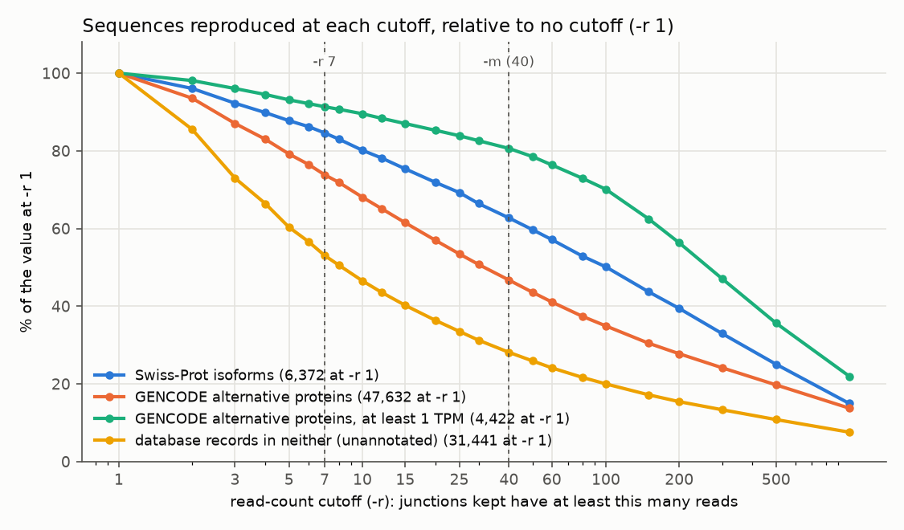

Each cell gives the count, and its share of the count at `-r 1`.
"Database records" are the JCAST records that `--uniprot` adds to
`jcast_uniprot_merged.fasta`. "In neither" means not a Swiss-Prot entry
(the merge already leaves those out) and not a GENCODE alternative
protein. The last column is the merged database's size over Swiss-Prot's
(42,545 entries). All 24 cutoffs are in
[recovery.tsv](model_audit/human_rmats410/recovery.tsv).

| `-r` | junctions kept | T1 junctions | database records | in neither | Swiss-Prot isoforms | GENCODE alternative | GENCODE, TSL ≤ 2 | GENCODE, ≥ 1 TPM | database × |
|---|---|---|---|---|---|---|---|---|---|
| 1 | 599,644 | 92,409 | 62,190 | 31,441 | 6,372 | 47,632 | 5,621 | 4,422 | 2.46 |
| 2 | 86% | 87% | 89% | 86% | 96% | 94% | 96% | 98% | 2.30 |
| 3 | 74% | 75% | 79% | 73% | 92% | 87% | 92% | 96% | 2.15 |
| 5 | 60% | 63% | 68% | 60% | 88% | 79% | 87% | 93% | 2.00 |
| 7 | 52% | 55% | 61% | 53% | 85% | 74% | 84% | 91% | 1.90 |
| 10 | 44% | 48% | 55% | 47% | 80% | 68% | 80% | 90% | 1.80 |
| 20 | 31% | 36% | 44% | 36% | 72% | 57% | 72% | 85% | 1.64 |
| 40 (`-m`) | 22% | 27% | 35% | 28% | 63% | 47% | 62% | 81% | 1.51 |
| 100 | 13% | 18% | 25% | 20% | 50% | 35% | 49% | 70% | 1.36 |

- **What a cutoff costs.** Going from `-r 1` to `-r 7` removes 15% of the
  Swiss-Prot isoforms and 9% of the expressed GENCODE isoforms. It also
  removes 47% of the unannotated records. Going on from 7 to 40 removes,
  of what `-r 7` keeps, 26% of the Swiss-Prot isoforms (5,391 → 3,997)
  and 12% of the expressed GENCODE isoforms (4,040 → 3,565). It also
  removes 47% of the unannotated records (16,683 → 8,844).
- **Isoforms of supported transcripts are lost less.** Isoforms with a
  TSL ≤ 2 transcript fall at the rate of the Swiss-Prot isoforms. Both
  fall more slowly than GENCODE's alternative proteins as a whole.

### 3.4 By read count

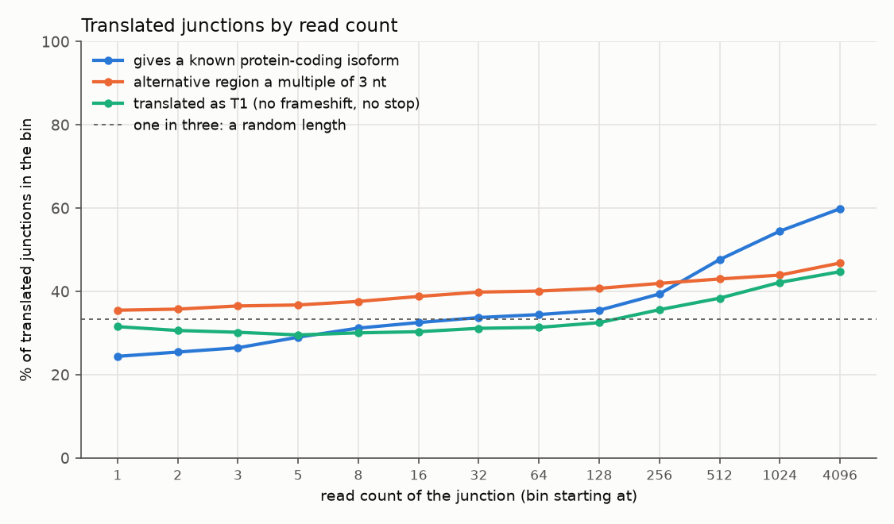

[bins.tsv](model_audit/human_rmats410/bins.tsv) covers the junctions JCAST
translated (fate T1, T1_alt_terminus, T2 or T4), binned by read count.
For each bin it gives:
- **the frame:** the share whose alternative region is a multiple of 3
  nt, so that both forms keep the frame. This comes from the rMATS
  coordinates alone. It is the exon's length for SE; the difference of
  the two exons for MXE; of the long and short exon for A5SS and A3SS;
  the intron for RI;
- **T1:** the share translated as T1, with no frameshift and no stop;
- **known:** the share with a record that is a Swiss-Prot or GENCODE
  alternative protein.

| reads | junctions | frame kept | T1 | known |
|---|---|---|---|---|
| 1 | 42,364 | 35.5% | 31.6% | 24.4% |
| 2 | 37,443 | 35.8% | 30.6% | 25.5% |
| 3–4 | 41,163 | 36.5% | 30.2% | 26.5% |
| 5–7 | 33,745 | 36.8% | 29.6% | 29.0% |
| 8–15 | 42,440 | 37.6% | 30.1% | 31.2% |
| 16–31 | 34,102 | 38.8% | 30.3% | 32.5% |
| 32–63 | 26,574 | 39.9% | 31.2% | 33.7% |
| 64–127 | 20,300 | 40.1% | 31.4% | 34.5% |
| 128–255 | 14,524 | 40.8% | 32.5% | 35.5% |
| 256–511 | 10,485 | 41.9% | 35.6% | 39.4% |
| 512–1023 | 7,637 | 43.0% | 38.4% | 47.7% |
| 1024–4095 | 8,741 | 43.9% | 42.2% | 54.5% |
| ≥ 4096 | 3,611 | 46.8% | 44.8% | 59.9% |

- **At 1–2 reads, the frame is kept about as often as chance would
  give** (35.5%, against one in three). Alternative regions under
  selection to keep the reading frame would show more. So, as a group,
  the lowest-count events look little selected for the frame.
- **No bin is a threshold.** Each share rises steadily over the whole
  range, with no step and no plateau. A cutoff from the data would be a
  count above which the shares level off, and there is none.
- **A quarter of the 1-read junctions give a known isoform** (24.4%,
  about 10,300 junctions).

**Novel and annotated events.** rMATS writes two lists of novel events.
`fromGTF.novelJunction.<type>.txt` has "AS events derived from novel
combinations of splice sites annotated in the GTF file".
`fromGTF.novelSpliceSite.<type>.txt` has "only events that include an
unannotated splice site", and is "only relevant if `--novelSS` is
enabled" (rMATS turbo README, v4.4.0). These are rMATS 4.1.0's calls;
§4.1 shows how 4.4.0's differ. Their event ids are those of
`<type>.MATS.JC.txt`. Every novel event listed there has the same
coordinates in both, checked for SE, A5SS and RI. In this folder, 58% of
all SE events and 69% of A5SS events are in one of the two lists. The same
shares, split by novel and annotated:

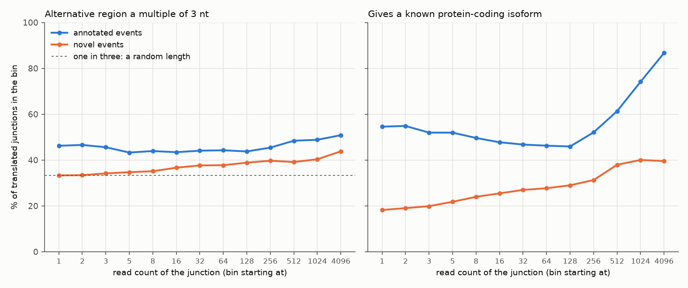

| reads | novel | frame kept: annotated | frame kept: novel | known: annotated | known: novel |
|---|---|---|---|---|---|
| 1 | 82.9% | 46.2% | 33.3% | 54.6% | 18.2% |
| 2 | 82.1% | 46.6% | 33.4% | 54.9% | 19.0% |
| 3–4 | 79.4% | 45.6% | 34.2% | 52.0% | 19.9% |
| 5–7 | 76.0% | 43.3% | 34.7% | 51.9% | 21.8% |
| 8–15 | 71.8% | 43.9% | 35.1% | 49.6% | 23.9% |
| 16–31 | 68.3% | 43.4% | 36.7% | 47.8% | 25.5% |
| 32–63 | 65.8% | 44.1% | 37.6% | 46.8% | 27.0% |
| 64–127 | 63.6% | 44.3% | 37.7% | 46.3% | 27.7% |
| 128–255 | 61.5% | 43.8% | 38.9% | 45.9% | 29.0% |
| 256–511 | 60.9% | 45.4% | 39.7% | 52.1% | 31.3% |
| 512–1023 | 58.4% | 48.4% | 39.1% | 61.3% | 37.9% |
| 1024–4095 | 57.7% | 48.8% | 40.3% | 74.2% | 40.0% |
| ≥ 4096 | 56.9% | 50.8% | 43.8% | 86.7% | 39.6% |

- **Annotated events do not change with read count up to about 256
  reads.** About 44–46% keep the frame and 46–55% give a known isoform,
  at 1 read as at 100. A cutoff below 256 removes annotated events no
  different from those it keeps.
- **Novel events at 1–2 reads keep the frame at chance.** The share
  rises slowly with read count, to 44% at ≥ 4096. As a group, the
  low-count novel events look little selected for the frame.
- **The shares for all events rise mostly because the mix changes.** The
  novel share falls from 83% to 57%.
- **A novel event can still give a known isoform** (18% at 1 read). Its
  other form may be one, and JCAST writes both forms.

### 3.5 By splice type

The share of translated junctions that give a known isoform, by read
count ([bins.tsv](model_audit/human_rmats410/bins.tsv)):

| reads | SE | MXE | A5SS | A3SS | RI |
|---|---|---|---|---|---|
| 1 | 30% | 33% | 17% | 18% | 20% |
| 2 | 30% | 34% | 19% | 20% | 22% |
| 3–4 | 30% | 29% | 20% | 23% | 25% |
| 5–7 | 31% | 31% | 24% | 26% | 25% |
| 8–15 | 32% | 34% | 28% | 30% | 25% |
| 16–31 | 34% | 35% | 29% | 32% | 21% |
| 32–63 | 36% | 39% | 30% | 34% | 15% |
| 128–255 | 41% | 47% | 33% | 35% | 12% |
| ≥ 4096 | 56% | 65% | 43% | 39% | 18% |

- **A5SS and A3SS** rise most at low counts, from 17–18% at 1 read to
  28–30% at 8–15. A cutoff of a few reads removes proportionally more
  of their unannotated junctions.
- **SE and MXE** stay near 30% until about 32 reads.
- **RI** falls above 16 reads. A retained intron with many reads is
  rarely a GENCODE protein-coding transcript.

This bears on §11: the types differ, but not in the way a model of the
counts alone would show.

### 3.6 A cutoff on novel events only

With rMATS 4.1.0's novel calls; §4.5 repeats it with 4.4.0's. §3.4
suggests another rule. Keep every annotated event, and apply the
cutoff to novel events only. The audit records measure it as they
measure the current rule
([recovery_novel_only.tsv](model_audit/human_rmats410/recovery_novel_only.tsv),
[tradeoff.tsv](model_audit/human_rmats410/tradeoff.tsv)).
An annotated event's read count is set above every cutoff.

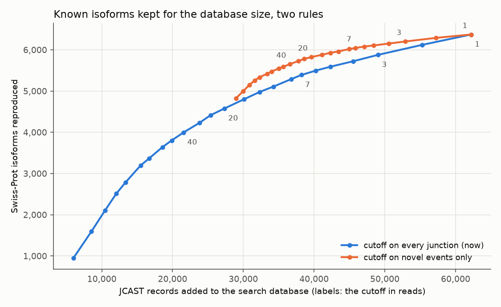

The rules compared at equal database size. Each row is the novel-only
rule at one cutoff. Each "now" value is the current rule interpolated to
the same number of database records:

| novel-only cutoff | database records (×) | Swiss-Prot isoforms: novel-only / now | GENCODE, ≥ 1 TPM: novel-only / now | in neither: novel-only / now |
|---|---|---|---|---|
| 3 | 52,867 (2.24) | 6,202 / 6,027 (+175) | 4,307 / 4,303 (+4) | 23,785 / 25,358 (−1,573) |
| 7 | 45,807 (2.08) | 6,045 / 5,735 (+310) | 4,182 / 4,184 (−2) | 18,327 / 21,028 (−2,701) |
| 20 | 39,628 (1.93) | 5,825 / 5,464 (+361) | 4,056 / 4,065 (−9) | 14,109 / 17,469 (−3,360) |
| 40 | 36,573 (1.86) | 5,652 / 5,276 (+376) | 3,958 / 4,007 (−49) | 12,171 / 15,801 (−3,630) |
| 100 | 33,380 (1.78) | 5,422 / 5,050 (+372) | 3,751 / 3,937 (−186) | 10,302 / 14,217 (−3,915) |

- **For Swiss-Prot isoforms, novel-only is better at every size.**
- **For the expressed GENCODE isoforms, the rules tie up to about 20
  reads.** Above that, novel-only does worse. Some expressed isoforms come
  from novel events with many reads, which it drops along with the
  low-count ones. With rMATS 4.4.0's calls this loss is gone (§4.5).
- **It cannot make the database smaller than the annotated events'
  records.** That floor is about 29,000 records (1.68 times Swiss-Prot),
  even at a cutoff of 1,000. To go smaller, it would need a cutoff on
  annotated events too.
- **The comparison favours novel-only by construction.** Annotated
  events give known isoforms more often, so keeping them raises recall
  per record. The case for the rule rests on the frame (§3.4): the novel
  events it drops keep the frame at chance, and the annotated events it
  keeps do not.
- **What JCAST would need:**
  - rMATS's `fromGTF.novelJunction.<type>.txt`, and, from a run with
    `--novelSS`, `fromGTF.novelSpliceSite.<type>.txt`. Without
    `--novelSS`, events with unannotated splice sites are not detected at
    all. The README does not say whether rMATS always writes these
    files;
  - JCAST reads only `<type>.MATS.JC.txt` now. It would read those two
    files, or decide "annotated" itself from the GTF's junctions;
  - with neither, it would fall back to the current rule.
- **Discovery.** Novel events are where unannotated isoforms come from,
  and finding those is part of JCAST's purpose. The rule keeps
  high-count novel events. It drops low-count ones, which look random
  for the frame.

### 3.7 Expression in the same samples

- **The measure.** The TPM of a GENCODE alternative protein is the sum,
  over the transcripts encoding its sequence, of each transcript's TPM
  averaged over the 6 samples (Salmon, `quant.sf`). Of the 47,632 that
  JCAST reproduces at `-r 1`, 4,422 reach 1 TPM and 1,243 reach 5.
- **By the read count of the best junction giving each**
  ([expression.tsv](model_audit/human_rmats410/expression.tsv)):
  - from junctions of 1–31 reads, 3–4% reach 1 TPM, with medians of
    0.004–0.06;
  - from junctions of 128–511 reads, 21–24% do;
  - from junctions of ≥ 1024 reads, fewer, 13–16%. Not explained here.
    Such junctions are likely in highly expressed genes with many
    transcripts, among which Salmon divides the reads.
- **Limits.**
  - GENCODE v50 has 382,428 translations. Many transcripts share most of
    their exons, so Salmon splits their reads and the TPM of any one is
    low. A known isoform below 1 TPM is not shown to be absent.
  - Salmon and rMATS count the same reads. Agreement between them is
    not independent evidence.

  The TPM column is a check on the direction of the effect, not a
  measure of what is expressed.

### 3.8 Reading

- **Every cutoff here is a trade-off.** Recall of known isoforms falls
  steadily as the cutoff rises. The search database shrinks, faster in
  its unannotated part. No read count separates noise from signal on
  any proxy measured.
- **Whether an event is annotated separates better than its read count
  does.** Among annotated events, read count barely matters below 256
  reads. Among novel events, the lowest counts look random for the
  frame. The read count measures depth; annotation measures
  plausibility.
- **These proxies do not settle the cost side.** The proxies count what
  a cutoff loses. What a larger database costs is a higher score
  threshold at the same FDR, and so fewer identifications. Measuring
  that needs spectra, and mass spectrometry is deferred. What this audit
  can give a user is the curve itself.
- **Measured against these proxies,** `-m`'s 40 is conservative. It
  keeps 81% of the expressed known isoforms and 63% of the Swiss-Prot
  isoforms, with a database 1.51 times Swiss-Prot's. `-r 7` keeps 91%
  and 85%, at 1.90 times.

## 4. The same samples through rMATS 4.4.0

The maintainer re-ran rMATS on the same BAMs with 4.4.0 (2026-11-16),
which "fixes several bugs with novel junctions, and also admits clipped
reads". Both runs used `--novelSS`; 4.4.0 also `--allow-clipping`.
Evidence: [human_rmats440/](model_audit/human_rmats440/).

### 4.1 What changed in rMATS

The release notes put both changes in 4.1.1 (2021-02-08): "Bug fix of
novel event classification" and "Add command line argument for handling
clipped alignments (`--allow-clipping`)". The README: "rMATS also
ignores alignments with soft or hard clipping unless `--allow-clipping`
is given." Neither says what the effect is. Later notes up to 4.4.0
(2026-08-10) mention no other change to the novel calls; 4.3.0 has "Bug
fix for missing values when counting reads". Measured on the two
folders, matching events by chromosome, strand and every coordinate
([rmats_versions.tsv](model_audit/human_rmats440/rmats_versions.tsv),
[rmats_versions.py](model_audit/rmats_versions.py)):

| human cells | SE | MXE | A5SS | A3SS | RI | all |
|---|---|---|---|---|---|---|
| events, 4.1.0 → 4.4.0 | 260,199 → 268,836 | 102,810 → 109,778 | 76,455 → 79,447 | 121,329 → 125,859 | 38,851 → 39,818 | 599,644 → 623,738 |
| novel junction calls | 93,291 → 61,846 | 21,555 → 21,577 | 11,731 → 3,120 | 22,081 → 4,521 | 2,673 → 538 | 151,331 → 91,602 |
| novel splice site calls | 96,906 → 101,406 | 55,606 → 61,531 | 49,279 → 51,054 | 71,433 → 73,819 | 22,750 → 23,409 | 295,974 → 311,219 |
| in both: novel junction → annotated | 32,273 | 473 | 8,699 | 17,659 | 2,142 | 61,246 |
| in both: junction reads, 4.4.0 / 4.1.0 | +4.1% | +4.7% | +5.1% | +5.0% | +5.7% | |
| in both: JCAST's count, 4.4.0 / 4.1.0 | +5.1% | +5.0% | +24% | +20% | +14% | |
| in both: median of JCAST's count | 7 → 7 | 12 → 12 | 5 → 5 | 6 → 6 | 14 → 14 | |

- **4.1.0 called 61,246 annotated events novel junctions,** 40% of its
  novel-junction calls. No event moved the other way. For A5SS, A3SS and
  RI most of 4.1.0's novel-junction calls were wrong. The novel splice
  site calls barely changed.
- **Counts rise a little here.** Of the events in both, 34–52% have a
  higher count in 4.4.0, and at most 3% (RI) a lower one. The medians
  do not move.
- **4.4.0 reports 4% more events** (32,273 only in 4.4.0, 8,179 only in
  4.1.0).
- **The mouse data change more** ([mouse_rmats440/rmats_versions.tsv](model_audit/mouse_rmats440/rmats_versions.tsv)):
  14% more events, junction reads +31–36% (RI +0.3%), and 20,417 of
  56,765 novel-junction calls now annotated. Why mouse gains more is not
  established here; its reads are shorter (100 nt against 150).
- **The `-m` cutoff** moves from 40 to 42 (human) and from 21 to 25
  (mouse).

### 4.2 The check

Cut at 42, the audit records give exactly what the maintainer's `-m`
run of 2026-11-16 wrote: the same 136,818 junctions kept with no fate
changed, the same sequences in each of the 11 `psq_` files, and the same
4,016 Swiss-Prot isoforms
([summary.txt](model_audit/human_rmats440/summary.txt)).

### 4.3 By cutoff

| | `-r 1`: 4.1.0 / 4.4.0 | `-r 7` | `-m` (40 / 42) |
|---|---|---|---|
| junctions kept | 599,644 / 623,738 | 52% / 52% | 22% / 22% |
| Swiss-Prot isoforms | 6,372 / 6,418 | 85% / 85% | 63% / 63% |
| GENCODE alternative proteins | 47,632 / 48,797 | 74% / 74% | 47% / 47% |
| the same, ≥ 1 TPM | 4,422 / 4,470 | 91% / 92% | 81% / 81% |
| database records in neither | 31,441 / 32,422 | 53% / 54% | 28% / 29% |
| database, × Swiss-Prot's size | 2.46 / 2.51 | 1.90 / 1.94 | 1.51 / 1.53 |

The new version adds 46 Swiss-Prot isoforms at `-r 1`, and 1,165
GENCODE alternative proteins. Every share is within two points of 4.1.0's
([recovery.tsv](model_audit/human_rmats440/recovery.tsv)). §3.3 and
§3.8 stand for 4.4.0.

### 4.4 Novel and annotated events

As §3.4, with 4.4.0's calls
([bins.tsv](model_audit/human_rmats440/bins.tsv)):

| reads | junctions | novel | frame kept: annotated | frame kept: novel | known: annotated | known: novel |
|---|---|---|---|---|---|---|
| 1 | 42,770 | 74.8% | 46.6% | 31.9% | 55.7% | 14.6% |
| 2 | 38,470 | 74.0% | 46.6% | 31.9% | 56.4% | 14.9% |
| 3–4 | 42,695 | 70.1% | 45.8% | 32.7% | 53.6% | 15.7% |
| 5–7 | 34,858 | 64.6% | 44.2% | 32.6% | 52.5% | 16.2% |
| 8–15 | 44,348 | 58.9% | 44.2% | 33.0% | 51.1% | 17.4% |
| 16–31 | 35,227 | 52.7% | 43.3% | 34.4% | 48.8% | 17.1% |
| 32–63 | 27,945 | 48.0% | 44.6% | 34.1% | 47.7% | 18.2% |
| 64–127 | 21,778 | 45.1% | 45.0% | 34.7% | 46.7% | 18.6% |
| 128–255 | 15,863 | 41.8% | 44.5% | 35.4% | 46.0% | 20.1% |
| 256–511 | 11,383 | 40.6% | 46.0% | 34.4% | 48.9% | 21.1% |
| 512–1023 | 8,412 | 41.4% | 49.5% | 33.3% | 57.0% | 28.8% |
| 1024–4095 | 9,455 | 44.0% | 49.6% | 35.4% | 67.8% | 33.5% |
| ≥ 4096 | 4,085 | 49.5% | 51.2% | 40.6% | 79.8% | 32.5% |

- **Novel events keep the frame at chance at every read count below
  4,096** (31.9–35.4%). On 4.1.0 the novel events' share rose to 39–44%
  from 128 reads up; the 61,246 events 4.4.0 moved to annotated were in
  that group then.
- **Annotated events do not improve with read count up to 256.** 44–47%
  keep the frame. 56% of those with 1–2 reads give a known isoform,
  against 46–49% at 16–511.
- **The novel share falls from 75% at 1 read to 41% at 128–511,** then
  rises again to 50% at ≥ 4096. 60% of all translated junctions are novel.
- **So read count does not make a novel event look selected for the
  frame,** in these cells. It does raise the share that give a known
  isoform (15% to 33%): the other form of a high-count novel event is
  more often a known one.

### 4.5 A cutoff on novel events only

As §3.6, with 4.4.0's calls
([tradeoff.tsv](model_audit/human_rmats440/tradeoff.tsv)):

| novel-only cutoff | database records (×) | Swiss-Prot isoforms: novel-only / now | GENCODE, ≥ 1 TPM: novel-only / now | in neither: novel-only / now |
|---|---|---|---|---|
| 3 | 56,598 (2.33) | 6,289 / 6,148 (+141) | 4,401 / 4,382 (+19) | 25,223 / 27,510 (−2,287) |
| 7 | 51,072 (2.20) | 6,185 / 5,939 (+246) | 4,311 / 4,303 (+8) | 19,990 / 24,045 (−4,055) |
| 20 | 46,923 (2.10) | 6,079 / 5,763 (+316) | 4,254 / 4,223 (+31) | 16,032 / 21,613 (−5,581) |
| 40 | 45,128 (2.06) | 6,022 / 5,685 (+337) | 4,223 / 4,188 (+35) | 14,337 / 20,540 (−6,203) |
| 100 | 43,356 (2.02) | 5,979 / 5,608 (+371) | 4,175 / 4,155 (+20) | 12,664 / 19,515 (−6,851) |

- **Novel-only now wins on all three measures at every size it reaches.**
  On 4.1.0 it lost expressed isoforms above 20 reads (§3.6). Those came
  from the events 4.1.0 mislabelled.
- **Its floor is higher:** 40,825 records (1.96 times Swiss-Prot) at a
  cutoff of 1,000, against 28,964 (1.68) on 4.1.0, since 4.4.0 calls
  more events annotated. The `-m` database (1.53) is out of its reach.
  Going below about twice Swiss-Prot needs a cutoff on annotated events
  too.

### 4.6 By splice type

As on 4.1.0 (§3.5). The share giving a known isoform rises at low
counts for A5SS (18% at 1 read, 29% at 8–15) and A3SS (19%, 31%); SE
and MXE stay at 28–32% below 16 reads; RI falls above 16 reads, to 11%
at 128–255 ([bins.tsv](model_audit/human_rmats440/bins.tsv)).

## 5. A second data set: mouse ventricles

### 5.1 The data

GEO GSE49906 ([Giudice et al. 2014](https://doi.org/10.1038/ncomms4603),
via PubMed): deep RNA-seq of FVB mouse ventricles at E17, P1, P10, P28
and P90, one sample each (SRR964790–SRR964794), 2 × 100 nt. The
maintainer's pipeline: STAR on GRCm39 with GENCODE vM39, Salmon, and
rMATS 4.4.0 with `--novelSS --allow-clipping`, E17 and P1 as `b1`
against P10, P28 and P90 as `b2`. JCAST's count sums all five samples.
The known sets: 8,479 Swiss-Prot isoform sequences (of 25,764 entries),
105,156 GENCODE alternative proteins, 11,071 of them with TSL ≤ 2. GENCODE
has no MANE for mouse. Evidence: [mouse_rmats440/](model_audit/mouse_rmats440/).

### 5.2 The check

Cut at 25, the audit records give exactly what the maintainer's `-m`
run wrote: 75,331 junctions with no fate changed, each of the 11 `psq_`
files, and 1,444 Swiss-Prot isoforms
([summary.txt](model_audit/mouse_rmats440/summary.txt)).

### 5.3 By cutoff

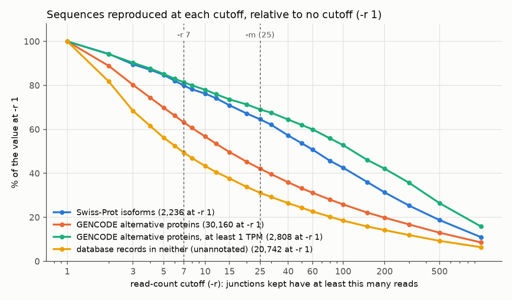

| `-r` | junctions kept | database records | in neither | Swiss-Prot isoforms | GENCODE alternative | GENCODE, TSL ≤ 2 | GENCODE, ≥ 1 TPM | database × |
|---|---|---|---|---|---|---|---|---|
| 1 | 294,320 | 40,518 | 20,742 | 2,236 | 30,160 | 2,308 | 2,808 | 2.57 |
| 2 | 82% | 85% | 82% | 94% | 89% | 93% | 94% | 2.33 |
| 3 | 69% | 73% | 68% | 90% | 80% | 88% | 90% | 2.15 |
| 5 | 55% | 61% | 56% | 85% | 70% | 82% | 85% | 1.97 |
| 7 | 48% | 55% | 49% | 80% | 63% | 77% | 81% | 1.86 |
| 10 | 40% | 48% | 43% | 76% | 57% | 72% | 78% | 1.76 |
| 20 | 29% | 38% | 34% | 67% | 45% | 63% | 71% | 1.59 |
| 25 (`-m`) | 26% | 35% | 31% | 65% | 42% | 60% | 69% | 1.55 |
| 100 | 12% | 21% | 18% | 43% | 26% | 38% | 53% | 1.33 |

- **The same shape as the human cells,** with no boundary.
- **A fixed cutoff costs more here.** At `-r 7` mouse keeps 80% of the
  Swiss-Prot isoforms and 81% of the expressed ones, against 85% and 92%
  in the human cells. A given `-r` does not mean the same in two data
  sets.
- **The model's cutoff adapts.** At 25 it keeps 35% of the database
  records and 65% of the Swiss-Prot isoforms, as 42 does in the human
  cells (35%, 63%).

### 5.4 Novel and annotated events

| reads | junctions | novel | frame kept: annotated | frame kept: novel | known: annotated | known: novel |
|---|---|---|---|---|---|---|
| 1 | 32,247 | 61.5% | 40.4% | 34.0% | 48.2% | 10.6% |
| 2 | 23,161 | 59.9% | 41.2% | 35.3% | 47.6% | 11.1% |
| 3–4 | 23,802 | 53.6% | 41.6% | 36.7% | 47.8% | 12.1% |
| 5–7 | 19,053 | 49.1% | 40.0% | 36.7% | 45.6% | 13.5% |
| 8–15 | 23,007 | 43.0% | 41.0% | 37.8% | 43.9% | 14.0% |
| 16–31 | 17,789 | 39.0% | 41.2% | 39.7% | 40.4% | 13.9% |
| 32–63 | 13,796 | 36.9% | 43.6% | 39.7% | 40.4% | 14.4% |
| 64–127 | 10,253 | 33.8% | 43.7% | 39.5% | 39.9% | 17.4% |
| 128–255 | 7,080 | 35.5% | 47.4% | 40.6% | 44.0% | 17.6% |
| 256–511 | 5,192 | 39.1% | 49.2% | 43.7% | 49.2% | 19.8% |
| 512–1023 | 3,511 | 40.3% | 51.8% | 40.1% | 56.9% | 23.6% |
| 1024–4095 | 3,985 | 45.8% | 51.1% | 44.4% | 64.6% | 23.5% |
| ≥ 4096 | 1,738 | 51.0% | 49.1% | 46.6% | 71.0% | 27.4% |

- **Annotated events with 1–2 reads are no worse than those with
  16–127:** 48% give a known isoform, against 40%. The frame is kept by
  40–44% throughout that range.
- **Novel events start at chance** (34.0% at 1 read) **and, unlike the
  human cells', rise:** to 40% by 16 reads and 40–47% above 256.
- **The novel share** falls from 62% at 1 read to 34% at 64–127, then
  rises to 51%. 49% of the translated junctions are novel.

### 5.5 By splice type

The share of translated junctions giving a known isoform
([bins.tsv](model_audit/mouse_rmats440/bins.tsv)):

| reads | SE | MXE | A5SS | A3SS | RI |
|---|---|---|---|---|---|
| 1 | 29% | 36% | 19% | 21% | 26% |
| 2 | 28% | 29% | 20% | 24% | 24% |
| 3–4 | 30% | 30% | 25% | 28% | 24% |
| 5–7 | 31% | 29% | 24% | 31% | 27% |
| 8–15 | 33% | 30% | 26% | 33% | 19% |
| 16–31 | 32% | 33% | 26% | 33% | 12% |
| 32–63 | 35% | 38% | 25% | 34% | 9% |
| 128–255 | 38% | 49% | 29% | 37% | 10% |
| ≥ 4096 | 45% | 56% | 24% | 39% | 8% |

The pattern of the human cells: A5SS and A3SS rise over the first few
reads, SE and MXE change little below 32, and RI falls above 8.

### 5.6 A cutoff on novel events only

| novel-only cutoff | database records (×) | Swiss-Prot isoforms: novel-only / now | GENCODE, ≥ 1 TPM: novel-only / now | in neither: novel-only / now |
|---|---|---|---|---|
| 3 | 34,894 (2.35) | 2,182 / 2,122 (+60) | 2,747 / 2,662 (+85) | 15,357 / 17,344 (−1,987) |
| 7 | 31,899 (2.24) | 2,147 / 2,055 (+92) | 2,714 / 2,589 (+125) | 12,465 / 15,534 (−3,069) |
| 20 | 29,681 (2.15) | 2,119 / 2,004 (+115) | 2,683 / 2,536 (+147) | 10,324 / 14,195 (−3,871) |
| 40 | 28,728 (2.12) | 2,106 / 1,984 (+122) | 2,663 / 2,509 (+154) | 9,400 / 13,690 (−4,290) |
| 100 | 27,792 (2.08) | 2,081 / 1,964 (+117) | 2,638 / 2,483 (+155) | 8,505 / 13,197 (−4,692) |

As in the human cells on 4.4.0: better on all three measures, with a
floor of 26,363 records (2.02 times Swiss-Prot) at a cutoff of 1,000
([tradeoff.tsv](model_audit/mouse_rmats440/tradeoff.tsv)).

### 5.7 Expression

The GENCODE alternative proteins JCAST reproduces at `-r 1`, by the read
count of the best junction giving each, with TPM averaged over the five
ages ([expression.tsv](model_audit/mouse_rmats440/expression.tsv)):
4–6% reach 1 TPM from junctions of 1–31 reads, 14% at 64–127, 17–22% at
128–1023, and 15–18% at ≥ 1024. The shape of §3.7, with its limits;
averaging over five ages also dilutes isoforms of one stage.

## 6. Genes, and the proteins known to be in heart

The maintainer asked for the canonical genes kept at each cutoff, to see
whether proteins known to be in the tissue have read counts below a
cutoff. The reference is PaxDb 6.1's integrated heart proteome: 9,167
mouse proteins (42% of the proteome; the maintainer's PXD002870 is its
largest part, weight 0.33) and 13,500 human proteins (69%). Each
protein is matched to its gene by the Ensembl protein of its STRING id,
else by gene name: 9,139 and 13,442 match. The ones counted below are
those whose gene has an rMATS event: 7,650 mouse and 10,764 human.
Evidence: `genes.tsv`, `paxdb.tsv`, `paxdb_by_count.tsv` and
`paxdb.png` in [human_rmats440/](model_audit/human_rmats440/) and
[mouse_rmats440/](model_audit/mouse_rmats440/).

### 6.1 What a cutoff does to canonicals

With `-c`, JCAST writes a gene's canonical whatever its junctions'
fates, skipped ones included (`main._translate_one`). So
`psq_canonical.fasta` does not change with the cutoff, and the merged
database has every Swiss-Prot canonical anyway. What a cutoff changes
is whether a gene gets any alternative sequence: a junction at or above
the cutoff, translated as T1, T1_alt_terminus, T2 or T4.

### 6.2 Genes given an alternative sequence

| cutoff | mouse: genes | mouse: PaxDb heart proteins (least / most abundant quarter) | human: genes | human: PaxDb heart proteins (least / most abundant quarter) |
|---|---|---|---|---|
| 1 | 12,158 | 97.2% (96.3% / 98.4%) | 12,892 | 96.5% (94.9% / 97.9%) |
| 3 | 11,132 | 92.9% (89.0% / 96.3%) | 12,213 | 92.5% (88.4% / 96.0%) |
| 7 | 10,123 | 87.2% (80.4% / 92.9%) | 11,485 | 88.1% (81.0% / 94.2%) |
| 20 | 8,638 | 78.2% (69.1% / 87.1%) | 10,368 | 81.0% (70.1% / 90.4%) |
| `-m` (25 / 42) | 8,289 | 75.9% (66.1% / 85.5%) | 9,463 | 74.8% (61.0% / 87.2%) |
| 100 | 5,785 | 57.5% (44.6% / 71.8%) | 8,217 | 66.1% (50.3% / 81.8%) |

At `-m`, 1,846 mouse and 2,712 human heart proteins get no alternative
sequence: 34% and 39% of the least abundant quarter, and 14% and 13% of
the most abundant.

### 6.3 Known heart proteins below a cutoff

The positive control the maintainer proposed. A protein PaxDb finds in
heart is there, so its gene's junction reads are what a present protein
can have. Each gene's count here is its best junction: the highest, over
its rMATS events, of the larger of the summed inclusion and skipping
counts.

| best junction below | mouse | mouse, least abundant quarter | human | human, least abundant quarter |
|---|---|---|---|---|
| 7 | 61 (0.8%) | 35 (2.0%) | 164 (1.5%) | 60 (2.5%) |
| 20 | 170 (2.2%) | 79 (4.5%) | 459 (4.3%) | 181 (7.6%) |
| `-m` (25 / 42) | 203 (2.7%) | 96 (5.5%) | 725 (6.7%) | 279 (11.8%) |

- **There are known heart proteins below each cutoff, but few.** The
  median best junction is about 3,400 reads in mouse and 3,070 in human;
  the 10th percentile 216 and 97 ([paxdb.tsv](model_audit/mouse_rmats440/paxdb.tsv)).
- **The human figures are inflated by the tissue.** These are iPSC-derived
  cardiomyocytes in culture, against adult heart, which also has blood,
  fibroblast and adult-stage proteins. Mouse ventricles match PaxDb's
  tissue better.

### 6.4 Whether PaxDb finds a gene's protein, by read count

The control turned round
([paxdb_by_count.tsv](model_audit/mouse_rmats440/paxdb_by_count.tsv)):
of the protein-coding genes with an rMATS event, the share whose protein
PaxDb finds in heart, by the gene's best junction.

| best junction | mouse: genes | found | human: genes | found |
|---|---|---|---|---|
| 1–2 | 74 | 23% | 68 | 66% |
| 3–7 | 255 | 21% | 269 | 58% |
| 8–31 | 670 | 24% | 675 | 63% |
| 32–255 | 1,875 | 32% | 1,590 | 62% |
| 256–1023 | 2,376 | 45% | 2,012 | 68% |
| 1024–4095 | 3,577 | 64% | 3,920 | 81% |
| ≥ 4096 | 4,076 | 85% | 5,073 | 91% |

- **Flat below about 256 reads, rising above.** Whether a gene's protein
  is found does not depend on its best junction's count in the range
  where cutoffs are set (1 to about 100). It does above 256.
- **Few genes have a best junction below 32** (about 1,000 of 13,000 in
  each), so the low bins are small.

### 6.5 Limits

- **PaxDb works at the gene level.** An isoform is found only by a
  peptide over its own junction or region, far fewer than a gene's
  peptides. An isoform's chance of being found at a given count is lower
  than its gene's.
- **Two counts are compared.** The cutoff applies to a junction's less
  used form; the control uses a gene's best junction. Both are junction
  reads summed over the same samples, so they are on one scale, but a
  gene's best junction reflects the gene's expression, not one
  isoform's.
- **PaxDb lists what a compendium found.** A protein it does not list is
  not shown to be absent.

## 7. Reading, across the three runs

- **Every cutoff is a trade-off,** in both rMATS versions and both
  species. No read count separates noise from signal on any proxy here,
  the PaxDb control included.
- **Annotation separates better than read count,** and more clearly once
  rMATS calls novel events correctly. Annotated events with 1 read are as
  good as those with 100. Novel events at 1–2 reads keep the frame at
  chance in both species; in the human cells, at almost every count.
- **A rule on novel events needs rMATS ≥ 4.1.1.** 4.1.0 calls 40% of its
  novel-junction events wrongly. The output files do not name the
  version, but 4.1.1 added `summary.txt`: it is in both 4.4.0 folders
  here and in neither 4.1.0 folder (nor in the bundled test data).
- **The novel-only rule is better at equal size but cannot go small.**
  Its floor is about twice Swiss-Prot's size. A smaller database needs a
  second cutoff, on annotated events: for example a low one for
  annotated events and a higher one for novel events. The audit records
  can measure such pairs.
- **The model's cutoff behaves alike across these runs.** It falls where
  35% of the database records remain, from 25 reads in mouse to 42 in
  the human cells. On this evidence it is a depth-adjusted heuristic, not
  a boundary in the data (§8 confirms it).
- **The PaxDb control does not argue for a higher cutoff.** Few heart
  proteins have so few reads, but those that do are there. Below about
  256 reads, a gene's count does not predict whether its protein is
  found.

## 8. The model's fit to the counts

Evidence: `fit.tsv`, `rootogram.tsv`, `stability.tsv`, `subsets.tsv`,
`depth.tsv`, `form.tsv`, `fit.png` and `fit_summary.txt` in each run's
folder, and [bundled.tsv](model_audit/bundled/bundled.tsv) for the
bundled folders. Script: [model_fit.py](model_audit/model_fit.py). Its EM
is JCAST's, run on the distinct counts, each weighted by how many
junctions have it. On the three runs it gives JCAST's parameters and
cutoffs exactly (`fit_summary.txt`).

### 8.1 What the counts look like

- **The most common count is the lowest.** 13% of the junctions have 1
  read in the human cells, and 18% in mouse.
- **One mode, then a steady fall.** Per unit of ln(count + 1), the
  model's own scale, the counts peak at 2 reads. From 5 reads to 8,000
  their density falls steadily, in both species. There is no second
  mode for an "expressed" component to sit on.

### 8.2 The model against the counts

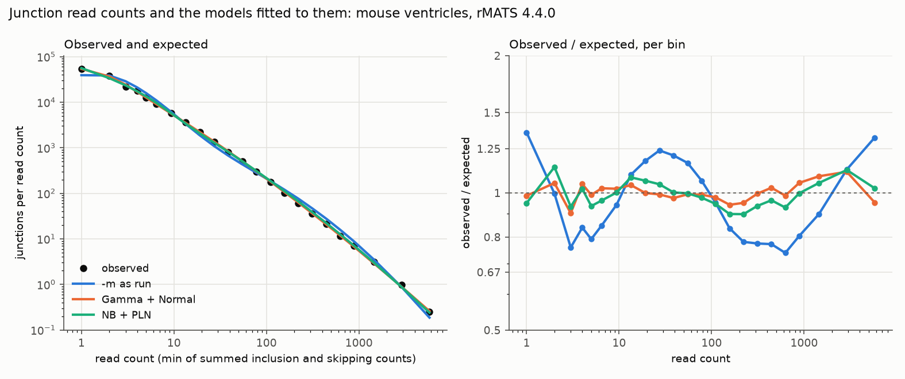

Junctions per read count, observed and expected by the `-m` fit
([rootogram.tsv](model_audit/human_rmats440/rootogram.tsv); the human
cells' chart: [fit.png](model_audit/human_rmats440/fit.png)):

| reads | human cells: observed | expected by `-m` | mouse: observed | expected by `-m` |
|---|---|---|---|---|
| 1 | 83,795 | 64,920 | 53,238 | 39,239 |
| 2 | 76,358 | 69,294 | 38,533 | 38,667 |
| 3 | 44,148 | 55,615 | 21,923 | 28,883 |
| 5 | 26,844 | 33,916 | 12,552 | 15,857 |
| 16–23 | 40,223 | 38,174 | 17,443 | 14,843 |
| 24–31 | 24,735 | 21,964 | 10,767 | 8,690 |
| 32–47 | 30,263 | 25,912 | 12,938 | 10,709 |
| 48–63 | 18,552 | 15,874 | 8,035 | 6,907 |

- **The misfit is where the cutoff falls.** `-m` expects 23% (human) and
  26% (mouse) fewer junctions with 1 read than there are. It expects up
  to 32% more with 3–5 reads, and 11–19% fewer with 24–63, around its
  cutoffs of 42 and 25.
- **Why.** The EM fits a continuous density to the values ln 2, ln 3, …
  as if they were points drawn from it. It ignores how wide each count's
  interval is on that scale, and that the counts stop at 1.

### 8.3 Other models, fitted to the counts

Each model gives each count c ≥ 1 a probability, truncated at 1 as the
data are. A model on ln(count + 1) gives c its mass over
[ln(c + ½), ln(c + 1½)]. Each is fitted by maximum likelihood, from a few
starts, so its likelihood is a lower bound for its family. BIC above the
best, per run ([fit.tsv](model_audit/human_rmats440/fit.tsv)):

| model | human, 4.4.0 | human, 4.1.0 | mouse |
|---|---|---|---|
| `-m` as run | 14,226 | 14,642 | 12,721 |
| Gamma + Normal, fitted to the counts | 0 | 0 | 60 |
| Normal + Normal (the 2019 paper's family) | 1,282 | 1,197 | 0 |
| negative binomial + Poisson-lognormal | 3,309 | 3,240 | 994 |
| two negative binomials | 38,401 | 35,310 | 14,643 |

- **JCAST's fit is not its family's best.** Fitted to the counts, the
  same Gamma + Normal gains 6,300–7,300 in log-likelihood.
- **Fitted to the counts, it no longer splits low from high:**
  - human cells: a Gamma near 4 reads (weight 0.34) inside a broad
    Normal also centred near 5 reads;
  - mouse: a Normal centred below any possible count (weight 0.98),
    whose observed part falls steadily, plus a small Gamma near 2 reads.

  Neither has a crossing between a low and a high group. Started from a
  split solution (§8.4's spread counts, mouse), the fit moves to the
  same one.
- **The negative binomials fit worst.** The counts spread over four
  orders of magnitude, wider than they allow.
- **The bundled folders** (§8.7) agree: in each of the 11 with a fit,
  the `-m` fit is 292 to 4,555 BIC above the best. The two-component
  fits to the counts imply cutoffs anywhere from 1 to 139 reads.

### 8.4 The cutoff's stability

[stability.tsv](model_audit/human_rmats440/stability.tsv):

| | human, 4.4.0 | human, 4.1.0 | mouse |
|---|---|---|---|
| JCAST (EM tolerance 10⁻⁶) | 42 | 40 | 25 |
| bootstrap, 95% of 100 | 41–44 | 39–42 | 24–26 |
| tolerance 10⁻⁴ / 10⁻⁵ | 25 / 36 | 25 / 35 | 17 / 22 |
| run to convergence | 45 | 43 | 26 |
| counts spread evenly over their intervals | 59 | 57 | 36–37 |

- **Resampling barely moves it** (1–2 reads): the data are many.
- **JCAST's EM stops before it converges.** It stops when the
  log-likelihood changes by less than 10⁻⁶ of itself, about 3 units on
  these data. Run to convergence (230–260 iterations), the cutoffs are
  3, 3 and 1 reads higher. In the bundled lung folder, 7 becomes 10, and
  its bootstrap range is 6–21.
- **The EM's start does not matter.** Splitting at the 35th or 65th
  percentile instead of the median gives the same cutoff, within 1 read.
- **The lattice of low counts moves it.** Spread evenly over their
  intervals, so that the EM sees no lattice, the counts give cutoffs
  about 40% higher. The Gamma's weight stays near 0.75.

### 8.5 What sets the cutoff

The model fitted to the counts of the first k replicates, summed
([depth.tsv](model_audit/human_rmats440/depth.tsv); human: DMSO 1–3,
then NMDI14 1–3; mouse: E17, P1, P10, P28, P90):

| replicates summed | 1 | 2 | 3 | 4 | 5 | 6 |
|---|---|---|---|---|---|---|
| human, 4.4.0: cutoff | 22 | 26 | 33 | 34 | 39 | 42 |
| junctions kept | 22.0% | 22.4% | 22.0% | 22.5% | 22.1% | 21.9% |
| mouse: cutoff | 16 | 20 | 20 | 22 | 25 | |
| junctions kept | 24.9% | 25.0% | 26.3% | 26.2% | 25.6% | |

- **The cutoff grows with the reads summed; the share it keeps does
  not.** `-m` keeps the 22% (human) or 25–26% (mouse) of junctions with
  the most reads, at any depth. §7's finding, that it keeps 35% of the
  database records in all three runs, is the same fact.
- **Fitted to a subset, it keeps a similar share of that subset**
  ([subsets.tsv](model_audit/human_rmats440/subsets.tsv)):

  | subset | human, 4.4.0 | mouse |
  |---|---|---|
  | every junction | 42 | 25 |
  | SE / MXE | 31 / 88 | 20 / 43 |
  | A5SS / A3SS | 12 / 12 | 9 / 9 |
  | RI | 11 | 6 |
  | annotated events | 148 | 43 |
  | novel events | 41 | 22 |

  Annotated events alone would get the higher cutoff, the reverse of
  §§4.4–5.6: annotated events with 1 read are as good as those with 100.

### 8.6 The count itself

- **It is summed over every sample,** so it grows with depth and with
  the number of replicates (§8.5).
- **It is the smaller of the two forms' counts,** with no allowance for
  how many junctions each form has. The ratio of rMATS's `IncFormLen` to
  `SkipFormLen` has a median of 1.56 (human) and 1.82 (mouse); 2 for RI,
  and for SE in mouse. Counted per junction position, the smaller form
  changes for 3% of the events
  ([form.tsv](model_audit/human_rmats440/form.tsv)). A small effect.

### 8.7 The bundled folders

[bundled.tsv](model_audit/bundled/bundled.tsv), offline:

| folder | junctions | `-m` | converged | bootstrap, 95% of 50 |
|---|---|---|---|---|
| encode_human_adrenalgland | 32,821 | 12 | 12 | 10–13 |
| encode_human_heart | 31,776 | 14 | 14 | 12–16 |
| encode_human_lung | 28,404 | 7 | 10 | 6–21 |
| encode_human_spleen | 33,828 | 5 | 5 | 4–5 |
| encode_human_stomach | 11,152 | no fit | no fit | 4–5 (14 of 50 fit) |
| encode_human_testis | 64,997 | 8 | 8 | 8–8 |
| encode_human_uterus | 8,553 | 5 | 5 | 3–6 (46 of 50) |
| encode_mouse_heart | 20,291 | 6 | 6 | 6–7 |
| heart_mouse_old | 88,879 | 29 | 30 | 27–30 |
| ipsc_human_d0 | 99,220 | 14 | 15 | 14–16 |
| ipsc_human_d14 | 116,887 | 15 | 16 | 14–16 |
| kidney_old_totalRNA_gencodeM26 | 35,854 | 4 | 4 | 4–4 |

`encode_mouse_fetalheart` holds headers only. The cutoffs as run are the
ones `tests/test_model.py` pins.

### 8.8 Reading

- **The `-m` model finds no boundary in the counts, because there is
  none to find.** The counts have one mode and a long tail. The Gamma
  takes the mode, the Normal the tail, and the cutoff falls where they
  cross, near the 74th–78th percentile of junctions.
- **Its cutoff is reproducible on one data set** (bootstrap ±2). It moves
  with the EM's stopping rule (up to 3 reads), with how the low counts
  are represented (40%), and in proportion to depth.
- **It is a depth-scaled quantile.** That is a defensible heuristic: it
  keeps the same share of each database (§7), where a fixed `-r` does
  not (§5.3). But it does not separate noise from signal, and it gives
  no reason for its share.
- **Fitting it better would not help.** Its family's best fit to the
  counts has no split at all.

## 9. Two cutoffs: annotated and novel events

The maintainer (2026-11-16) sees strong potential in the cutoff on novel
events only. Its floor is about twice Swiss-Prot's size (§§4.5, 5.6).
Adding a second cutoff, for annotated events, takes it below that floor.
Evidence: `pairs.tsv`, `frontier.tsv`, `gtf_calls.tsv` and `pairs.png`
in [human_rmats440/](model_audit/human_rmats440/) and
[mouse_rmats440/](model_audit/mouse_rmats440/). Script:
[two_cutoffs.py](model_audit/two_cutoffs.py).

### 9.1 Every pair

At the pair (a, n), JCAST would keep annotated events with at least a
reads and novel events with at least n. The current rule is a = n; the
novel-only rule is a = 1. Measured as in §§4–5, from the same records,
for a from 1 to 1,000 and n from 1 to 1,000 or none.

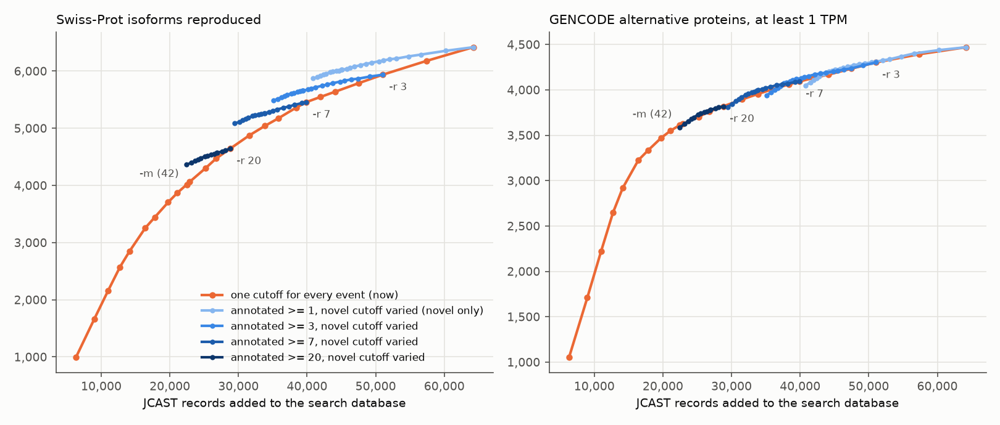

- **For Swiss-Prot isoforms, every family of pairs lies above the current
  rule, in both species.**
- **For expressed GENCODE isoforms,** the pairs lie above in mouse at
  every size. In the human cells they gain a little down to `-r 20`'s
  size (19 to 27 isoforms), and nothing at `-m`'s
  ([mouse chart](model_audit/mouse_rmats440/pairs.png)).

### 9.2 At the database size of each current cutoff

The current rule against the pairs that fit within the same number of
database records ([frontier.tsv](model_audit/human_rmats440/frontier.tsv)).
Human cells, rMATS 4.4.0:

| size of | rule | annotated / novel cutoff | records | Swiss-Prot isoforms | GENCODE, ≥ 1 TPM | in neither |
|---|---|---|---|---|---|---|
| `-r 3` | now | 3 / 3 | 51,026 | 5,937 | 4,302 | 24,016 |
| | best on every measure | 1 / 8 | 50,443 | 6,171 | 4,305 | 19,392 |
| `-r 7` | now | 7 / 7 | 39,878 | 5,457 | 4,092 | 17,580 |
| | most Swiss-Prot, keeping novel events | 2 / 150 | 39,849 | 5,763 | 4,098 | 11,461 |
| | most expressed | 3 / 40 | 39,450 | 5,658 | 4,119 | 13,106 |
| | most Swiss-Prot | 1 / none | 38,897 | 5,836 | 3,998 | 8,574 |
| `-r 20` | now | 20 / 20 | 28,795 | 4,644 | 3,818 | 12,141 |
| | most expressed | 12 / 100 | 28,494 | 4,862 | 3,837 | 9,485 |
| | most Swiss-Prot, keeping novel events | 8 / 1,000 | 28,562 | 5,002 | 3,786 | 7,673 |
| `-m` (42) | now | 42 / 42 | 22,464 | 4,016 | 3,612 | 9,281 |
| | most Swiss-Prot, keeping novel events | 20 / 1,000 | 22,450 | 4,367 | 3,587 | 6,376 |
| | most Swiss-Prot | 15 / none | 22,225 | 4,524 | 3,587 | 4,987 |

Mouse ventricles ([frontier.tsv](model_audit/mouse_rmats440/frontier.tsv)):

| size of | rule | annotated / novel cutoff | records | Swiss-Prot isoforms | GENCODE, ≥ 1 TPM | in neither |
|---|---|---|---|---|---|---|
| `-r 3` | now | 3 / 3 | 29,655 | 2,003 | 2,535 | 14,179 |
| | best on every measure | 1 / 25 | 29,317 | 2,114 | 2,676 | 9,968 |
| `-r 7` | now | 7 / 7 | 22,115 | 1,787 | 2,286 | 10,249 |
| | best on every measure | 3 / 200 | 22,031 | 1,886 | 2,406 | 6,889 |
| `-r 20` | now | 20 / 20 | 15,289 | 1,503 | 2,003 | 7,014 |
| | best, keeping novel events | 10 / 500 | 15,155 | 1,627 | 2,088 | 4,893 |
| | best on every measure | 8 / none | 14,759 | 1,647 | 2,096 | 3,857 |
| `-m` (25) | now | 25 / 25 | 14,099 | 1,444 | 1,939 | 6,462 |
| | best, keeping novel events | 12 / 1,000 | 13,944 | 1,572 | 2,018 | 4,348 |
| | best on every measure | 10 / none | 13,681 | 1,607 | 2,047 | 3,586 |

- **At large sizes** (`-r 3`'s), the best pair is the novel-only rule
  with a modest novel cutoff: 8 reads in the human cells, 25 in mouse.
  It is better on all three measures.
- **At middle sizes** (`-r 7`'s): a low annotated cutoff (2–3) and a
  novel cutoff of 40–200.
- **At small sizes** (`-r 20`'s, `-m`'s), the best pairs spend the
  records on annotated events with 8–20 reads, and keep few or no novel
  events. Judged by Swiss-Prot isoforms alone, dropping novel events
  altogether is best in the human cells from `-r 7`'s size down.
- **The measures favour annotation by construction:** known isoforms
  come from annotated events more often. What a pair gives up is
  discovery, the novel events below n. §§4.4 and 5.4 are why that costs
  little: novel events with few reads keep the frame at chance.

### 9.3 Telling novel events from the GTF

JCAST could call an event novel itself, from the GTF it already reads:
annotated if each splice junction of each form is an intron of a GTF
transcript (for RI, if a GTF exon also covers the intron). Against rMATS
4.4.0's call ([gtf_calls.tsv](model_audit/human_rmats440/gtf_calls.tsv)):

| | human: rMATS annotated | rMATS novel | mouse: rMATS annotated | rMATS novel |
|---|---|---|---|---|
| annotated from the GTF | 220,794 | 12,374 | 138,768 | 3,480 |
| novel from the GTF | 123 | 390,447 | 5 | 152,067 |

- **The calls agree for 98.0% (human) and 98.8% (mouse) of events.**
  rMATS's annotated events are all annotated from the GTF but 123 and 5.
- **Where they differ,** the GTF calls annotated some events that rMATS
  calls novel: mostly A5SS, A3SS and RI (10,262 of 12,374 in the human
  cells). Their splice junctions are all annotated; rMATS presumably
  objects to an exon end that is not a junction, which this rule does
  not check.
- **So JCAST need not depend on rMATS's files.** The GTF works with any
  rMATS version and without `--novelSS`, and rMATS 4.1.0's mislabelling
  (§4.1) would not matter.

### 9.4 Where a novel cutoff could come from

- **Not from the model.** Fitted to novel events alone, it gives 41
  (human) and 22 (mouse), close to the folder's cutoff. Fitted to
  annotated events alone it gives 148 and 43 (§8.5).
- **Not reliably from the frame.** The share of novel events that keep
  the frame leaves chance by about 16 reads in mouse, but not below
  4,096 in the human cells (§§4.4, 5.4).
- **So n is a choice:** how much discovery to pay for in database size.
  The curves in §9.1 show the price, data set by data set.

### 9.5 Reading

- **The pair (annotated, novel) beats one cutoff** in both species, at
  every database size measured.
- **Novel-only is the best pair at large sizes.** At smaller ones, the
  annotated events need a cutoff too.
- **JCAST can make the novel call itself,** from the GTF.

## 10. NMDI14

### 10.1 The test

- **The question:** do T4 junctions with few reads respond to the NMD
  inhibitor as those with many do? If so, they come from transcripts.
- **The measure.** For each event and condition, the share of the
  inclusion form (PSI), from the summed replicate counts, each form per
  junction position. A T4 junction records which slice hit a premature
  stop, and slice 1 is the inclusion form in every splice type. The stop
  form's change is its PSI under NMDI14 minus under DMSO.
- **The baseline:** T1 junctions, whose inclusion form has no stop.
- **The positive control:** events whose one form is in GENCODE's
  `nonsense_mediated_decay` transcripts only and whose other form is in
  a `protein_coding` one (58,081 events).

Evidence: `nmd.tsv`, `nmd_genes.tsv`, `nmd_gencode.tsv`,
`nmd_transcripts.tsv` and `nmd.png` in
[human_rmats440/](model_audit/human_rmats440/). Script:
[nmd_response.py](model_audit/nmd_response.py).

### 10.2 Results

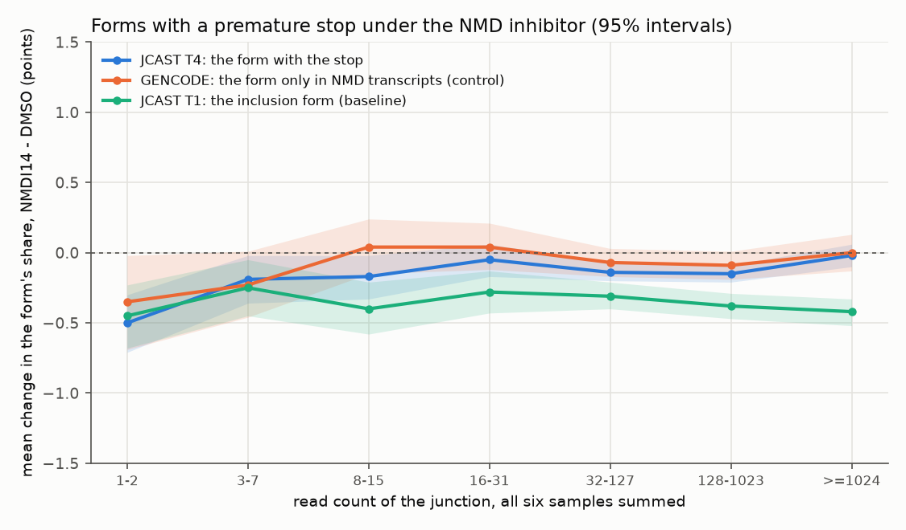

| | events | mean change, points (95%) | share rising | rMATS FDR < 0.05: events, share rising |
|---|---|---|---|---|
| JCAST T4: the stop form | 201,696 | −0.23 (−0.30 to −0.16) | 51.1% | 7,747, 49.2% |
| GENCODE: the NMD-only form (annotated events) | 56,191 | −0.11 (−0.19 to −0.03) | 52.1% | 2,641, 52.2% |
| JCAST T1: the inclusion form | 96,192 | −0.35 (−0.43 to −0.27) | 45.8% | 3,782, 38.6% |

- **JCAST's stop forms do not gain under NMDI14 at any read count.** The
  stop form's mean change, either slice, is within a point of zero in
  every bin, for annotated and novel events alike. So is it in genes on the folder's list of NMD
  targets ([nmd_genes.tsv](model_audit/human_rmats440/nmd_genes.tsv)).
- **Nor do GENCODE's own NMD forms,** the positive control.
- **Nor do NMD transcripts at the transcript level.** In the folder's
  DESeq2 results (`R/01_out/DTE_results_NMD_vs_DMSO.csv`, baseMean ≥ 10;
  [nmd_transcripts.tsv](model_audit/human_rmats440/nmd_transcripts.tsv)):

  | transcripts | count | median log2 fold change | share up | padj < 0.05, up / down |
  |---|---|---|---|---|
  | protein_coding | 65,320 | 0.005 | 52.8% | 4,826 / 3,721 |
  | nonsense_mediated_decay | 26,194 | 0.003 | 52.2% | 1,213 / 958 |
  | retained_intron | 14,576 | −0.006 | 47.8% | 656 / 723 |

  Classic NMD targets, the NMD-type transcripts of SRSF2, SRSF3, SRSF6,
  SRSF7 and SRSF11, mostly move by less than 0.5 in log2.
  `DTE_significant_NMD_targets.csv` lists significant NMD-type
  transcripts in both directions (53% up).

### 10.3 Reading

- **These samples show no measurable block of NMD,** so the test cannot
  say whether T4 junctions with few reads are transcripts. It counts
  neither for them nor against them.
- **The test needs a stronger NMD perturbation,** such as UPF1
  knock-down or cycloheximide. A future item, with mass spectrometry.

## 11. A cutoff per splice type

The maintainer deprioritized this on 2026-11-16, in favour of the
annotated and novel rule. For the record:
- **Fitted alone, each type gets its own cutoff** (§8.5). In the human
  cells: SE 31, MXE 88, A5SS and A3SS 12, RI 11. In mouse: 20, 43, 9, 9
  and 6.
- **Each such cutoff keeps a share of its own type,** as the folder's
  does. The differences follow each type's counts (MXE events have the
  most reads), not a boundary in any of them.
- **The types differ in what their junctions give** (§§3.5, 4.6, 5.5):
  A5SS and A3SS improve over the first few reads, and RI declines above
  8–16. A model of counts per type would not follow that.

## 12. The GUI's Model page

The maintainer agreed (2026-11-16) that the Model page should show what
a cutoff keeps, with charts like this report's, so that users can
choose. Other data sets may behave in ways these two do not. A third
data set, the 2019 paper's deep iPSC differentiation series through
rMATS 4.4.0, is being prepared for the comparisons.

What the page could show, by what each chart needs:

| chart | needs | time |
|---|---|---|
| the counts and the model (as now) | the rMATS folder | seconds |
| junctions kept at each cutoff, annotated and novel | and the GTF (§9.3), or rMATS's `fromGTF` files | seconds once the GTF is cached |
| by read count, the share of annotated and novel events keeping the frame (§4.4, left) | the rMATS coordinates | seconds |
| records and Swiss-Prot isoforms kept at each cutoff, or pair of cutoffs (§§4.3, 9.1) | a run at `-r 1` that writes each junction's records, with `--uniprot` | the run |
| the FASTA at another cutoff, without translating again | the same records | seconds |

- **The first three can come before a run;** the last two after one,
  perhaps on the Results page.
- **The records would become an output:** a line per record, 174 MB for
  the human cells. That overlaps with row 22's option (b), which keeps
  each junction's peptides.

## 13. Decisions requested

1. **The `-m` model** (§8). Options:
   - (a) keep it, and document it as what it is: a cutoff that keeps
     about the quarter of junctions with the most reads, scaled to
     depth, with no boundary in the data behind it;
   - (b) as (a), and let the EM converge (cutoffs up 1–3 reads; the
     tests' pinned cutoffs change);
   - (c) replace it with a stated share of junctions;
   - (d) use it only to suggest the novel cutoff of a pair (decision 2).

   Recommended: (a). Fitting it better would not give it a meaning.
2. **Annotated and novel events** (§§4.5, 5.6, 9):
   - offer a pair of cutoffs, one for annotated and one for novel
     events;
   - tell them apart from the GTF (§9.3), which works with any rMATS
     version (recommended), or from rMATS's `fromGTF` files, which need
     rMATS ≥ 4.1.1 and `--novelSS`;
   - on the command line, for example `-r` for every event as now, and a
     new option for novel events, defaulting to `-r`'s value so that
     runs do not change;
   - keep today's defaults until users can see the curves (decision 4).
3. **A cutoff per splice type:** not pursued (§11), as the maintainer
   leans. To confirm.
4. **The Model page** (§12): which charts in v0.5.0, and whether a run
   writes its records, as an output and as row 22's option (b).
5. **NMDI14** (§10): inconclusive. Record it, with a stronger NMD
   perturbation as a future item.
6. **The third data set:** when it is ready, the same steps:
   - a run at `-r 1` with the audit switch;
   - then `cutoff_recovery.py`, `two_cutoffs.py` and `model_fit.py`.

**The maintainer's answers (2026-11-18):**
1. **The model is kept** (a). The open question is whether its cutoff
   should apply to novel events only (decision 2).
2. **The pair of cutoffs: leaning yes, decided after a test against mass
   spectra.** The maintainer will run JCAST on human heart and prepare
   the spectra of two deep human heart proteomes (probably the Mann and
   Lundby labs') for a search with quantms. Two databases from the same
   rMATS folder go in: `-m` on every event, and `-m` on novel events only
   (§16).
3. **A cutoff per splice type: dropped for now,** given the novel-event
   cutoff.
4. **The Model page:**
   - the database-size charts (§§3.6, 4.5, 5.6);
   - the alternative region by read count (§4.4);
   - if they can be made quickly, the database records by kind at each
     cutoff (§4.3).

   What each needs is in §16. Given §16.2, later the same day: **only
   the charts that need no run, for now** (§9.3, §4.4 left). Those that
   need a run's records (database records, Swiss-Prot isoforms, records
   by kind) wait for later decisions; they would belong on the results
   page, or on a Model page shown after a run, and every run would have
   to translate at `-r 1`.
5. **NMDI14 is recorded as inconclusive.** A new science report is to
   ask what NMDI14 does to splicing, from rMATS, and to gene expression,
   from the folder's Salmon output (to be linked in).
6. **The third data set,** the iPSC differentiation series, is in §14. A
   fourth, ENCODE human adult and fetal heart, is coming, for the search
   against spectra.

Also on 2026-11-18: the GUI is to remember its settings between sessions
in v0.5.0, and the maintainer asked how the count treats replicates and
conditions, and how many junctions rMATS's statistics cost (§15).

## 14. A third data set: iPSC differentiation

### 14.1 The data

The maintainer added it on 2026-11-18: the 2019 paper's deep
differentiation series, human iPSCs to cardiomyocytes
(`2019_iPSC_Diff_RNA`). It has 12 samples, three at each of four stages,
2 × 150 nt, unstranded. rMATS 4.4.0 compares DR15 and DR19 (days 0 and
2) with DR20 and DR24 (days 7 and 14), as the pipeline's comment has it.
The other inputs are as in §4: GENCODE v50, Swiss-Prot of 2026-11-11, and
the folder's Salmon quantifications.
- **It is the largest of the three:** 1,436,384 events, 2.3 times the
  NMDI14 cells', with 3.2 times their junction reads.
- **80% of its events are novel,** against 65% in the NMDI14 cells.
- **The maintainer's `-m` run** (JCAST 0.4.0, `jcast/`) chose 39 reads.

The `-r 1` run with the audit switch took 13 min 42 s with `-p 14`
([r1_logfile.log](model_audit/ipsc_diff_rmats440/r1_logfile.log)).
Evidence: [ipsc_diff_rmats440/](model_audit/ipsc_diff_rmats440/).

### 14.2 The check

Cut at 39 reads, the `-r 1` records equal the maintainer's `-m` run
exactly ([summary.txt](model_audit/ipsc_diff_rmats440/summary.txt)):
- the same 314,396 junctions, with the same fates;
- every `psq_*.fasta`, sequence for sequence;
- the same 5,556 Swiss-Prot isoforms.

### 14.3 By cutoff

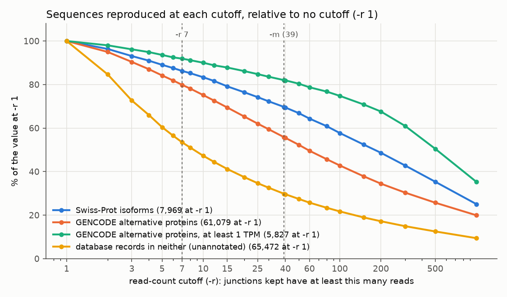

| | `-r 1` | `-r 3` | `-r 7` | `-r 20` | `-m` (39) |
|---|---|---|---|---|---|
| junctions kept | 1,436,384 | 72% | 50% | 31% | 22% |
| Swiss-Prot isoforms | 7,969 | 93% | 86% | 76% | 70% |
| GENCODE alternative proteins | 61,079 | 90% | 80% | 65% | 56% |
| the same, ≥ 1 TPM | 5,827 | 96% | 92% | 86% | 82% |
| database records in neither | 65,472 | 73% | 53% | 37% | 30% |
| search database, × Swiss-Prot's size | 3.48 | 2.95 | 2.54 | 2.13 | 1.92 |

([recovery.tsv](model_audit/ipsc_diff_rmats440/recovery.tsv))
- **The shares are close to the other two runs' (§1).** `-m` keeps
  somewhat more Swiss-Prot isoforms here: 70%, against 63% (human) and
  65% (mouse).
- **`-m` again keeps 37% of the database records,** against 35% in the
  other three runs (§7).
- **The database at `-r 1` is larger:** 3.48 times Swiss-Prot's size,
  against 2.51 and 2.57. A cutoff matters more in a deep series.

### 14.4 Novel and annotated events

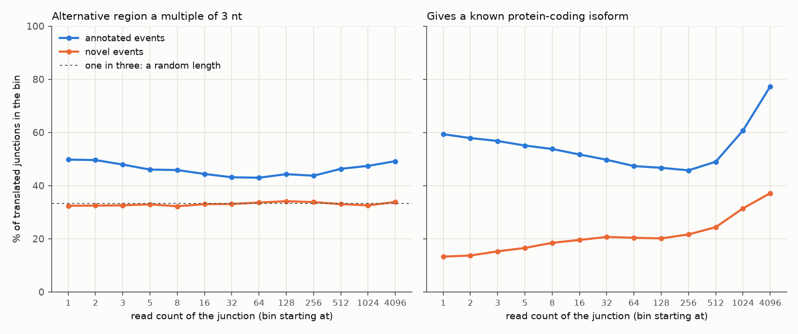

As §4.4 ([bins.tsv](model_audit/ipsc_diff_rmats440/bins.tsv)):

| reads | junctions | novel | frame kept: annotated | frame kept: novel | known: annotated | known: novel |
|---|---|---|---|---|---|---|
| 1 | 102,591 | 90.1% | 49.8% | 32.4% | 59.3% | 13.3% |
| 2 | 80,499 | 89.2% | 49.6% | 32.5% | 57.9% | 13.7% |
| 3–4 | 88,707 | 86.3% | 47.9% | 32.6% | 56.8% | 15.3% |
| 5–7 | 71,532 | 82.0% | 46.0% | 32.9% | 55.1% | 16.6% |
| 8–15 | 86,579 | 76.2% | 45.9% | 32.2% | 53.8% | 18.5% |
| 16–31 | 69,393 | 69.5% | 44.4% | 33.0% | 51.7% | 19.6% |
| 32–63 | 53,878 | 63.7% | 43.1% | 33.1% | 49.7% | 20.7% |
| 64–127 | 42,197 | 59.3% | 43.0% | 33.6% | 47.3% | 20.4% |
| 128–255 | 31,234 | 55.9% | 44.3% | 34.1% | 46.7% | 20.1% |
| 256–511 | 22,667 | 53.9% | 43.7% | 33.8% | 45.7% | 21.6% |
| 512–1023 | 16,123 | 53.2% | 46.3% | 33.0% | 49.0% | 24.4% |
| 1024–4095 | 21,012 | 59.4% | 47.4% | 32.6% | 60.7% | 31.4% |
| ≥ 4096 | 11,192 | 62.6% | 49.2% | 33.8% | 77.3% | 37.2% |

- **Novel events keep the frame at chance at every read count**
  (32.2–34.1%), now up to the highest.
- **Annotated events with 1 read are the best of those below 1,024:**
  59% give a known isoform, against 46–52% from 16 to 1,023 reads.
- **90% of the junctions with 1–2 reads are novel.**

### 14.5 A cutoff on novel events only

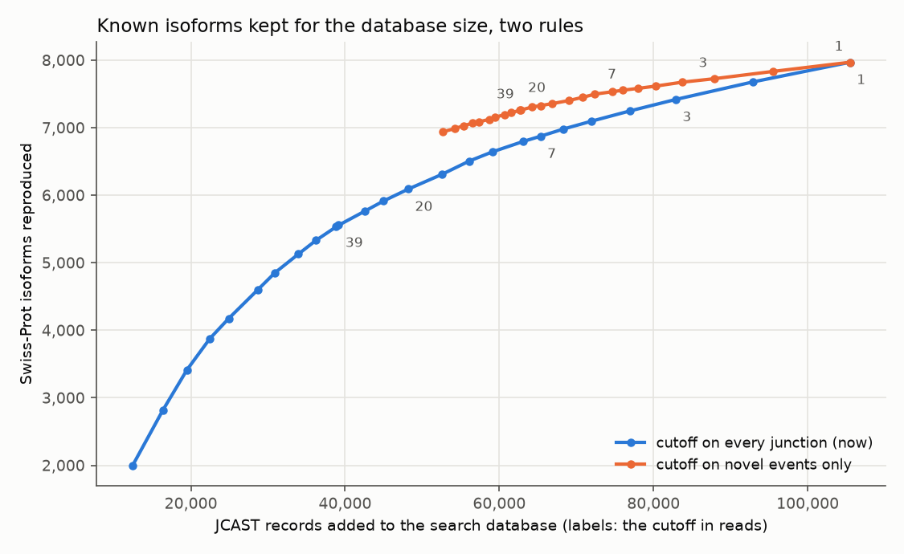

([tradeoff.tsv](model_audit/ipsc_diff_rmats440/tradeoff.tsv))

| novel-only cutoff | database records (×) | Swiss-Prot isoforms: novel-only / now | GENCODE, ≥ 1 TPM: novel-only / now | in neither: novel-only / now |
|---|---|---|---|---|
| 3 | 87,863 (3.07) | 7,725 / 7,547 (+178) | 5,693 / 5,657 (+36) | 48,691 / 51,479 (−2,788) |
| 7 | 76,057 (2.79) | 7,555 / 7,221 (+334) | 5,576 / 5,516 (+60) | 37,405 / 42,544 (−5,139) |
| 20 | 66,890 (2.57) | 7,357 / 6,929 (+428) | 5,459 / 5,372 (+87) | 28,649 / 36,040 (−7,391) |
| 40 | 62,669 (2.47) | 7,256 / 6,779 (+477) | 5,398 / 5,308 (+90) | 24,662 / 33,229 (−8,567) |
| 100 | 58,663 (2.38) | 7,122 / 6,622 (+500) | 5,311 / 5,235 (+76) | 20,884 / 30,679 (−9,795) |

- **Better on all three measures at every size,** as in §§4.5 and 5.6.
- **Its floor is 52,686 records** (2.24 times Swiss-Prot) at a cutoff of
  1,000.
- **At `-m`'s 39, applied to novel events only,** the database has
  62,793 JCAST records (2.48 times Swiss-Prot) and 7,261 Swiss-Prot
  isoforms. Applied to every event, it has 39,167 (1.92) and 5,556. That
  is the size of the difference the search of §16.1 would test.

### 14.6 The model's fit

As §8 ([fit_summary.txt](model_audit/ipsc_diff_rmats440/fit_summary.txt),
[fit.tsv](model_audit/ipsc_diff_rmats440/fit.tsv),
[stability.tsv](model_audit/ipsc_diff_rmats440/stability.tsv),
[depth.tsv](model_audit/ipsc_diff_rmats440/depth.tsv),
[subsets.tsv](model_audit/ipsc_diff_rmats440/subsets.tsv)):

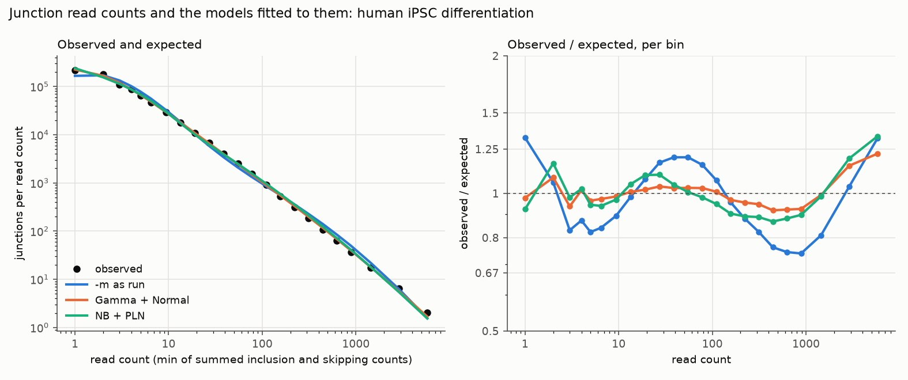

- **The same misfit.** At 1 read, `-m` expects 166,396 junctions
  against 220,288 observed, 24% too few. It expects too many at 3–11
  reads, too few at 16–127, and too many again at 128–2,047 (ΔBIC
  42,725).
- **Fitted to the counts, the family does not split** (the cutoff is 1).
- **The cutoff:**
  - 39 as run, 39–40 by bootstrap;
  - 42 with the EM run to convergence;
  - 59 with each count spread over its interval.
- **It keeps a share again,** though one that falls a little with depth:
  12 reads and 26.4% of junctions at one replicate, 39 and 21.9% at
  twelve. The share falls as the later days' samples are added.
- **By subset:** SE 22, MXE 112, A5SS and A3SS 9, RI 11; novel events
  42. On annotated events alone the model finds no cutoff.

### 14.7 Two cutoffs

As §9 ([pairs.tsv](model_audit/ipsc_diff_rmats440/pairs.tsv),
[frontier.tsv](model_audit/ipsc_diff_rmats440/frontier.tsv),
[gtf_calls.tsv](model_audit/ipsc_diff_rmats440/gtf_calls.tsv)). Each cell
gives database records, Swiss-Prot isoforms, GENCODE isoforms with
≥ 1 TPM, and records in neither:

| size of | current rule | pair (annotated / novel) | pair's values |
|---|---|---|---|
| `-r 3` | 82,892 / 7,418 / 5,604 / 47,578 | 1 / 5 | 80,252 / 7,615 / 5,614 / 41,422 |
| `-r 7` | 65,366 / 6,874 / 5,355 / 35,002 | 1 / 25 | 65,360 / 7,327 / 5,437 / 27,207 |
| `-m` (39) | 39,167 / 5,556 / 4,780 / 19,533 | 5 / none | 38,547 / 6,249 / 4,728 / 8,487 |
| | | 10 / 1,000 | 38,973 / 6,014 / 4,749 / 12,258 |
| | | 25 / 80 | 38,940 / 5,707 / 4,816 / 17,128 |

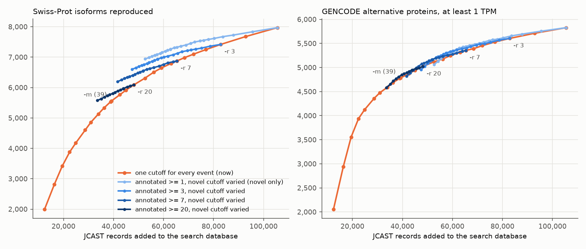

- **A pair beats one cutoff at every size,** and the novel-only rule
  (annotated at 1) is the best pair at the larger sizes, as in §9.2.
- **At `-m`'s size, the annotated events need a cutoff too.** The pair
  with the most expressed GENCODE isoforms (25 / 80) keeps 151 more
  Swiss-Prot isoforms than `-m`, and 2,405 fewer records in neither.
- **The call from the GTF agrees with rMATS's for 98.2% of events**
  (98.0% and 98.8% in §9.3). As there, nearly all of the disagreement
  is events that rMATS calls novel and the GTF annotated (24,837),
  against 429 the other way.

### 14.8 PaxDb's heart proteins

Only days 7 and 14 are cardiomyocytes, so this is weaker than §6
([paxdb.tsv](model_audit/ipsc_diff_rmats440/paxdb.tsv),
[paxdb_by_count.tsv](model_audit/ipsc_diff_rmats440/paxdb_by_count.tsv)).
- **438 of the 11,925 heart proteins PaxDb finds** whose gene has an
  rMATS event (3.7%) have a best junction below `-m`'s 39 reads; 147
  (5.2%) in the least abundant quarter. §6.3 found 2.7% (mouse) and 6.7%
  (human) ([genes.tsv](model_audit/ipsc_diff_rmats440/genes.tsv)).
- **Below 256 reads, a gene's count says little** about whether PaxDb
  finds its protein: 43–58% in each bin, against 71% at 1,024–4,095 and
  86% at ≥ 4,096.

### 14.9 Reading: do the conclusions change?

No. Each principal conclusion holds on the third data set:
- **no read count is a boundary** (§§3–5);
- **`-m` misfits the counts, and its cutoff is a depth-scaled share**
  (§8);
- **novel events keep the frame at chance, and annotated events with 1
  read are as good as those with 100** (§§4.4, 5.4);
- **the novel-only rule wins at equal size on every measure** (§§4.5,
  5.6);
- **a pair of cutoffs beats one,** and the GTF can tell novel events
  (§9);
- **few heart proteins have so few reads** (§6).

What is new:
- **The database is larger at every cutoff,** so the choice of cutoff
  weighs more.
- **The share that `-m` keeps falls a little with depth** (26% to 22%),
  where it held still in the other two.
- **rMATS's statistics drop many more events here,** for a reason the
  other two data sets do not show (§15).

## 15. Events rMATS drops before JCAST reads them

The maintainer asked (2026-11-18):
- with several replicates per condition, what count does JCAST model?
- how many junctions are lost when one is missing from a condition
  entirely, as in a design with fetal and adult hearts as the two
  conditions?

### 15.1 The count

JCAST's count ([junctions.py](../jcast/junctions.py), `read_count`) is
the smaller of two sums:
- the inclusion junction counts (IJC) of every replicate of both
  conditions;
- the skipping junction counts (SJC), summed the same way.

It is neither an average nor a minimum over samples or conditions. A
form seen in only one condition counts in full, as long as the other
form has a read somewhere. `-r` and `-m` both filter on this count, and
the conditions play no other part in it.

### 15.2 What rMATS drops

rMATS does not give these events an NA p-value: it removes them. With
its statistics on (the default), its post step rewrites
`JC.raw.input.<type>.txt` before the statistical model (`rmats.py`,
`filter_countfile`, [rMATS 4.4.0](https://github.com/Xinglab/rmats-turbo/blob/v4.4.0/rmats.py)).
It keeps an event only if:
- each group has at least one read, inclusion or skipping, in any
  replicate;
- the event has an inclusion read and a skipping read, in either group;
- both forms have a length.

`<type>.MATS.JC.txt` is made from that file, so a dropped event is in
neither. No `MATS.JC.txt` of the three data sets has an NA p-value, or an
event without reads in a group. The second condition is JCAST's own (a
count of at least 1); the first is the one a design with two conditions
adds.

With `--statoff`, rMATS skips the filter and writes every event it found,
with PValue and FDR `NA`. It does the same when only one group is given.

### 15.3 How many

[dropped_events.py](model_audit/dropped_events.py) compares each folder
with a post step run with `--statoff` on the same prep files. That was
rMATS 4.4.0 with the pipelines' options, in 2.5 (mouse), 4.5 (human) and
8.6 minutes (iPSC). The `fromGTF` files are identical, so the events and
their IDs are the same.

| | NMDI14 cells | mouse ventricles | iPSC differentiation |
|---|---|---|---|
| groups | DMSO / NMDI14 | E17, P1 / P10, P28, P90 | days 0, 2 / days 7, 14 |
| events rMATS found | 848,342 | 448,231 | 1,685,464 |
| in `MATS.JC.txt` | 623,738 | 294,320 | 1,436,384 |
| dropped | 224,604 | 153,911 | 249,080 |
| of those, no reads at all | 72,295 | 51,119 | 36,698 |
| reads in one form only | 140,623 | 95,057 | 143,769 |
| **a read in both forms, none in one group** | **11,686** | **7,735** | **68,613** |
| the same, as a share of the events kept | 1.9% | 2.6% | 4.8% |
| no reads in the first group / the second | 7,444 / 4,242 | 4,281 / 3,454 | 42,392 / 26,221 |
| at or above `-m`'s cutoff (42, 25, 39) | 19 | 115 | 2,687 |
| novel (rMATS): dropped / kept | 82% / 65% | 72% / 53% | 90% / 80% |
| `-m` cutoff: as run / with them | 42 / 37 | 25 / 22 | 39 / 34 |

([dropped.tsv](model_audit/ipsc_diff_rmats440/dropped.tsv),
[dropped_bins.tsv](model_audit/ipsc_diff_rmats440/dropped_bins.tsv),
[dropped_genes.tsv](model_audit/ipsc_diff_rmats440/dropped_genes.tsv),
[dropped_model.txt](model_audit/ipsc_diff_rmats440/dropped_model.txt);
the same files in [human_rmats440/](model_audit/human_rmats440/) and
[mouse_rmats440/](model_audit/mouse_rmats440/))

- **Only the bold row is lost to JCAST.** It would skip the others at
  `-r 1` anyway: an event needs a read in both forms.
- **The loss is at low counts in the two data sets whose groups share a
  cell type or tissue.** 6.7% (human) and 7.2% (mouse) of the events
  with 1 read are dropped, and under 0.4% from 16 reads up.
- **In the iPSC series it reaches every count.** 10.8% of the events with
  1 read are dropped, 1.8% at 16–31, and 0.3% at 1,024–4,095.
- **These are genes that a condition switches on.** In the iPSC series,
  1,693 genes lose every event, 76 of them with a dropped event of at
  least 39 reads (among them TECRL, MYL2, TTR, HMGCS2 and HNF4A). Others
  lose most of their events: MYBPC3 635 (158 kept), MYL7 888 (1,297),
  MYH6 219 (395), CSRP3 83 (19). Each of their dropped events has no read
  on days 0–2.
- **In the mouse ventricles, the genes are cardiac too, but at low
  counts:** Myh7 (114 events, no reads at P10–P90; up to 371 reads), Ttn
  (126; up to 48), Myh6 (92; 200), Tnnt2 (64; 55).

### 15.4 What they would add

The dropped events with a read in both forms, written as an rMATS folder
(FDR set to 0) and run through JCAST at `-r 1` with the audit switch. A
sequence counts as added if no kept event gives it.

| | NMDI14 cells | mouse | iPSC |
|---|---|---|---|
| dropped junctions translated: T1 (with alternative termini) / T2 / T4 | 785 / 318 / 2,217 | 793 / 179 / 1,404 | 3,631 / 1,430 / 10,771 |
| at `-r 1`: Swiss-Prot isoforms, kept + added | 6,418 + 54 | 2,236 + 33 | 7,969 + 148 |
| database records | 64,213 + 340 | 40,518 + 354 | 105,495 + 1,272 |
| GENCODE alternative proteins | 48,797 + 216 | 30,160 + 219 | 61,079 + 641 |
| the same, ≥ 1 TPM | 4,470 + 5 | 2,808 + 6 | 5,827 + 13 |
| at `-m`: Swiss-Prot isoforms | 4,016 + 0 | 1,444 + 2 | 5,556 + 12 |
| database records | 22,464 + 13 | 14,099 + 8 | 39,167 + 101 |

([dropped_known.tsv](model_audit/ipsc_diff_rmats440/dropped_known.tsv),
and in the other two folders)

- **Most dropped events give nothing:** 53–64% fail, as novel events
  with few reads do.
- **At `-r 1` they add 0.8–1.9% to the Swiss-Prot isoforms;** at `-m`,
  0 to 12.
- **The iPSC series' additions include cardiac isoforms.** Among the 148
  Swiss-Prot isoforms are NCX1 (SLC8A1) isoform 5 (441 reads), HSPB7
  isoform 2 (36), FSD2 isoform 2 (677) and two of HMGCS2 (1,018). These
  are the kind the maintainer asked about.
- **`-m` at the cutoff as run** is what the table uses. With the dropped
  events in the folder, `-m` would choose a lower cutoff (§15.3) and
  keep more of the kept events too (§15.8).

### 15.5 What JCAST does with `--statoff` and one-group folders

Two gaps, found while measuring this:
- **A `--statoff` folder gives an empty database.** Every FDR is `NA`,
  and `fates.filtered` keeps a junction only if `q_lo <= fdr <= q_hi`,
  which is false for NaN. Every junction with a read would be
  `skipped_fdr`.
- **A folder from one group gives an empty database.** The second group's
  count fields are empty. `read_count` cannot parse them, so it counts
  both forms 0, and every junction is `skipped_low_count`.
- **And `-m` on a `--statoff` folder would see the counts of 0** that
  rMATS's filter now removes: a quarter of the events in the human
  folder, a third in the mouse, a tenth in the iPSC. The cutoff would be
  1 (human, mouse) or 5 (iPSC), in place of 42, 25 and 39: no cutoff at
  all ([dropped_model.txt](model_audit/ipsc_diff_rmats440/dropped_model.txt);
  §15.8).

The first two were checked on the functions directly. No test covers any
of the three: the 65 bundled rMATS files all have two groups, FDRs, and
no count of 0.

### 15.6 Reading

- **The design matters to JCAST only through rMATS's filter.** JCAST
  sums both conditions; rMATS drops events that one condition does not
  express at all.
- **Where the conditions share a tissue,** the loss is small, and 94–99%
  of it is below 8 reads.
- **Where a condition switches a gene programme on,** as differentiation
  does, the loss reaches high counts and known cardiac isoforms. The
  maintainer's fetal and adult hearts may fall between the two; the
  ENCODE data set will tell.
- **The way round is rMATS's own `--statoff`,** not a new grouping.
  Pooling fetal and adult samples into both groups would avoid the
  filter but distort the statistics. A post step with `--statoff`
  reuses the prep files (minutes, §15.3) and leaves the statistics run
  for the biology. Ignoring P-values in JCAST is then what the default
  `-q 0 1` should mean.

### 15.7 Decisions requested

1. **Make JCAST read `--statoff` and one-group folders** (recommended,
   for v0.5.0):
   - an `NA` FDR passes the default `-q 0 1`; with a narrower `-q` it is
     skipped and counted as `skipped_fdr`;
   - an empty count field counts 0 for its group only;
   - `-m` is fitted to the junctions with a read in both forms, those it
     could translate.

   None of these changes a folder made with statistics: the three data
   sets and the bundled files have no `NA` FDR, no empty group and no
   count of 0.
2. **Recommend `--statoff` for JCAST's folder** in the documentation,
   with the reason (§15.2), while the statistics run stays for
   differential splicing.
3. **The ENCODE heart data set:** run it both ways, as here, to see what
   the fetal and adult grouping costs.

**The maintainer's answers (2026-11-18):** 1 and 2 are adopted. The
maintainer will make the three folders again with `--statoff` and run
JCAST on them once the fix is in. Asked first how far the zero counts
move `-m`: see §15.8.

### 15.8 How far `--statoff` moves `-m`

The maintainer's question, before the fix. The same `--statoff` folders,
fitted two ways, against `-m` as run on the folders made with
statistics:

| | NMDI14 cells | mouse | iPSC |
|---|---|---|---|
| `-m` as run (statistics on) | 42 | 25 | 39 |
| the same, resampled (§8) / with the EM converged | 40–44 / 45 | 23–27 / 26 | 38–40 / 42 |
| `--statoff`, fitted as JCAST fits today, counts of 0 included | 1 | 1 | 5 |
| **`--statoff`, fitted on counts ≥ 1, as the fix would (§15.7)** | **37** | **22** | **34** |
| database records: as run → with the fix | 22,464 → 23,464 (+4.5%) | 14,099 → 14,762 (+4.7%) | 39,167 → 41,040 (+4.8%) |
| search database, × Swiss-Prot's size | 1.53 → 1.55 | 1.55 → 1.57 | 1.92 → 1.96 |
| Swiss-Prot isoforms | 4,016 → 4,128 | 1,444 → 1,482 | 5,556 → 5,679 |
| of those, from the events rMATS drops | 0 | 2 | 14 |
| GENCODE alternative proteins, ≥ 1 TPM | 3,612 → 3,645 | 1,939 → 1,975 | 4,780 → 4,831 |

([dropped_model.txt](model_audit/ipsc_diff_rmats440/dropped_model.txt),
[dropped_known.tsv](model_audit/ipsc_diff_rmats440/dropped_known.tsv),
its last column, and the same files in the other two folders. "With the
fix" is the kept events' records at the lower cutoff and the dropped
events' records not given by a kept one.)

- **Read by JCAST as it is, a `--statoff` folder has no cutoff.** The
  cutoff becomes 1 or 5 reads; it does not fall by that much. The
  events with no read in one form put a spike at ln(0 + 1) = 0, and the
  Gamma ("trace") component fits the spike: in the human cells its
  shape falls from 3.6 to 0.09. Every count from 1 read up is then
  "expressed". So the fix fits on counts ≥ 1, the counts a folder made
  with statistics passes, as §15.7 proposes.
- **With the fix, `-m` falls 3–5 reads.** That is outside the resampling
  range, and a little further than the converged EM moves it the other
  way (1–3 reads). Most of the events rMATS drops have 1–4 reads (95%,
  88% and 77%; [dropped_bins.tsv](model_audit/ipsc_diff_rmats440/dropped_bins.tsv)).
  They pull the trace component down (its mean on ln(count + 1) from
  1.88 to 1.83 in the human cells), and the crossing moves with it.
- **The lower cutoff matters more than the events it brings back.** At
  `-m`, the database grows by 4.5–4.8%, and the Swiss-Prot isoforms by
  2–3%. Almost all of that comes from events already in the folder,
  newly above the cutoff; the dropped events themselves add 0–14
  isoforms.
- **The fit could exclude the one-group events** and keep today's
  cutoffs exactly, but a folder of one group has no other kind. Not
  recommended. The documentation should say that `-m` on a `--statoff`
  folder is a few reads lower than on a folder made with statistics.

## 16. Next: the search against spectra, and the Model page

### 16.1 Two databases for the search

The maintainer's test of the pair of cutoffs (§13, answer 2): one rMATS
folder of human heart, two JCAST databases, both searched with quantms
against the spectra of two deep human heart proteomes.
- **`-m` on every event:** a run as now.
- **`-m` on novel events only,** with annotated events at `-r 1`. JCAST
  has no option for it. [novel_only.diff](model_audit/novel_only.diff),
  an audit-only switch like `audit_records.diff`, makes it:
  - with `JCAST_AUDIT_ANNOTATED_CUTOFF=1`, an event that rMATS calls
    annotated has a cutoff of 1, and a novel event keeps the run's
    cutoff;
  - it reads rMATS's `fromGTF.novelJunction` and `fromGTF.novelSpliceSite`
    files, so it needs rMATS ≥ 4.1.1 run with `--novelSS`, as the
    maintainer's pipelines are.
- **Checked on the iPSC series.** A run with the switch and `-m` (39; 7 min
  50 s with `-p 10`) equals the `-r 1` records cut by the novel-only rule
  ([summary.txt](model_audit/ipsc_diff_rmats440/summary.txt),
  `cutoff_recovery.py --check_novel_only`):
  - the same 481,191 junctions, with the same fates;
  - every `psq_*.fasta`, sequence for sequence;
  - 7,261 Swiss-Prot isoforms.

  Its log still says "Translating junctions with a read count of at
  least 39", which is true only of novel events
  ([novel_only_logfile.log](model_audit/ipsc_diff_rmats440/novel_only_logfile.log)).

What the search could compare between the two databases:
- the JCAST sequences that peptides support, at the same FDR;
- what each database costs in canonical identifications. The novel-only
  database is larger (§14.5), and a larger database raises the score
  needed for the same FDR.

`--statoff` for JCAST's folder is adopted (§15.7), so the heart folder
should be made that way, and both runs made after the fix.

### 16.2 The Model page

The maintainer's choice (§13, answer 4), and what each chart needs. The
maintainer then chose the first two, which need no run, for v0.5.0, and
left the other three for later decisions (§13).

| chart | in this report | needs | before a run? |
|---|---|---|---|
| junctions kept at each cutoff, annotated and novel | §9.3 | the rMATS folder (rMATS's novel files, or the GTF) | yes, seconds |
| by read count, the share of annotated and novel events whose alternative region keeps the frame | §4.4, left | the rMATS folder | yes, seconds |
| database records and Swiss-Prot isoforms kept, for the two rules | §§3.6, 4.5, 5.6 | the records of a run at `-r 1`, and `--uniprot` | no |
| database records by kind at each cutoff | §4.3 | the same | no |
| by read count, the share giving a known isoform | §4.4, right | the same | no |

- **The last three are quick once the records exist.** From the human
  cells' records, every cutoff's Swiss-Prot counts took 2.5 seconds,
  most of it reading the two files. The records themselves need the run
  (§14.1: 14 minutes at `-r 1` for 1.4 million junctions).
- **GENCODE's isoforms need its translations,** which JCAST does not
  read. The page could show Swiss-Prot isoforms and the records in
  neither set, or JCAST could take GENCODE's translations as an optional
  input.
- **So a run would write its records** (§12): a line per record, 174 MB
  for the human cells and 375 MB for the iPSC series. From them the page
  could also write the FASTA at another cutoff, or pair, without
  translating again.
