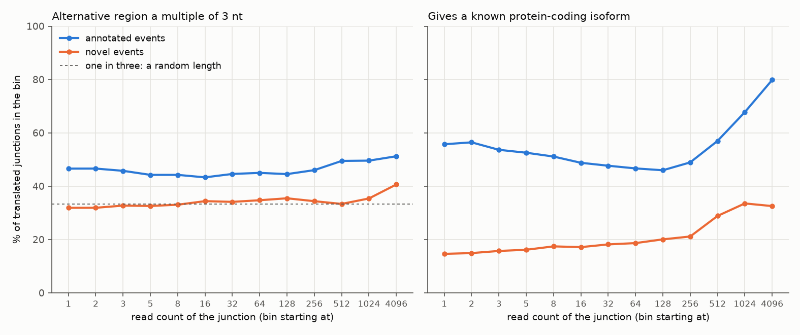
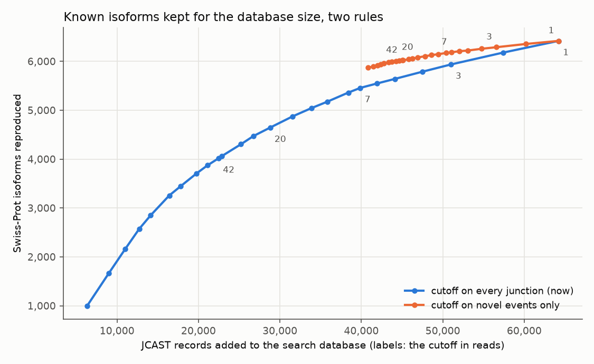
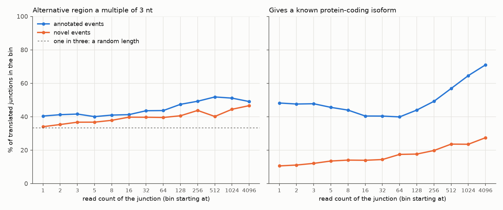
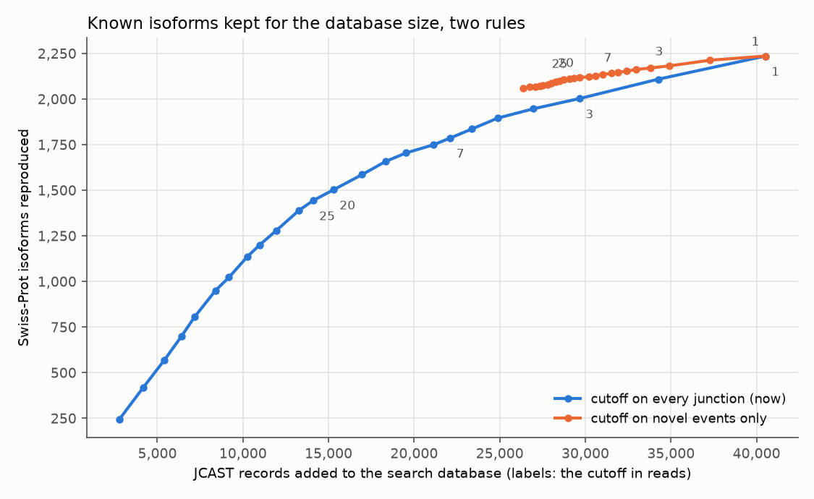
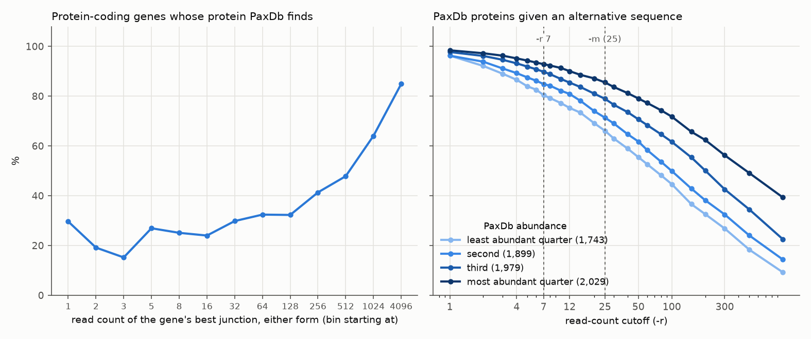

# Audit: the `-m` read-count model (row 23)

| | |
|---|---|
| **Date** | 2026-11-15; §§4–7 added 2026-11-16 |
| **Status** | In progress. Measured: which known protein-coding isoforms a cutoff loses (§3), the same on rMATS 4.4.0 (§4) and on a second data set, mouse heart (§5), and genes against the proteins PaxDb finds in heart (§6). To come: the model's fit to the counts (§8.1), a cutoff per splice type (§8.2), the NMDI14 test (§8.3). Then the decisions (§9). |
| **Question** | Does the `-m` model fit junction read counts? Should each splice type have its own cutoff? Does a cutoff lose bona fide protein-coding isoforms? ([REVIEW.md §5.6](../REVIEW.md#56--the-modeled-read-cutoff-is-a-weakly-identified-heuristic--new), roadmap row 23, asked for on 2026-11-14.) Mass spectrometry, the decisive test, was deferred by the maintainer on 2026-11-15 as a future research item: no RNA-seq here has spectra from the same samples, and the result would depend on the spectra's depth. On 2026-11-16 the maintainer re-ran rMATS, added the mouse data set, and asked for the PaxDb comparison. |
| **Reproduce** | Run JCAST at `-r 1` with [audit_records.diff](model_audit/audit_records.diff) applied and `JCAST_AUDIT_RECORDS=<records.tsv>` set (8–11 min with `-p 10` to `-p 16`), then `python reports/model_audit/cutoff_recovery.py --records <records.tsv> --run <output dir> --rmats <dir> --uniprot <FASTA> --gencode <pc_translations.fa.gz> --gtf <gtf> [--cache_dir <dir>] [--salmon <dir>] [--paxdb <file>] [--check <output dir>:<cutoff> …] [--model_cutoff <n>] --out <dir>` (about 1 min with the GTF cache). §4.1: `python reports/model_audit/rmats_versions.py --old <rMATS 4.1.0 dir> --new <rMATS 4.4.0 dir> --out <dir>`. |
| **Inputs** | Not bundled. **Human** (`20240514_Boomi_NMDI_RNASeq`): iPSC-derived cardiomyocytes, 3 DMSO and 3 NMDI14, 2 × 150 nt; GENCODE v50, GRCh38; Swiss-Prot human with isoforms of 2026-11-11 (42,545 entries); GENCODE v50 translations (`gencode.v50.pc_translations.fa.gz`, sha256 `5d6408c3…`); the folder's Salmon quantifications. rMATS 4.1.0 (§3: `rmats_4_1_0/`, 599,644 events; run at `3bfb12a`) and 4.4.0 (§4: `rmats/`, 623,738 events; run at `da06619`). **Mouse** (§5, `GSE49906_MouseHeart_RNASeq`): ventricles of FVB mice at E17, P1, P10, P28 and P90, one each, 2 × 100 nt ([Giudice et al. 2014](https://doi.org/10.1038/ncomms4603)); rMATS 4.4.0 (294,320 events); GENCODE vM39, GRCm39; Swiss-Prot mouse with isoforms of 2026-11-15 (25,764 entries); GENCODE vM39 translations (sha256 `bb90bb10…`); Salmon. All runs `-r 1 -c --uniprot`. **PaxDb** 6.1 (§6), downloaded 2026-11-16: `10090-HEART-integrated.txt` (sha256 `e7c4694b…`) and `9606-HEART-integrated.txt` (`835d4ca5…`). |
| **Evidence** | One folder per run, each with `summary.txt` (the known sets and the check), `recovery.tsv` (per cutoff), `recovery_novel_only.tsv` and `tradeoff.tsv` (the cutoff on novel events only), `bins.tsv` (per read count and splice type), `expression.tsv`, the charts, and `r1_logfile.log` (the `-r 1` run, with its inputs' hashes): [human_rmats410/](model_audit/human_rmats410/) (§3), [human_rmats440/](model_audit/human_rmats440/) (§4) and [mouse_rmats440/](model_audit/mouse_rmats440/) (§5). The last two also have `rmats_versions.tsv` (§4.1) and `genes.tsv`, `paxdb.tsv`, `paxdb_by_count.tsv` and `paxdb.png` (§6). Scripts: [cutoff_recovery.py](model_audit/cutoff_recovery.py), [rmats_versions.py](model_audit/rmats_versions.py), [audit_records.diff](model_audit/audit_records.diff). |

## 1. Summary

Three runs: the human cells through rMATS 4.1.0 (§3) and 4.4.0 (§4),
and mouse ventricles through 4.4.0 (§5).

- **One run at `-r 1` gives every cutoff.** An audit-only switch records
  each junction's records, even those JCAST does not write again, with
  the junction's read count. Cut at a cutoff, the records equal the full
  run at that cutoff, file by file and junction by junction. This was
  checked four times: at `-r 7` and `-m` (40) on 4.1.0, and at the
  maintainer's `-m` runs on 4.4.0 (42 human, 25 mouse).
- **What each cutoff keeps** of what `-r 1` reproduces (§§3.3, 4.3,
  5.3), human on rMATS 4.4.0 / mouse:

  | | `-r 1` | `-r 3` | `-r 7` | `-r 20` | `-m` (42 / 25) |
  |---|---|---|---|---|---|
  | Swiss-Prot isoforms | 6,418 / 2,236 | 93% / 90% | 85% / 80% | 72% / 67% | 63% / 65% |
  | GENCODE alternative proteins | 48,797 / 30,160 | 87% / 80% | 74% / 63% | 58% / 45% | 47% / 42% |
  | the same, ≥ 1 TPM in these samples | 4,470 / 2,808 | 96% / 90% | 92% / 81% | 85% / 71% | 81% / 69% |
  | database records in neither | 32,422 / 20,742 | 74% / 68% | 54% / 49% | 37% / 34% | 29% / 31% |
  | search database, × Swiss-Prot's size | 2.51 / 2.57 | 2.20 / 2.15 | 1.94 / 1.86 | 1.68 / 1.59 | 1.53 / 1.55 |

- **No read count stands out as a boundary,** in any of the three runs.
  The shares of junctions that keep the frame, and that give a known
  isoform, rise smoothly with read count. A cutoff trades recall against
  the size of the search database.
- **Whether an event is annotated says more than its read count.** With
  rMATS 4.4.0 (§§4.4, 5.4):
  - **annotated events with 1 read** give a known isoform at least as
    often as annotated events with 100 (56% against 47% human; 48%
    against 40% mouse);
  - **novel events** keep the frame as often as chance at 1–2 reads in
    both. In the human cells they stay at chance (32–35%) at every read
    count below 4,096.
- **rMATS 4.1.0 mislabelled novel events** (§4.1). On the same BAMs, 4.4.0
  calls 61,246 of 4.1.0's 151,331 "novel junction" events annotated, and
  none the other way. 4.1.1 fixed the "novel event classification" and
  added `--allow-clipping`. With clipped reads allowed, 4.4.0 counts 4–6%
  more junction reads in the human cells and 31–36% more in the mouse's
  (RI excepted). The per-cutoff results
  barely move (§4.3), but the novel-event results of §3 are superseded by
  §4.4.
- **A cutoff on novel events only does better at equal size** (§§4.5,
  5.6), on rMATS 4.4.0 in both species. It keeps 141–371 (human) and
  60–122 (mouse) more Swiss-Prot isoforms, and as many or more expressed
  GENCODE isoforms. On 4.1.0 it lost expressed isoforms above 20 reads;
  that came from the mislabelled events. But it cannot make the database
  smaller than about twice Swiss-Prot's, since every annotated event is
  kept.
- **`-m` lands at the same point in all three runs.** Its cutoffs, 40, 42
  and 25 reads, each keep 35% of the database records and 63–65% of the
  Swiss-Prot isoforms.
- **Proteins known to be in heart rarely have so few reads** (§6). Of the
  heart proteins PaxDb lists whose gene has an rMATS event, the best
  junction is below 7 reads for 0.8% (mouse) and 1.5% (human). It is
  below the `-m` cutoff for 2.7% and 6.7%. Some do, so a junction with a
  few reads can come from a protein that is there. Whether PaxDb finds a
  gene's protein does not depend on the gene's best junction count
  below about 256 reads, and rises above it. Neither result picks a
  cutoff.
- **At `-m`, a quarter of the PaxDb heart proteins get no alternative
  sequence** (§6.2): 1,846 in mouse and 2,712 in human; 34% and 39% of
  the least abundant quarter.
- **The model** (§2). The 2019 paper describes a Gaussian mixture with
  the cutoff at a 0.95 probability of the high group. Since September
  2021 the code has fitted Gamma plus Normal, with the cutoff where the
  two weighted densities cross. The maintainer's reason: the counts stop
  abruptly at 0.

## 2. The model now

[jcast/model.py](../jcast/model.py); REVIEW.md §5.6 has the history.

- **The count** (`junctions.read_count`): min(summed IJC, summed SJC),
  over both samples and every replicate.
- **The model:** a Gamma ("trace") plus a Normal ("expressed") on
  ln(count + 1), fitted by EM. The cutoff is where the weighted densities
  cross, a posterior of 0.5. One fit covers every rMATS file in the
  folder (PR 12).
- **The cutoffs here,** from the maintainer's `-m` runs' logs (Gamma
  shape and rate; Normal mean and sd; weights):

  | data set | rMATS | cutoff | Gamma | Normal | weights |
  |---|---|---|---|---|---|
  | human cells | 4.1.0 | 40 | 3.592, 1.937 | 4.649, 1.809 | 0.744, 0.256 |
  | human cells | 4.4.0 | 42 | 3.583, 1.905 | 4.695, 1.814 | 0.743, 0.257 |
  | mouse ventricles | 4.1.0 | 21 | 3.890, 2.535 | 4.160, 1.747 | 0.710, 0.290 |
  | mouse ventricles | 4.4.0 | 25 | 3.730, 2.290 | 4.346, 1.788 | 0.706, 0.294 |

- **The paper's model.** Lau et al. 2019 describe a Gaussian mixture,
  with the cutoff at a posterior of 0.95 for the high group. On ENCODE
  heart that gave ≥ 4 reads
  ([DOI](https://doi.org/10.1016/j.celrep.2019.11.026), via PubMed). The
  bundled `encode_human_heart` folder gets 14 from the code
  (`tests/test_model.py`). It is not known whether that folder holds the
  same samples. The code also had a scikit-learn Gaussian mixture that
  nothing called; PR 12 removed it (decisions log, 2026-11-13).
- **When and why it changed** (traced 2026-11-16). The code's first model
  was that Gaussian mixture (`8c6f015`, 2021-09-03). Two weeks later
  `3aff172` (2021-09-16) added a Gamma, or log-normal, plus Normal
  mixture, with the cutoff from the 95th percentile of the low component
  and the 5th of the high one.
  `ba11fc5` (2021-09-23) moved the cutoff to where the weighted densities
  cross. The maintainer's reason: the counts stop abruptly at 0, which a
  Gaussian does not fit well. A Gamma on ln(count + 1) is bounded at 0.

## 3. Which known isoforms a cutoff loses

The human cells through rMATS 4.1.0: the folder's `rmats/` until
2026-11-16, now `rmats_4_1_0/`. §4 repeats this section on rMATS 4.4.0.
Its per-cutoff results barely differ, but 4.4.0 calls 40% of 4.1.0's
novel-junction events annotated. §4.4 and §4.5 supersede the novel and
annotated split of §3.4 and §3.6.

### 3.1 Method

- **Why one run's output is not enough.** A record whose sequence is
  already in its file is not written again. A sequence that two
  junctions give is filed under the first one written, whatever its read
  count. The output of a run at `-r 1` cannot say which sequences a
  higher cutoff keeps.
- **The audit switch.** [audit_records.diff](model_audit/audit_records.diff)
  changes `main._finish` only. With `JCAST_AUDIT_RECORDS=<file>` set, it
  writes a line for every record of every junction, written or not: the
  splice type, the rMATS id, the read count, the file, the sequence's
  SHA-1 and length, and the header. On the whole genome, 1,187,842 lines
  (166 MB); 459,200 records besides the canonicals, 249,857 distinct
  sequences.
- **At cutoff c,** a sequence is in a file if a junction with a read
  count ≥ c gives it. This assumes a junction's records do not depend on
  the other junctions translated. §3.2 checks that.
- **The known isoforms,** as sets of distinct sequences:
  - **Swiss-Prot:** the isoforms (accession `-N`) of the `--uniprot`
    FASTA, less any sequence that is also a canonical entry's: 22,127.
  - **GENCODE:** the v50 translations of `protein_coding` transcripts,
    less the sequences of `Ensembl_canonical` transcripts and of
    Swiss-Prot canonicals: 161,440. 21,206 of them have a transcript of
    TSL ≤ 2. Only 49 are MANE without being canonical, too few to
    report.
- **"Reproduced"** means a JCAST record, in any `psq_` file but
  `psq_canonical`, has exactly that sequence. JCAST builds the canonical
  with one event changed. It cannot reproduce an isoform that differs
  from the canonical in more than one place, or by an event rMATS did not
  report. At `-r 1` it reproduces 6,372 of the 22,127 Swiss-Prot
  isoforms (29%). The recall below is relative to `-r 1`, not to
  Swiss-Prot.
- **Counting.** The handoff of 2026-11-14 counted accessions: 5,393 at
  `-r 7` and 3,999 at `-m` (40). That count took in A0A024RBG1, a
  canonical entry with the sequence of Q9NZJ9-2. Counting distinct
  sequences, less canonicals, gives 5,391 and 3,997.

### 3.2 The check against two full runs

The two whole-genome runs of 2026-11-13 (`-m`, cutoff 40) and
2026-11-14 (`-r 7`, from the GUI) have the same inputs and `--uniprot`
FASTA. Between their code and `3bfb12a`, no change altered the output
(scope report §§9–13). The audit records of the `-r 1` run, cut at 7
and at 40, give exactly what those runs wrote
([summary.txt](model_audit/human_rmats410/summary.txt); the `-m` run
is now in `jcast_rmats_4_1_0/`, and the `-r 7` run is no longer on
disk):
- the same junctions kept (308,950 and 131,233), with no fate changed;
- in each of the 11 `psq_` files but `psq_canonical`, the same set of
  sequences;
- the same Swiss-Prot isoform sequences (5,391 and 3,997).

### 3.3 By cutoff

Each cell gives the count, and its share of the count at `-r 1`.
"Database records" are the JCAST records that `--uniprot` adds to
`jcast_uniprot_merged.fasta`. "In neither" means not a Swiss-Prot entry
(the merge already leaves those out) and not a GENCODE alternative
protein. The last column is the merged database's size over Swiss-Prot's
(42,545 entries). All 24 cutoffs are in
[recovery.tsv](model_audit/human_rmats410/recovery.tsv).

| `-r` | junctions kept | T1 junctions | database records | in neither | Swiss-Prot isoforms | GENCODE alternative | GENCODE, TSL ≤ 2 | GENCODE, ≥ 1 TPM | database × |
|---|---|---|---|---|---|---|---|---|---|
| 1 | 599,644 | 92,409 | 62,190 | 31,441 | 6,372 | 47,632 | 5,621 | 4,422 | 2.46 |
| 2 | 86% | 87% | 89% | 86% | 96% | 94% | 96% | 98% | 2.30 |
| 3 | 74% | 75% | 79% | 73% | 92% | 87% | 92% | 96% | 2.15 |
| 5 | 60% | 63% | 68% | 60% | 88% | 79% | 87% | 93% | 2.00 |
| 7 | 52% | 55% | 61% | 53% | 85% | 74% | 84% | 91% | 1.90 |
| 10 | 44% | 48% | 55% | 47% | 80% | 68% | 80% | 90% | 1.80 |
| 20 | 31% | 36% | 44% | 36% | 72% | 57% | 72% | 85% | 1.64 |
| 40 (`-m`) | 22% | 27% | 35% | 28% | 63% | 47% | 62% | 81% | 1.51 |
| 100 | 13% | 18% | 25% | 20% | 50% | 35% | 49% | 70% | 1.36 |

- **What a cutoff costs.** Going from `-r 1` to `-r 7` removes 15% of the
  Swiss-Prot isoforms and 9% of the expressed GENCODE isoforms. It also
  removes 47% of the unannotated records. Going on from 7 to 40 removes,
  of what `-r 7` keeps, 26% of the Swiss-Prot isoforms (5,391 → 3,997)
  and 12% of the expressed GENCODE isoforms (4,040 → 3,565). It also
  removes 47% of the unannotated records (16,683 → 8,844).
- **Isoforms of supported transcripts are lost less.** Isoforms with a
  TSL ≤ 2 transcript fall at the rate of the Swiss-Prot isoforms. Both
  fall more slowly than GENCODE's alternative proteins as a whole.

### 3.4 By read count

[bins.tsv](model_audit/human_rmats410/bins.tsv) covers the junctions JCAST
translated (fate T1, T1_alt_terminus, T2 or T4), binned by read count.
For each bin it gives:
- **the frame:** the share whose alternative region is a multiple of 3
  nt, so that both forms keep the frame. This comes from the rMATS
  coordinates alone. It is the exon's length for SE; the difference of
  the two exons for MXE; of the long and short exon for A5SS and A3SS;
  the intron for RI;
- **T1:** the share translated as T1, with no frameshift and no stop;
- **known:** the share with a record that is a Swiss-Prot or GENCODE
  alternative protein.

| reads | junctions | frame kept | T1 | known |
|---|---|---|---|---|
| 1 | 42,364 | 35.5% | 31.6% | 24.4% |
| 2 | 37,443 | 35.8% | 30.6% | 25.5% |
| 3–4 | 41,163 | 36.5% | 30.2% | 26.5% |
| 5–7 | 33,745 | 36.8% | 29.6% | 29.0% |
| 8–15 | 42,440 | 37.6% | 30.1% | 31.2% |
| 16–31 | 34,102 | 38.8% | 30.3% | 32.5% |
| 32–63 | 26,574 | 39.9% | 31.2% | 33.7% |
| 64–127 | 20,300 | 40.1% | 31.4% | 34.5% |
| 128–255 | 14,524 | 40.8% | 32.5% | 35.5% |
| 256–511 | 10,485 | 41.9% | 35.6% | 39.4% |
| 512–1023 | 7,637 | 43.0% | 38.4% | 47.7% |
| 1024–4095 | 8,741 | 43.9% | 42.2% | 54.5% |
| ≥ 4096 | 3,611 | 46.8% | 44.8% | 59.9% |

- **At 1–2 reads, the frame is kept about as often as chance would
  give** (35.5%, against one in three). Alternative regions under
  selection to keep the reading frame would show more. So, as a group,
  the lowest-count events look little selected for the frame.
- **No bin is a threshold.** Each share rises steadily over the whole
  range, with no step and no plateau. A cutoff from the data would be a
  count above which the shares level off, and there is none.
- **A quarter of the 1-read junctions give a known isoform** (24.4%,
  about 10,300 junctions).

**Novel and annotated events.** rMATS writes two lists of novel events.
`fromGTF.novelJunction.<type>.txt` has "AS events derived from novel
combinations of splice sites annotated in the GTF file".
`fromGTF.novelSpliceSite.<type>.txt` has "only events that include an
unannotated splice site", and is "only relevant if `--novelSS` is
enabled" (rMATS turbo README, v4.4.0). These are rMATS 4.1.0's calls;
§4.1 shows how 4.4.0's differ. Their event ids are those of
`<type>.MATS.JC.txt`. Every novel event listed there has the same
coordinates in both, checked for SE, A5SS and RI. In this folder, 58% of
all SE events and 69% of A5SS events are in one of the two lists. The same
shares, split by novel and annotated:

| reads | novel | frame kept: annotated | frame kept: novel | known: annotated | known: novel |
|---|---|---|---|---|---|
| 1 | 82.9% | 46.2% | 33.3% | 54.6% | 18.2% |
| 2 | 82.1% | 46.6% | 33.4% | 54.9% | 19.0% |
| 3–4 | 79.4% | 45.6% | 34.2% | 52.0% | 19.9% |
| 5–7 | 76.0% | 43.3% | 34.7% | 51.9% | 21.8% |
| 8–15 | 71.8% | 43.9% | 35.1% | 49.6% | 23.9% |
| 16–31 | 68.3% | 43.4% | 36.7% | 47.8% | 25.5% |
| 32–63 | 65.8% | 44.1% | 37.6% | 46.8% | 27.0% |
| 64–127 | 63.6% | 44.3% | 37.7% | 46.3% | 27.7% |
| 128–255 | 61.5% | 43.8% | 38.9% | 45.9% | 29.0% |
| 256–511 | 60.9% | 45.4% | 39.7% | 52.1% | 31.3% |
| 512–1023 | 58.4% | 48.4% | 39.1% | 61.3% | 37.9% |
| 1024–4095 | 57.7% | 48.8% | 40.3% | 74.2% | 40.0% |
| ≥ 4096 | 56.9% | 50.8% | 43.8% | 86.7% | 39.6% |

- **Annotated events do not change with read count up to about 256
  reads.** About 44–46% keep the frame and 46–55% give a known isoform,
  at 1 read as at 100. A cutoff below 256 removes annotated events no
  different from those it keeps.
- **Novel events at 1–2 reads keep the frame at chance.** The share
  rises slowly with read count, to 44% at ≥ 4096. As a group, the
  low-count novel events look little selected for the frame.
- **The shares for all events rise mostly because the mix changes.** The
  novel share falls from 83% to 57%.
- **A novel event can still give a known isoform** (18% at 1 read). Its
  other form may be one, and JCAST writes both forms.

### 3.5 By splice type

The share of translated junctions that give a known isoform, by read
count ([bins.tsv](model_audit/human_rmats410/bins.tsv)):

| reads | SE | MXE | A5SS | A3SS | RI |
|---|---|---|---|---|---|
| 1 | 30% | 33% | 17% | 18% | 20% |
| 2 | 30% | 34% | 19% | 20% | 22% |
| 3–4 | 30% | 29% | 20% | 23% | 25% |
| 5–7 | 31% | 31% | 24% | 26% | 25% |
| 8–15 | 32% | 34% | 28% | 30% | 25% |
| 16–31 | 34% | 35% | 29% | 32% | 21% |
| 32–63 | 36% | 39% | 30% | 34% | 15% |
| 128–255 | 41% | 47% | 33% | 35% | 12% |
| ≥ 4096 | 56% | 65% | 43% | 39% | 18% |

- **A5SS and A3SS** rise most at low counts, from 17–18% at 1 read to
  28–30% at 8–15. A cutoff of a few reads removes proportionally more
  of their unannotated junctions.
- **SE and MXE** stay near 30% until about 32 reads.
- **RI** falls above 16 reads. A retained intron with many reads is
  rarely a GENCODE protein-coding transcript.

This bears on §8.2: the types differ, but not in the way a model of the
counts alone would show.

### 3.6 A cutoff on novel events only

With rMATS 4.1.0's novel calls; §4.5 repeats it with 4.4.0's. §3.4
suggests another rule. Keep every annotated event, and apply the
cutoff to novel events only. The audit records measure it as they
measure the current rule
([recovery_novel_only.tsv](model_audit/human_rmats410/recovery_novel_only.tsv),
[tradeoff.tsv](model_audit/human_rmats410/tradeoff.tsv)).
An annotated event's read count is set above every cutoff.

The rules compared at equal database size. Each row is the novel-only
rule at one cutoff. Each "now" value is the current rule interpolated to
the same number of database records:

| novel-only cutoff | database records (×) | Swiss-Prot isoforms: novel-only / now | GENCODE, ≥ 1 TPM: novel-only / now | in neither: novel-only / now |
|---|---|---|---|---|
| 3 | 52,867 (2.24) | 6,202 / 6,027 (+175) | 4,307 / 4,303 (+4) | 23,785 / 25,358 (−1,573) |
| 7 | 45,807 (2.08) | 6,045 / 5,735 (+310) | 4,182 / 4,184 (−2) | 18,327 / 21,028 (−2,701) |
| 20 | 39,628 (1.93) | 5,825 / 5,464 (+361) | 4,056 / 4,065 (−9) | 14,109 / 17,469 (−3,360) |
| 40 | 36,573 (1.86) | 5,652 / 5,276 (+376) | 3,958 / 4,007 (−49) | 12,171 / 15,801 (−3,630) |
| 100 | 33,380 (1.78) | 5,422 / 5,050 (+372) | 3,751 / 3,937 (−186) | 10,302 / 14,217 (−3,915) |

- **For Swiss-Prot isoforms, novel-only is better at every size.**
- **For the expressed GENCODE isoforms, the rules tie up to about 20
  reads.** Above that, novel-only does worse. Some expressed isoforms come
  from novel events with many reads, which it drops along with the
  low-count ones. With rMATS 4.4.0's calls this loss is gone (§4.5).
- **It cannot make the database smaller than the annotated events'
  records.** That floor is about 29,000 records (1.68 times Swiss-Prot),
  even at a cutoff of 1,000. To go smaller, it would need a cutoff on
  annotated events too.
- **The comparison favours novel-only by construction.** Annotated
  events give known isoforms more often, so keeping them raises recall
  per record. The case for the rule rests on the frame (§3.4): the novel
  events it drops keep the frame at chance, and the annotated events it
  keeps do not.
- **What JCAST would need:**
  - rMATS's `fromGTF.novelJunction.<type>.txt`, and, from a run with
    `--novelSS`, `fromGTF.novelSpliceSite.<type>.txt`. Without
    `--novelSS`, events with unannotated splice sites are not detected at
    all. The README does not say whether rMATS always writes these
    files;
  - JCAST reads only `<type>.MATS.JC.txt` now. It would read those two
    files, or decide "annotated" itself from the GTF's junctions;
  - with neither, it would fall back to the current rule.
- **Discovery.** Novel events are where unannotated isoforms come from,
  and finding those is part of JCAST's purpose. The rule keeps
  high-count novel events. It drops low-count ones, which look random
  for the frame.

### 3.7 Expression in the same samples

- **The measure.** The TPM of a GENCODE alternative protein is the sum,
  over the transcripts encoding its sequence, of each transcript's TPM
  averaged over the 6 samples (Salmon, `quant.sf`). Of the 47,632 that
  JCAST reproduces at `-r 1`, 4,422 reach 1 TPM and 1,243 reach 5.
- **By the read count of the best junction giving each**
  ([expression.tsv](model_audit/human_rmats410/expression.tsv)):
  - from junctions of 1–31 reads, 3–4% reach 1 TPM, with medians of
    0.004–0.06;
  - from junctions of 128–511 reads, 21–24% do;
  - from junctions of ≥ 1024 reads, fewer, 13–16%. Not explained here.
    Such junctions are likely in highly expressed genes with many
    transcripts, among which Salmon divides the reads.
- **Limits.**
  - GENCODE v50 has 382,428 translations. Many transcripts share most of
    their exons, so Salmon splits their reads and the TPM of any one is
    low. A known isoform below 1 TPM is not shown to be absent.
  - Salmon and rMATS count the same reads. Agreement between them is
    not independent evidence.

  The TPM column is a check on the direction of the effect, not a
  measure of what is expressed.

### 3.8 Reading

- **Every cutoff here is a trade-off.** Recall of known isoforms falls
  steadily as the cutoff rises. The search database shrinks, faster in
  its unannotated part. No read count separates noise from signal on
  any proxy measured.
- **Whether an event is annotated separates better than its read count
  does.** Among annotated events, read count barely matters below 256
  reads. Among novel events, the lowest counts look random for the
  frame. The read count measures depth; annotation measures
  plausibility.
- **These proxies do not settle the cost side.** The proxies count what
  a cutoff loses. What a larger database costs is a higher score
  threshold at the same FDR, and so fewer identifications. Measuring
  that needs spectra, and mass spectrometry is deferred. What this audit
  can give a user is the curve itself.
- **Measured against these proxies,** `-m`'s 40 is conservative. It
  keeps 81% of the expressed known isoforms and 63% of the Swiss-Prot
  isoforms, with a database 1.51 times Swiss-Prot's. `-r 7` keeps 91%
  and 85%, at 1.90 times.

## 4. The same samples through rMATS 4.4.0

The maintainer re-ran rMATS on the same BAMs with 4.4.0 (2026-11-16),
which "fixes several bugs with novel junctions, and also admits clipped
reads". Both runs used `--novelSS`; 4.4.0 also `--allow-clipping`.
Evidence: [human_rmats440/](model_audit/human_rmats440/).

### 4.1 What changed in rMATS

The release notes put both changes in 4.1.1 (2021-02-08): "Bug fix of
novel event classification" and "Add command line argument for handling
clipped alignments (`--allow-clipping`)". The README: "rMATS also
ignores alignments with soft or hard clipping unless `--allow-clipping`
is given." Neither says what the effect is. Later notes up to 4.4.0
(2026-08-10) mention no other change to the novel calls; 4.3.0 has "Bug
fix for missing values when counting reads". Measured on the two
folders, matching events by chromosome, strand and every coordinate
([rmats_versions.tsv](model_audit/human_rmats440/rmats_versions.tsv),
[rmats_versions.py](model_audit/rmats_versions.py)):

| human cells | SE | MXE | A5SS | A3SS | RI | all |
|---|---|---|---|---|---|---|
| events, 4.1.0 → 4.4.0 | 260,199 → 268,836 | 102,810 → 109,778 | 76,455 → 79,447 | 121,329 → 125,859 | 38,851 → 39,818 | 599,644 → 623,738 |
| novel junction calls | 93,291 → 61,846 | 21,555 → 21,577 | 11,731 → 3,120 | 22,081 → 4,521 | 2,673 → 538 | 151,331 → 91,602 |
| novel splice site calls | 96,906 → 101,406 | 55,606 → 61,531 | 49,279 → 51,054 | 71,433 → 73,819 | 22,750 → 23,409 | 295,974 → 311,219 |
| in both: novel junction → annotated | 32,273 | 473 | 8,699 | 17,659 | 2,142 | 61,246 |
| in both: junction reads, 4.4.0 / 4.1.0 | +4.1% | +4.7% | +5.1% | +5.0% | +5.7% | |
| in both: JCAST's count, 4.4.0 / 4.1.0 | +5.1% | +5.0% | +24% | +20% | +14% | |
| in both: median of JCAST's count | 7 → 7 | 12 → 12 | 5 → 5 | 6 → 6 | 14 → 14 | |

- **4.1.0 called 61,246 annotated events novel junctions,** 40% of its
  novel-junction calls. No event moved the other way. For A5SS, A3SS and
  RI most of 4.1.0's novel-junction calls were wrong. The novel splice
  site calls barely changed.
- **Counts rise a little here.** Of the events in both, 34–52% have a
  higher count in 4.4.0, and at most 3% (RI) a lower one. The medians
  do not move.
- **4.4.0 reports 4% more events** (32,273 only in 4.4.0, 8,179 only in
  4.1.0).
- **The mouse data change more** ([mouse_rmats440/rmats_versions.tsv](model_audit/mouse_rmats440/rmats_versions.tsv)):
  14% more events, junction reads +31–36% (RI +0.3%), and 20,417 of
  56,765 novel-junction calls now annotated. Why mouse gains more is not
  established here; its reads are shorter (100 nt against 150).
- **The `-m` cutoff** moves from 40 to 42 (human) and from 21 to 25
  (mouse).

### 4.2 The check

Cut at 42, the audit records give exactly what the maintainer's `-m`
run of 2026-11-16 wrote: the same 136,818 junctions kept with no fate
changed, the same sequences in each of the 11 `psq_` files, and the same
4,016 Swiss-Prot isoforms
([summary.txt](model_audit/human_rmats440/summary.txt)).

### 4.3 By cutoff

| | `-r 1`: 4.1.0 / 4.4.0 | `-r 7` | `-m` (40 / 42) |
|---|---|---|---|
| junctions kept | 599,644 / 623,738 | 52% / 52% | 22% / 22% |
| Swiss-Prot isoforms | 6,372 / 6,418 | 85% / 85% | 63% / 63% |
| GENCODE alternative proteins | 47,632 / 48,797 | 74% / 74% | 47% / 47% |
| the same, ≥ 1 TPM | 4,422 / 4,470 | 91% / 92% | 81% / 81% |
| database records in neither | 31,441 / 32,422 | 53% / 54% | 28% / 29% |
| database, × Swiss-Prot's size | 2.46 / 2.51 | 1.90 / 1.94 | 1.51 / 1.53 |

The new version adds 46 Swiss-Prot isoforms at `-r 1`, and 1,165
GENCODE alternative proteins. Every share is within two points of 4.1.0's
([recovery.tsv](model_audit/human_rmats440/recovery.tsv)). §3.3 and
§3.8 stand for 4.4.0.

### 4.4 Novel and annotated events

As §3.4, with 4.4.0's calls
([bins.tsv](model_audit/human_rmats440/bins.tsv)):

| reads | junctions | novel | frame kept: annotated | frame kept: novel | known: annotated | known: novel |
|---|---|---|---|---|---|---|
| 1 | 42,770 | 74.8% | 46.6% | 31.9% | 55.7% | 14.6% |
| 2 | 38,470 | 74.0% | 46.6% | 31.9% | 56.4% | 14.9% |
| 3–4 | 42,695 | 70.1% | 45.8% | 32.7% | 53.6% | 15.7% |
| 5–7 | 34,858 | 64.6% | 44.2% | 32.6% | 52.5% | 16.2% |
| 8–15 | 44,348 | 58.9% | 44.2% | 33.0% | 51.1% | 17.4% |
| 16–31 | 35,227 | 52.7% | 43.3% | 34.4% | 48.8% | 17.1% |
| 32–63 | 27,945 | 48.0% | 44.6% | 34.1% | 47.7% | 18.2% |
| 64–127 | 21,778 | 45.1% | 45.0% | 34.7% | 46.7% | 18.6% |
| 128–255 | 15,863 | 41.8% | 44.5% | 35.4% | 46.0% | 20.1% |
| 256–511 | 11,383 | 40.6% | 46.0% | 34.4% | 48.9% | 21.1% |
| 512–1023 | 8,412 | 41.4% | 49.5% | 33.3% | 57.0% | 28.8% |
| 1024–4095 | 9,455 | 44.0% | 49.6% | 35.4% | 67.8% | 33.5% |
| ≥ 4096 | 4,085 | 49.5% | 51.2% | 40.6% | 79.8% | 32.5% |

- **Novel events keep the frame at chance at every read count below
  4,096** (31.9–35.4%). On 4.1.0 the novel events' share rose to 39–44%
  from 128 reads up; the 61,246 events 4.4.0 moved to annotated were in
  that group then.
- **Annotated events do not improve with read count up to 256.** 44–47%
  keep the frame. 56% of those with 1–2 reads give a known isoform,
  against 46–49% at 16–511.
- **The novel share falls from 75% at 1 read to 41% at 128–511,** then
  rises again to 50% at ≥ 4096. 60% of all translated junctions are novel.
- **So read count does not make a novel event look selected for the
  frame,** in these cells. It does raise the share that give a known
  isoform (15% to 33%): the other form of a high-count novel event is
  more often a known one.

### 4.5 A cutoff on novel events only

As §3.6, with 4.4.0's calls
([tradeoff.tsv](model_audit/human_rmats440/tradeoff.tsv)):

| novel-only cutoff | database records (×) | Swiss-Prot isoforms: novel-only / now | GENCODE, ≥ 1 TPM: novel-only / now | in neither: novel-only / now |
|---|---|---|---|---|
| 3 | 56,598 (2.33) | 6,289 / 6,148 (+141) | 4,401 / 4,382 (+19) | 25,223 / 27,510 (−2,287) |
| 7 | 51,072 (2.20) | 6,185 / 5,939 (+246) | 4,311 / 4,303 (+8) | 19,990 / 24,045 (−4,055) |
| 20 | 46,923 (2.10) | 6,079 / 5,763 (+316) | 4,254 / 4,223 (+31) | 16,032 / 21,613 (−5,581) |
| 40 | 45,128 (2.06) | 6,022 / 5,685 (+337) | 4,223 / 4,188 (+35) | 14,337 / 20,540 (−6,203) |
| 100 | 43,356 (2.02) | 5,979 / 5,608 (+371) | 4,175 / 4,155 (+20) | 12,664 / 19,515 (−6,851) |

- **Novel-only now wins on all three measures at every size it reaches.**
  On 4.1.0 it lost expressed isoforms above 20 reads (§3.6). Those came
  from the events 4.1.0 mislabelled.
- **Its floor is higher:** 40,825 records (1.96 times Swiss-Prot) at a
  cutoff of 1,000, against 28,964 (1.68) on 4.1.0, since 4.4.0 calls
  more events annotated. The `-m` database (1.53) is out of its reach.
  Going below about twice Swiss-Prot needs a cutoff on annotated events
  too.

### 4.6 By splice type

As on 4.1.0 (§3.5). The share giving a known isoform rises at low
counts for A5SS (18% at 1 read, 29% at 8–15) and A3SS (19%, 31%); SE
and MXE stay at 28–32% below 16 reads; RI falls above 16 reads, to 11%
at 128–255 ([bins.tsv](model_audit/human_rmats440/bins.tsv)).

## 5. A second data set: mouse ventricles

### 5.1 The data

GEO GSE49906 ([Giudice et al. 2014](https://doi.org/10.1038/ncomms4603),
via PubMed): deep RNA-seq of FVB mouse ventricles at E17, P1, P10, P28
and P90, one sample each (SRR964790–SRR964794), 2 × 100 nt. The
maintainer's pipeline: STAR on GRCm39 with GENCODE vM39, Salmon, and
rMATS 4.4.0 with `--novelSS --allow-clipping`, E17 and P1 as `b1`
against P10, P28 and P90 as `b2`. JCAST's count sums all five samples.
The known sets: 8,479 Swiss-Prot isoform sequences (of 25,764 entries),
105,156 GENCODE alternative proteins, 11,071 of them with TSL ≤ 2. GENCODE
has no MANE for mouse. Evidence: [mouse_rmats440/](model_audit/mouse_rmats440/).

### 5.2 The check

Cut at 25, the audit records give exactly what the maintainer's `-m`
run wrote: 75,331 junctions with no fate changed, each of the 11 `psq_`
files, and 1,444 Swiss-Prot isoforms
([summary.txt](model_audit/mouse_rmats440/summary.txt)).

### 5.3 By cutoff

| `-r` | junctions kept | database records | in neither | Swiss-Prot isoforms | GENCODE alternative | GENCODE, TSL ≤ 2 | GENCODE, ≥ 1 TPM | database × |
|---|---|---|---|---|---|---|---|---|
| 1 | 294,320 | 40,518 | 20,742 | 2,236 | 30,160 | 2,308 | 2,808 | 2.57 |
| 2 | 82% | 85% | 82% | 94% | 89% | 93% | 94% | 2.33 |
| 3 | 69% | 73% | 68% | 90% | 80% | 88% | 90% | 2.15 |
| 5 | 55% | 61% | 56% | 85% | 70% | 82% | 85% | 1.97 |
| 7 | 48% | 55% | 49% | 80% | 63% | 77% | 81% | 1.86 |
| 10 | 40% | 48% | 43% | 76% | 57% | 72% | 78% | 1.76 |
| 20 | 29% | 38% | 34% | 67% | 45% | 63% | 71% | 1.59 |
| 25 (`-m`) | 26% | 35% | 31% | 65% | 42% | 60% | 69% | 1.55 |
| 100 | 12% | 21% | 18% | 43% | 26% | 38% | 53% | 1.33 |

- **The same shape as the human cells,** with no boundary.
- **A fixed cutoff costs more here.** At `-r 7` mouse keeps 80% of the
  Swiss-Prot isoforms and 81% of the expressed ones, against 85% and 92%
  in the human cells. A given `-r` does not mean the same in two data
  sets.
- **The model's cutoff adapts.** At 25 it keeps 35% of the database
  records and 65% of the Swiss-Prot isoforms, as 42 does in the human
  cells (35%, 63%).

### 5.4 Novel and annotated events

| reads | junctions | novel | frame kept: annotated | frame kept: novel | known: annotated | known: novel |
|---|---|---|---|---|---|---|
| 1 | 32,247 | 61.5% | 40.4% | 34.0% | 48.2% | 10.6% |
| 2 | 23,161 | 59.9% | 41.2% | 35.3% | 47.6% | 11.1% |
| 3–4 | 23,802 | 53.6% | 41.6% | 36.7% | 47.8% | 12.1% |
| 5–7 | 19,053 | 49.1% | 40.0% | 36.7% | 45.6% | 13.5% |
| 8–15 | 23,007 | 43.0% | 41.0% | 37.8% | 43.9% | 14.0% |
| 16–31 | 17,789 | 39.0% | 41.2% | 39.7% | 40.4% | 13.9% |
| 32–63 | 13,796 | 36.9% | 43.6% | 39.7% | 40.4% | 14.4% |
| 64–127 | 10,253 | 33.8% | 43.7% | 39.5% | 39.9% | 17.4% |
| 128–255 | 7,080 | 35.5% | 47.4% | 40.6% | 44.0% | 17.6% |
| 256–511 | 5,192 | 39.1% | 49.2% | 43.7% | 49.2% | 19.8% |
| 512–1023 | 3,511 | 40.3% | 51.8% | 40.1% | 56.9% | 23.6% |
| 1024–4095 | 3,985 | 45.8% | 51.1% | 44.4% | 64.6% | 23.5% |
| ≥ 4096 | 1,738 | 51.0% | 49.1% | 46.6% | 71.0% | 27.4% |

- **Annotated events with 1–2 reads are no worse than those with
  16–127:** 48% give a known isoform, against 40%. The frame is kept by
  40–44% throughout that range.
- **Novel events start at chance** (34.0% at 1 read) **and, unlike the
  human cells', rise:** to 40% by 16 reads and 40–47% above 256.
- **The novel share** falls from 62% at 1 read to 34% at 64–127, then
  rises to 51%. 49% of the translated junctions are novel.

### 5.5 By splice type

The share of translated junctions giving a known isoform
([bins.tsv](model_audit/mouse_rmats440/bins.tsv)):

| reads | SE | MXE | A5SS | A3SS | RI |
|---|---|---|---|---|---|
| 1 | 29% | 36% | 19% | 21% | 26% |
| 2 | 28% | 29% | 20% | 24% | 24% |
| 3–4 | 30% | 30% | 25% | 28% | 24% |
| 5–7 | 31% | 29% | 24% | 31% | 27% |
| 8–15 | 33% | 30% | 26% | 33% | 19% |
| 16–31 | 32% | 33% | 26% | 33% | 12% |
| 32–63 | 35% | 38% | 25% | 34% | 9% |
| 128–255 | 38% | 49% | 29% | 37% | 10% |
| ≥ 4096 | 45% | 56% | 24% | 39% | 8% |

The pattern of the human cells: A5SS and A3SS rise over the first few
reads, SE and MXE change little below 32, and RI falls above 8.

### 5.6 A cutoff on novel events only

| novel-only cutoff | database records (×) | Swiss-Prot isoforms: novel-only / now | GENCODE, ≥ 1 TPM: novel-only / now | in neither: novel-only / now |
|---|---|---|---|---|
| 3 | 34,894 (2.35) | 2,182 / 2,122 (+60) | 2,747 / 2,662 (+85) | 15,357 / 17,344 (−1,987) |
| 7 | 31,899 (2.24) | 2,147 / 2,055 (+92) | 2,714 / 2,589 (+125) | 12,465 / 15,534 (−3,069) |
| 20 | 29,681 (2.15) | 2,119 / 2,004 (+115) | 2,683 / 2,536 (+147) | 10,324 / 14,195 (−3,871) |
| 40 | 28,728 (2.12) | 2,106 / 1,984 (+122) | 2,663 / 2,509 (+154) | 9,400 / 13,690 (−4,290) |
| 100 | 27,792 (2.08) | 2,081 / 1,964 (+117) | 2,638 / 2,483 (+155) | 8,505 / 13,197 (−4,692) |

As in the human cells on 4.4.0: better on all three measures, with a
floor of 26,363 records (2.02 times Swiss-Prot) at a cutoff of 1,000
([tradeoff.tsv](model_audit/mouse_rmats440/tradeoff.tsv)).

### 5.7 Expression

The GENCODE alternative proteins JCAST reproduces at `-r 1`, by the read
count of the best junction giving each, with TPM averaged over the five
ages ([expression.tsv](model_audit/mouse_rmats440/expression.tsv)):
4–6% reach 1 TPM from junctions of 1–31 reads, 14% at 64–127, 17–22% at
128–1023, and 15–18% at ≥ 1024. The shape of §3.7, with its limits;
averaging over five ages also dilutes isoforms of one stage.

## 6. Genes, and the proteins known to be in heart

The maintainer asked for the canonical genes kept at each cutoff, to see
whether proteins known to be in the tissue have read counts below a
cutoff. The reference is PaxDb 6.1's integrated heart proteome: 9,167
mouse proteins (42% of the proteome; the maintainer's PXD002870 is its
largest part, weight 0.33) and 13,500 human proteins (69%). Each
protein is matched to its gene by the Ensembl protein of its STRING id,
else by gene name: 9,139 and 13,442 match. The ones counted below are
those whose gene has an rMATS event: 7,650 mouse and 10,764 human.
Evidence: `genes.tsv`, `paxdb.tsv`, `paxdb_by_count.tsv` and
`paxdb.png` in [human_rmats440/](model_audit/human_rmats440/) and
[mouse_rmats440/](model_audit/mouse_rmats440/).

### 6.1 What a cutoff does to canonicals

With `-c`, JCAST writes a gene's canonical whatever its junctions'
fates, skipped ones included (`main._translate_one`). So
`psq_canonical.fasta` does not change with the cutoff, and the merged
database has every Swiss-Prot canonical anyway. What a cutoff changes
is whether a gene gets any alternative sequence: a junction at or above
the cutoff, translated as T1, T1_alt_terminus, T2 or T4.

### 6.2 Genes given an alternative sequence

| cutoff | mouse: genes | mouse: PaxDb heart proteins (least / most abundant quarter) | human: genes | human: PaxDb heart proteins (least / most abundant quarter) |
|---|---|---|---|---|
| 1 | 12,158 | 97.2% (96.3% / 98.4%) | 12,892 | 96.5% (94.9% / 97.9%) |
| 3 | 11,132 | 92.9% (89.0% / 96.3%) | 12,213 | 92.5% (88.4% / 96.0%) |
| 7 | 10,123 | 87.2% (80.4% / 92.9%) | 11,485 | 88.1% (81.0% / 94.2%) |
| 20 | 8,638 | 78.2% (69.1% / 87.1%) | 10,368 | 81.0% (70.1% / 90.4%) |
| `-m` (25 / 42) | 8,289 | 75.9% (66.1% / 85.5%) | 9,463 | 74.8% (61.0% / 87.2%) |
| 100 | 5,785 | 57.5% (44.6% / 71.8%) | 8,217 | 66.1% (50.3% / 81.8%) |

At `-m`, 1,846 mouse and 2,712 human heart proteins get no alternative
sequence: 34% and 39% of the least abundant quarter, and 14% and 13% of
the most abundant.

### 6.3 Known heart proteins below a cutoff

The positive control the maintainer proposed. A protein PaxDb finds in
heart is there, so its gene's junction reads are what a present protein
can have. Each gene's count here is its best junction: the highest, over
its rMATS events, of the larger of the summed inclusion and skipping
counts.

| best junction below | mouse | mouse, least abundant quarter | human | human, least abundant quarter |
|---|---|---|---|---|
| 7 | 61 (0.8%) | 35 (2.0%) | 164 (1.5%) | 60 (2.5%) |
| 20 | 170 (2.2%) | 79 (4.5%) | 459 (4.3%) | 181 (7.6%) |
| `-m` (25 / 42) | 203 (2.7%) | 96 (5.5%) | 725 (6.7%) | 279 (11.8%) |

- **There are known heart proteins below each cutoff, but few.** The
  median best junction is about 3,400 reads in mouse and 3,070 in human;
  the 10th percentile 216 and 97 ([paxdb.tsv](model_audit/mouse_rmats440/paxdb.tsv)).
- **The human figures are inflated by the tissue.** These are iPSC-derived
  cardiomyocytes in culture, against adult heart, which also has blood,
  fibroblast and adult-stage proteins. Mouse ventricles match PaxDb's
  tissue better.

### 6.4 Whether PaxDb finds a gene's protein, by read count

The control turned round
([paxdb_by_count.tsv](model_audit/mouse_rmats440/paxdb_by_count.tsv)):
of the protein-coding genes with an rMATS event, the share whose protein
PaxDb finds in heart, by the gene's best junction.

| best junction | mouse: genes | found | human: genes | found |
|---|---|---|---|---|
| 1–2 | 74 | 23% | 68 | 66% |
| 3–7 | 255 | 21% | 269 | 58% |
| 8–31 | 670 | 24% | 675 | 63% |
| 32–255 | 1,875 | 32% | 1,590 | 62% |
| 256–1023 | 2,376 | 45% | 2,012 | 68% |
| 1024–4095 | 3,577 | 64% | 3,920 | 81% |
| ≥ 4096 | 4,076 | 85% | 5,073 | 91% |

- **Flat below about 256 reads, rising above.** Whether a gene's protein
  is found does not depend on its best junction's count in the range
  where cutoffs are set (1 to about 100). It does above 256.
- **Few genes have a best junction below 32** (about 1,000 of 13,000 in
  each), so the low bins are small.

### 6.5 Limits

- **PaxDb works at the gene level.** An isoform is found only by a
  peptide over its own junction or region, far fewer than a gene's
  peptides. An isoform's chance of being found at a given count is lower
  than its gene's.
- **Two counts are compared.** The cutoff applies to a junction's less
  used form; the control uses a gene's best junction. Both are junction
  reads summed over the same samples, so they are on one scale, but a
  gene's best junction reflects the gene's expression, not one
  isoform's.
- **PaxDb lists what a compendium found.** A protein it does not list is
  not shown to be absent.

## 7. Reading, across the three runs

- **Every cutoff is a trade-off,** in both rMATS versions and both
  species. No read count separates noise from signal on any proxy here,
  the PaxDb control included.
- **Annotation separates better than read count,** and more clearly once
  rMATS calls novel events correctly. Annotated events with 1 read are as
  good as those with 100. Novel events at 1–2 reads keep the frame at
  chance in both species; in the human cells, at almost every count.
- **A rule on novel events needs rMATS ≥ 4.1.1.** 4.1.0 calls 40% of its
  novel-junction events wrongly. The output files do not name the
  version, but 4.1.1 added `summary.txt`: it is in both 4.4.0 folders
  here and in neither 4.1.0 folder (nor in the bundled test data).
- **The novel-only rule is better at equal size but cannot go small.**
  Its floor is about twice Swiss-Prot's size. A smaller database needs a
  second cutoff, on annotated events: for example a low one for
  annotated events and a higher one for novel events. The audit records
  can measure such pairs.
- **The model's cutoff behaves alike across these runs.** It falls where
  35% of the database records remain, from 25 reads in mouse to 42 in
  the human cells. On this evidence it is a depth-adjusted heuristic, not
  a boundary in the data (§8.1 tests the fit).
- **The PaxDb control does not argue for a higher cutoff.** Few heart
  proteins have so few reads, but those that do are there. Below about
  256 reads, a gene's count does not predict whether its protein is
  found.

## 8. Still to measure

### 8.1 The model's fit to the counts

- Rootograms of the observed counts against the model's probability of
  each count (its density over [ln(c + ½), ln(c + 1½)]).
- Count models compared by log-likelihood and BIC:
  - a two-component negative-binomial mixture;
  - a negative binomial plus a Poisson-lognormal.
- The cutoff's stability: by bootstrap, with other EM starts and
  tolerances.
- What the count is:
  - it is summed over every sample, so it grows with depth and with the
    number of replicates;
  - it is the smaller of the two forms' counts;
  - IJC and SJC count different numbers of junctions (`IncFormLen`,
    `SkipFormLen`).

Data: the 13 bundled folders and chr15 offline; by path, the three
whole-genome folders here (the human cells on rMATS 4.1.0 and 4.4.0, the
mouse ventricles on 4.4.0). Four fits are in §2.

### 8.2 A cutoff per splice type

- Fit each type alone and compare the cutoffs. On chr15, SE alone gives
  6 reads, against 26 for every type.
- A middle way: a shared trace component with weights per type.
- Then, with the audit records of §§3–5, what each per-type cutoff keeps
  (§§3.5, 4.6, 5.5 by type), in both species.

### 8.3 NMDI14

- **The test.** For a T4 junction, the form with the premature stop
  should gain a larger share under NMDI14 than in DMSO. The rMATS
  tables keep each condition's counts: `SAMPLE_1` is DMSO (`b1.txt`),
  `SAMPLE_2` NMDI14. On rMATS 4.4.0 (`rmats/`), whose novel calls are
  right. The mouse data set has no such contrast.
- **The question:** do low-count T4 junctions respond as high-count ones
  do? If so, they are transcripts, not noise.
- **Controls:** T1 junctions, and the folder's own NMD targets
  (`R/01_out/DTE_significant_NMD_targets.csv`).

## 9. Decisions requested

After §8. The questions as they now stand:
1. Keep the model and document it as a heuristic, change it, or replace
   it with a recommended `-r`. For the last, §§3.3, 4.3 and 5.3 give the
   trade-off at each cutoff; §5.3 shows that one `-r` costs different
   amounts in two data sets, where the model's cutoff adapts.
2. Apply the cutoff to novel events only (§§4.5, 5.6), or use two
   cutoffs, a low one for annotated events and a higher one for novel
   events (§7). Either needs rMATS's `fromGTF.novel*` files, or the GTF's
   junctions, and a fallback without them. With rMATS 4.1.0 the novel
   calls are wrong for 40% of novel-junction events (§4.1); JCAST could
   warn when `summary.txt` is missing.
3. A cutoff per splice type (§§3.5, 4.6, 5.5, 8.2).
4. Whether a run, or the GUI's Model page, should show what a cutoff
   keeps, for example the Swiss-Prot isoforms reproduced at each cutoff.
   The audit switch would then become an output (compare row 22's option
   (b)).
